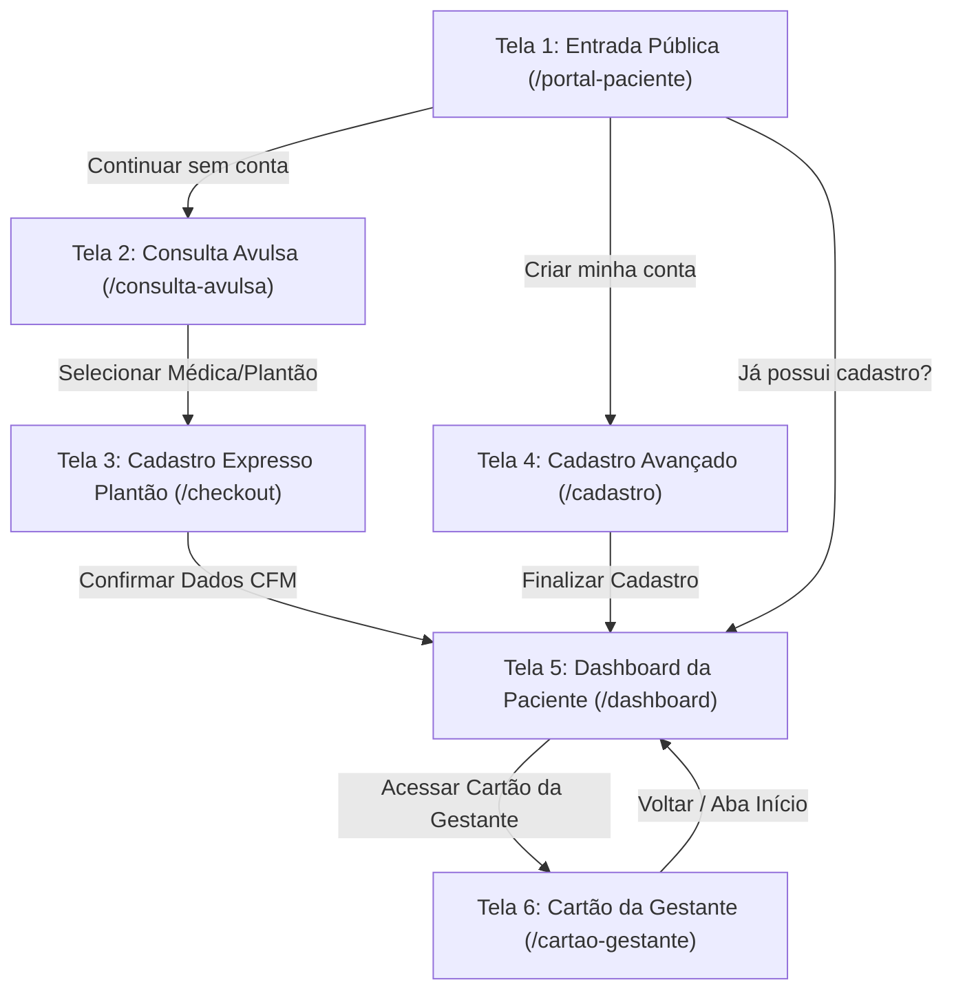
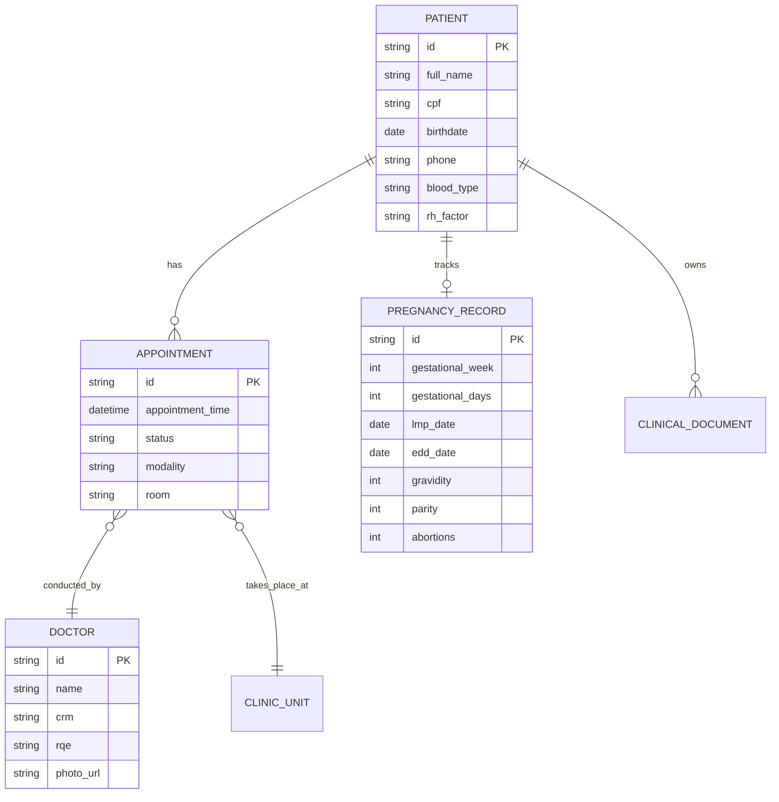

# Cana Med Mulher — Plano Canônico de Design e Reimplementação UI/UX: Área da Paciente
> **Documento de Especificação de Design 100% Fiel ao Protótipo Oficial do Google Stitch**  
> **Projeto:** "Cana Med Mulher Mobile Login" (`projects/10903446353704381660`)  
> **Tema Canônico:** **Serene Bloom** (Material Design 3 Tokenized)  
> **Autor:** UI/UX Design Planner (Cana Med Mulher Multiagent System)  
> **Destinatário:** Agente Implementador & Orquestrador  
> **Status:** Aprovado para Implementação Direta  

---

## 1. Objetivo da Página e Escopo da Reimplementação

### 1.1. Contexto Clínico e Missão da Área da Paciente
A **Área da Paciente** do Cana Med Mulher é a interface de acolhimento digital e autoatendimento de mulheres em consultas ginecológicas e no pré-natal ambulatorial. A plataforma tem como premissa eliminar a burocracia, reduzir a sobrecarga cognitiva da paciente em momentos de dor, incerteza ou gestação, e estabelecer um vínculo visual acolhedor, transparente e seguro com a clínica.

### 1.2. O Problema Apontado pelo Usuário
A versão anterior implementada divergiu de forma substancial do protótipo oficial aprovado no Google Stitch:
1. **Perda da Identidade Serene Bloom:** Substituição indevida da paleta quente e serena (`#b30063`, `#d8257c`, `#7c4c8a`, `#fdf7ff`) por cinzas frios/ardósia genéricos (`#94A3B8`, `#CBD5E1`, `#1E293B`) e roxo escuro corporativo (`#852A91`), distorcendo a atmosfera médica feminina acolhedora.
2. **Botões Deformados com Bordas Cinzas Duras:** O efeito colateral do `preflight: false` no Tailwind CSS deixou botões com estilos nativos do navegador (bordas cinzas duras e cantos quadrados), arruinando componentes cruciais como o botão "Continuar sem conta" e "Criar minha conta".
3. **Botão de Login Sem Estilização:** O acesso para pacientes já cadastradas ("Já possui cadastro? Acessar área da paciente") foi reduzido a um link de texto minúsculo, sem hierarquia, contraste ou affordance de clique.
4. **Ausência de Casca Mobile Pura:** As páginas públicas e de agendamento perderam o enquadramento mobile `max-w-md` / `max-w-lg mx-auto` com centralização de tela, TopAppBar translúcida fixa e Bottom Navigation Bar com 5 abas ativas.
5. **Dashboard Descaracterizado:** O painel da paciente perdeu o card heróico da Dra. Camila Vasconcelos, o widget gestacional com a comparação lúdica da berinjela (`🍆`), o Bento grid de 4 cartões com cantos arredondados generosos (`rounded-2xl` e `rounded-3xl`) e os canais de sobreaviso obstétrico de emergência.

### 1.3. Escopo das 6 Telas Oficiais Extraídas do Stitch
A reimplementação abrange 100% da experiência pública e autenticada:
- **Tela 1:** Entrada e Agendamento Público Mobile (`steps/2887/output.txt`) — Landing pública de triagem e agendamento sem conta.
- **Tela 2:** Consulta Avulsa Mobile (`steps/2903/output.txt`) — Seleção de telemedicina imediata vs. presencial e médica plantonista.
- **Tela 3:** Cadastro Consulta Avulsa Mobile (`steps/2905/output.txt`) — Checkout clínico expresso em menos de 2 minutos com triagem de alergias e CPF para CFM.
- **Tela 4:** Cadastro Avançado Mobile (`steps/2907/output.txt`) — Perfil clínico completo, tipo sanguíneo, histórico obstétrico GPA e convênio.
- **Tela 5 (Mobile & Web):** Dashboard da Paciente (`steps/2893/output.txt` & `steps/2911/output.txt`) — Casca híbrida responsiva (TopAppBar + BottomNavBar no mobile; SideNavBar w-72 + TopNavBar h-18 no desktop), Hero acolhedor, Próxima Consulta, Widget Gestacional e Bento Grid.
- **Tela 6:** Cartão da Gestante Mobile (`steps/2909/output.txt`) — Timeline vertical de pré-natal, métricas clínicas (DUM, DPP, PA, BCF) e laudos em PDF.

---

## 2. Diagnóstico Atual: Desvios Críticos e Oportunidades

| Elemento / Tela | Comportamento Atual no Código | Padrão Mandatório do Google Stitch | Impacto na Experiência da Paciente |
| :--- | :--- | :--- | :--- |
| **Paleta de Cores** | `patient-serene.css` usa `--color-serene-primary: #852A91`, superfícies `#FFFFFF`/`#F7F8FA`, bordas cinza `#CBD5E1`. | Paleta **Serene Bloom**: Primária `#b30063`, Primária Container `#d8257c`, Secundária `#7c4c8a`, Superfície `#fdf7ff`, Outline-Variant `#e0bec7`. | Interface perde o aconchego feminino e a identidade dos protótipos aprovados. |
| **Bordas dos Botões** | Bordas cinzas duras causadas por `preflight: false` e botões sem reset explícito de `border: none` ou `border-width`. | Botões com `border-none`, sombras suaves coloridas (`shadow-md shadow-primary/20`), cantos `rounded-xl` e gradiente `linear-gradient(135deg, #d8257c 0%, #b30063 100%)`. | Aparência de formulário cru ou quebrado. |
| **Acesso "Já possui cadastro"** | Texto pequeno azul/roxo (`text-xs font-bold hover:underline`) no rodapé sem container visual. | Card/Botão elegante com badge de cadeado, container `bg-surface-container-lowest/90`, borda sutil `#e0bec7/40`, ícone e microcopy de convite. | Paciente recorrente não localiza onde fazer login. |
| **Casca Mobile das Páginas** | O container esticava em tela cheia desktop sem limites ou ficava desproporcional. | Wrapper estrito `relative w-full max-w-md mx-auto min-h-screen flex flex-col bg-background shadow-2xl` com TopAppBar e BottomNavBar padronizadas. | Falta de responsividade e quebra em dispositivos móveis. |
| **Bottom Navigation Bar** | Itens estáticos, sem microinterações táteis, e ausente em telas chave de fluxo clínico. | Barra fixa de 5 abas (`h-16`, `bg-surface/90 backdrop-blur-md border-t border-outline-variant/30`), ícones Material Symbols com `font-variation-settings: 'FILL' 1` na aba ativa. | Desorientação da paciente quanto à sua localização no portal. |
| **Dashboard da Paciente** | Grid desestruturado, ausência de foto das médicas, ausência da ilustração da berinjela (`🍆`). | Bento Grid responsivo de 12 colunas no desktop (8 colunas principal, 4 lateral) e 1 coluna fluida no mobile; Dra. Camila com foto, CRM/RQE; widget gestacional completo. | Perda do senso de cuidado personalizado e acolhedor. |

---

## 3. Direção Visual Proposta: Serene Bloom Puro

A direção visual oficial do projeto denomina-se **Serene Bloom**. Inspirada na estética calmante de clínicas de alta gama de saúde reprodutiva e obstetrícia humanizada, combina luminescência delicada, tipografia límpida e microinterações táteis que diminuem a ansiedade da mulher.

```
       ┌──────────────────────────────────────────────────────────┐
       │                 PALETA SERENE BLOOM                      │
       ├─────────────────────────┬────────────────────────────────┤
       │ Primary (#b30063)       │ Magenta profundo de acolhimento│
       │ Primary Cont. (#d8257c) │ Framboesa vibrante de ação     │
       │ Secondary (#7c4c8a)     │ Violeta lavanda de serenidade  │
       │ Surface (#fdf7ff)       │ Off-white com névoa lilás      │
       │ On-Surface (#1d1929)    │ Ameixa quase preto (legível)   │
       │ Outline-Var. (#e0bec7)  │ Borda suave sem cinza duro     │
       └─────────────────────────┴────────────────────────────────┘
```

### 3.1. Princípios de Atmosfera Visual:
1. **Luminescência Ambiente de Fundo (Atmospheric Glows):** A aplicação utiliza círculos desfocados de luz difusa (`blur-3xl`, opacidade de 20% a 30%) em posições estratégicas para transmitir sensação de ambiente acolhedor e iluminado, nunca plano ou estéril.
2. **Afinação Ergonômica dos Botões (Zero Bordas Cinzas Duras):**
   - **Botão Primário de Ação:** Gradiente `from-[#d8257c] to-[#b30063]`, texto `#ffffff`, sombra colorida `shadow-[0_8px_20px_-4px_rgba(216,37,124,0.35)]`, cantos `rounded-xl`, sem nenhuma borda padrão de navegador.
   - **Botão Secundário:** Superfície clara `bg-surface-container-low` (`#f8f1ff`), texto secundário `#7c4c8a`, borda ultrafina e translúcida `border border-outline-variant/50` (`#e0bec7`), hover sutil.
   - **Botão de Login Rápido:** Card receptivo com `bg-surface-container-lowest`, borda arredondada `rounded-2xl`, hover com micro-elevação `hover:shadow-md`.
3. **Hierarquia Tipográfica Refinada:** Fonte **Plus Jakarta Sans**, com escala contrastante entre números gestacionais destacados (`font-extrabold`), títulos calorosos (`font-bold`) e microtextos institucionais claros (`font-label-md` e `font-label-sm`).
4. **Semiótica e Ícones Médicos:** Uso rigoroso do **Google Material Symbols Outlined** com preenchimento contextual (`FILL 1`) exclusivamente no estado ativo ou selecionado.

---

## 4. Estrutura e Hierarquia das Telas

### 4.1. Diagrama de Navegação da Área da Paciente



---

## 5. Especificação Detalhada dos Componentes

### 5.1. Casca Mobile-First Canônica (Telas 1, 2, 3, 4 e 6)
Todas as páginas móveis devem ser envelopadas em um container com largura máxima estrita e centralização automática no viewport:

```html
<!-- Mobile Shell Canônica -->
<div class="relative w-full max-w-md mx-auto min-h-screen flex flex-col bg-[#fdf7ff] text-[#1d1929] shadow-2xl selection:bg-[#ffd9e3] selection:text-[#3e001e]">
  <!-- Luminescência Ambiente de Fundo -->
  <div aria-hidden="true" class="fixed inset-0 pointer-events-none overflow-hidden z-0">
    <div class="absolute -top-24 left-1/2 -translate-x-1/2 w-96 h-96 bg-[#ffd9e3] opacity-30 rounded-full blur-3xl"></div>
    <div class="absolute top-1/3 -right-28 w-80 h-80 bg-[#fad7ff] opacity-25 rounded-full blur-3xl"></div>
    <div class="absolute -bottom-20 -left-20 w-80 h-80 bg-[#f3eaff] opacity-60 rounded-full blur-3xl"></div>
  </div>

  <!-- TopAppBar Fixa e Translúcida -->
  <header class="sticky top-0 left-0 w-full z-40 bg-[#fdf7ff]/90 backdrop-blur-md px-4 py-3 border-b border-[#e0bec7]/30 flex items-center justify-between shadow-sm">
    <div class="flex items-center gap-3">
      <button type="button" aria-label="Voltar" class="w-10 h-10 rounded-full flex items-center justify-center text-[#7c4c8a] hover:bg-[#f3eaff] active:scale-95 transition-all">
        <span class="material-symbols-outlined text-[24px]">arrow_back</span>
      </button>
      <div>
        <h1 class="text-base font-bold text-[#b30063] leading-tight">Título da Página</h1>
        <p class="text-xs text-[#615869]">Subtítulo explicativo acolhedor</p>
      </div>
    </div>
    
  </header>

  <!-- Conteúdo Central Roolável -->
  <main class="relative z-10 flex-1 px-4 pt-4 pb-28 space-y-5 overflow-y-auto">
    <!-- Conteúdo Específico -->
  </main>

  <!-- Bottom Navigation Bar com 5 Abas -->
  <nav aria-label="Navegação da Paciente" class="fixed bottom-0 left-0 w-full z-50 flex justify-around items-center px-2 py-2 h-16 bg-[#fdf7ff] border-t border-[#e0bec7]/30 shadow-[0_-4px_16px_rgba(75,30,90,0.06)] max-w-md mx-auto" style="left: 50%; transform: translateX(-50%);">
    <!-- Item 1: Início -->
    <a href="#inicio" class="flex flex-col items-center justify-center text-[#b30063] font-bold gap-1 active:scale-90 transition-transform">
      <span class="material-symbols-outlined text-[24px]" style="font-variation-settings: 'FILL' 1;">home</span>
      <span class="text-[11px] leading-tight">Início</span>
    </a>
    <!-- Item 2: Agendar -->
    <a href="#agendar" class="flex flex-col items-center justify-center text-[#615869] font-medium gap-1 hover:text-[#b30063] active:scale-90 transition-transform">
      <span class="material-symbols-outlined text-[24px]">calendar_add_on</span>
      <span class="text-[11px] leading-tight">Agendar</span>
    </a>
    <!-- Item 3: Consultas -->
    <a href="#consultas" class="flex flex-col items-center justify-center text-[#615869] font-medium gap-1 hover:text-[#b30063] active:scale-90 transition-transform">
      <span class="material-symbols-outlined text-[24px]">calendar_month</span>
      <span class="text-[11px] leading-tight">Consultas</span>
    </a>
    <!-- Item 4: Pré-natal -->
    <a href="#prenatal" class="flex flex-col items-center justify-center text-[#615869] font-medium gap-1 hover:text-[#b30063] active:scale-90 transition-transform">
      <span class="material-symbols-outlined text-[24px]">pregnant_woman</span>
      <span class="text-[11px] leading-tight">Pré-natal</span>
    </a>
    <!-- Item 5: Perfil -->
    <a href="#perfil" class="flex flex-col items-center justify-center text-[#615869] font-medium gap-1 hover:text-[#b30063] active:scale-90 transition-transform">
      <span class="material-symbols-outlined text-[24px]">person</span>
      <span class="text-[11px] leading-tight">Perfil</span>
    </a>
  </nav>
</div>
```

---

### 5.2. Especificação dos Botões (Eliminando Deformações e Bordas Duras)

Para prevenir de forma definitiva os efeitos indesejados do `preflight: false`, todos os botões do sistema devem adotar classes explícitas de remoção de borda (`border-0` ou `border-none`) e definição de raio, tipografia e sombra:

#### 1. Botão "Continuar sem conta" (Ação Primária em Gradiente):
```html
<button
  type="button"
  class="w-full flex items-center justify-center gap-2 py-3.5 px-6 rounded-xl text-white font-bold text-sm tracking-wide border-0 outline-none cursor-pointer active:scale-[0.98] transition-all duration-150"
  style="background: linear-gradient(135deg, #d8257c 0%, #b30063 100%); box-shadow: 0 8px 20px -4px rgba(216, 37, 124, 0.35);"
>
  <span>Continuar sem conta</span>
  <span class="material-symbols-outlined text-lg">arrow_forward</span>
</button>
```

#### 2. Botão "Criar minha conta" (Ação Secundária com Borda Delicada):
```html
<button
  type="button"
  class="w-full flex items-center justify-center gap-2 py-3.5 px-6 rounded-xl bg-[#f8f1ff] text-[#7c4c8a] hover:bg-[#f3eaff] font-bold text-sm tracking-wide border border-[#e0bec7]/60 outline-none cursor-pointer active:scale-[0.98] transition-all duration-150"
>
  <span class="material-symbols-outlined text-lg text-[#b30063]">person_add</span>
  <span>Criar minha conta</span>
</button>
```

#### 3. Card/Botão "Já possui cadastro? Acessar área da paciente" (Novo Padrão Elegante):
```html
<div class="mt-4 p-4 rounded-2xl bg-[#ffffff] border border-[#e0bec7]/40 shadow-[0_2px_12px_-2px_rgba(75,30,90,0.04)] flex items-center justify-between gap-3 hover:border-[#b30063]/40 transition-all">
  <div class="flex items-center gap-3">
    <div class="w-10 h-10 rounded-full bg-[#f3eaff] flex items-center justify-center text-[#b30063] shrink-0">
      <span class="material-symbols-outlined text-xl">lock_open</span>
    </div>
    <div class="text-left">
      <p class="text-xs font-bold text-[#1d1929] leading-tight">Já possui cadastro na clínica?</p>
      <p class="text-[11px] text-[#615869]">Acesse seus exames, consultas e pré-natal</p>
    </div>
  </div>
  <button
    type="button"
    class="px-3.5 py-2 rounded-xl bg-[#ffd9e3] hover:bg-[#d8257c] text-[#b30063] hover:text-white font-bold text-xs border-0 cursor-pointer active:scale-95 transition-all flex items-center gap-1 shrink-0"
  >
    <span>Entrar</span>
    <span class="material-symbols-outlined text-sm">arrow_forward</span>
  </button>
</div>
```

---

### 5.3. Casca Desktop Responsiva (SideNavBar + TopNavBar)
Para telas desktop (`>= 1024px`), o portal da paciente utiliza a casca em 2 painéis fixos mapeados exatamente do protótipo Stitch (`steps/2911/output.txt`):

1. **SideNavBar Fixa à Esquerda (`w-72` / 288px):**
   - **Topo:** Logotipo Cana Med Mulher (`h-9`), subtítulo "Portal da Paciente".
   - **Menu (6 Itens):**
     1. Início (`home`, ativo por padrão com fundo `#f1b8ff/40`, texto `#b30063` e `FILL 1`).
     2. Agendar consulta (`calendar_month`).
     3. Minhas consultas (`event_available`, com badge numérico "1").
     4. Cartão da Gestante (`pregnant_woman`, com dot pulsante de gestação ativa).
     5. Consulta Avulsa / Plantão (`medical_services`).
     6. Meu perfil (`account_circle`).
   - **Rodapé:** Avatar da paciente Juliana Rocha Mendes com semana gestacional ("26ª Semana"), e botão "Sair" (`logout`) com hover avermelhado discreto.

2. **TopNavBar Fixa Superior (`left-72 h-18` / 72px):**
   - **Esquerda:** Título "Painel do Paciente" e tag verde esmeralda "Conectada" com ponto luminoso.
   - **Direita:** Ícone de Notificações com badge de aviso, ícone de Ajuda (`help_outline`), divisória vertical sutil e botão de destaque:
     ```html
     <a href="#plantao" class="flex items-center gap-2 px-4 py-2.5 rounded-xl border border-[#d8257c]/40 bg-[#ffd9e3]/30 hover:bg-[#ffd9e3]/60 text-[#b30063] font-bold text-xs transition-all active:scale-95 shadow-sm">
       <span class="material-symbols-outlined text-[#b30063] text-[20px]" style="font-variation-settings: 'FILL' 1;">medical_services</span>
       <span>Plantão de Emergência</span>
     </a>
     ```

3. **Canvas Central Desktop (`ml-72 pt-24 pb-16 px-8 max-w-[1360px] mx-auto`):**
   - Hero Header acolhedor com luminescência violeta difusa.
   - Grid de 12 colunas: 8 colunas para a jornada clínica principal e 4 colunas para o widget obstétrico e plantão 24h.

---

### 5.4. Especificação dos Componentes do Dashboard da Paciente

#### Componente 1: Hero Header Acolhedor
- **Mobile:**
  - Badge em pílula: `Espaço Saúde da Mulher` com ícone `favorite` em tom magenta preenchido (`FILL 1`).
  - Saudação: `Olá, ` em texto neutro escuro `#1d1929` + `Juliana` em negrito `#b30063`.
  - Microcopy: *"Veja seus próximos compromissos e acompanhe seu cuidado com serenidade."*
- **Desktop:**
  - Badge duplo: `PRÉ-NATAL ESPECIALIZADO` (fundo `#ffd9e3/40`, texto `#b30063`) + `Semana 26 de 40` (`#7c4c8a`).
  - Saudação: `Olá, Juliana` em escala `display-mobile` (`2.25rem` / `36px`).
  - Botão de Agendamento à direita com ícone `add` e gradiente Serene Bloom.

#### Componente 2: Card de Próxima Consulta com Dra. Camila Vasconcelos
- **Container:** `bg-[#ffffff] rounded-3xl border border-[#e0bec7]/40 p-6 sm:p-7 shadow-[0_4px_20px_-2px_rgba(75,30,90,0.05)] relative overflow-hidden`.
- **Cabeçalho:** Ícone `calendar_clock` preenchido em violeta, subtítulo `Próximo Atendimento`, título `Consulta Pré-Natal de Rotina` e tag verde esmeralda `Confirmada` (`bg-emerald-50 text-emerald-800 border border-emerald-200`).
- **Bloco da Médica (Cardlet Interno):**
  - Foto em alta definição da médica Dra. Camila Vasconcelos com cantos arredondados generosos (`rounded-2xl ring-2 ring-[#b30063]/20`).
  - Identificação: Dra. Camila Vasconcelos, Ginecologia e Obstetrícia, `CRM 148.920 • RQE 42.110`.
- **Especificações de Atendimento (Grid 2 Colunas):**
  - *Data e Horário:* Terça-feira, 24 de Outubro às 14:30h (Chegar com 15 min de antecedência).
  - *Local:* Unidade Jardins • Presencial (Sala 304 - 3º Andar • Alameda Santos, 1827).
- **Ações de Rodapé:** Botão neutro "Remarcar consulta" e botão com gradiente primário "Ver detalhes do agendamento".

#### Componente 3: Widget Gestacional com Ilustração da Berinjela (`🍆`)
- **Container:** `bg-gradient-to-br from-[#ffffff] via-[#f8f1ff] to-[#ede4fb]/60 rounded-3xl border border-[#e0bec7]/50 p-6 shadow-sm relative overflow-hidden`.
- **Métricas Chave em Grid:**
  - *Idade Gestacional:* `26ª Semana` (6º Mês) em destaque `#b30063`.
  - *DPP Estimada:* `22/01/2025` com contador `98 dias restantes`.
- **Barra de Progresso Gestacional:**
  - Trilho: `#f3eaff`, preenchimento com gradiente `linear-gradient(90deg, #d8257c 0%, #a855f7 60%, #ec4899 100%)` em 65%.
  - Rótulos: 1ª Semana, 2º Trimestre (Semana 26 de 40), 40ª Semana.
- **Cardlet Lúdico de Tamanho Fetal:**
  ```html
  <div class="p-4 rounded-2xl bg-[#f8f1ff]/50 border border-[#f1b8ff]/40 flex items-center gap-4">
    <div class="w-14 h-14 rounded-2xl bg-[#f1b8ff]/40 flex items-center justify-center text-2xl shrink-0">
      🍆
    </div>
    <div class="space-y-0.5">
      <span class="text-[11px] font-bold uppercase tracking-wider text-[#7c4c8a]">Tamanho do Bebê</span>
      <p class="font-bold text-sm text-[#1d1929]">Como uma berinjela</p>
      <p class="text-xs text-[#615869]">Aproximadamente 35 cm e cerca de 760g de puro amor e desenvolvimento.</p>
    </div>
  </div>
  ```
- **Último Exame Realizado:** Ultrassom Morfológico 2º Trimestre com indicação "Laudo aprovado e assinado" e link para download do PDF.
- **Botão de Acesso:** Botão em violeta sólido `#7c4c8a` "Acessar Cartão da Gestante" com ícone de crachá/cartão (`badge`).

#### Componente 4: Bento Grid de Acesso Rápido (4 Cartões)
Grid responsivo 2x2 no mobile e no desktop com cartões brancos, cantos `rounded-2xl`, bordas finas `#e0bec7/30` e hover dinâmico:
1. **Minhas Consultas:** Ícone `calendar_month` em círculo `#f3eaff`, badge "1 ativa", chamada "Visualizar agenda" com seta.
2. **Exames Anexados:** Ícone `description` / `lab_profile` em círculo violeta, badge "8 laudos", chamada "Baixar exames".
3. **Cartão da Gestante:** Ícone `pregnant_woman` em círculo magenta, badge "26ª semana", chamada "Acompanhar evolução".
4. **Falar com a Clínica:** Ícone `support_agent` / `chat`, badge verde "Online agora", chamada "Abrir canal de mensagem".

#### Componente 5: Bloco de Emergência e Plantão Obstétrico 24h
- **Container Lateral:** `bg-gradient-to-br from-[#ffffff] to-[#f8f1ff] rounded-3xl border border-[#e0bec7]/30 p-6 space-y-4`.
- **Aviso Clínico:** Alerta para sinais de alarme obstétrico (contrações regulares, febre >38°C, sangramento vaginal ou perda de líquido amniótico).
- **Ações Rápidas de Contato:**
  - Botão vermelho de ligação direta: `bg-[#ba1a1a] text-white font-bold py-3 px-4 rounded-xl flex items-center justify-center gap-2 shadow-sm` com "Ligar para Emergência 24h".
  - Botão WhatsApp de enfermagem obstétrica: `bg-[#ecfdf5] text-[#065f46] border border-[#a7f3d0] font-bold py-3 px-4 rounded-xl flex items-center justify-center gap-2` com "WhatsApp de Enfermagem Obstétrica".
  - Identificação do hospital/maternidade de retaguarda: *Maternidade São Camilo • Plantão Integrado*.

---

## 6. Tokens Canônicos e Padrões Visuais (CSS e Tailwind)

O arquivo `patient-serene.css` e a configuração do Tailwind devem incorporar formalmente os tokens do protótipo Stitch:

### 6.1. Definição Canônica de Cores Serene Bloom
```css
:root {
  /* Cores Principais Serene Bloom */
  --serene-primary: #b30063;
  --serene-primary-container: #d8257c;
  --serene-primary-fixed: #ffd9e3;
  --serene-primary-fixed-dim: #ffb0c9;
  --serene-on-primary: #ffffff;
  --serene-on-primary-container: #fffafa;
  --serene-on-primary-fixed: #3e001e;
  --serene-on-primary-fixed-variant: #8d004d;

  /* Cores Secundárias e Terciárias */
  --serene-secondary: #7c4c8a;
  --serene-secondary-container: #f1b8ff;
  --serene-secondary-fixed: #fad7ff;
  --serene-secondary-fixed-dim: #ecb3f9;
  --serene-on-secondary: #ffffff;
  --serene-on-secondary-container: #734381;

  --serene-tertiary: #615869;
  --serene-tertiary-container: #7a7082;
  --serene-tertiary-fixed: #ebdef3;
  --serene-on-tertiary: #ffffff;

  /* Superfícies e Fundos com Brilho Lilás Sutil */
  --serene-background: #fdf7ff;
  --serene-surface: #fdf7ff;
  --serene-surface-dim: #dfd6ed;
  --serene-surface-bright: #fdf7ff;
  --serene-surface-variant: #e7dff6;
  --serene-surface-container-lowest: #ffffff;
  --serene-surface-container-low: #f8f1ff;
  --serene-surface-container: #f3eaff;
  --serene-surface-container-high: #ede4fb;
  --serene-surface-container-highest: #e7dff6;

  /* Textos e Contraste */
  --serene-on-surface: #1d1929;
  --serene-on-surface-variant: #594047;
  --serene-on-background: #1d1929;

  /* Contornos e Bordas Suaves */
  --serene-outline: #8c6f78;
  --serene-outline-variant: #e0bec7;

  /* Estados de Erro Clínico */
  --serene-error: #ba1a1a;
  --serene-error-container: #ffdad6;
  --serene-on-error: #ffffff;
  --serene-on-error-container: #93000a;

  /* Gradientes Oficiais */
  --serene-gradient-primary: linear-gradient(135deg, #d8257c 0%, #b30063 100%);
  --serene-gradient-gestational: linear-gradient(90deg, #d8257c 0%, #a855f7 60%, #ec4899 100%);
  --serene-gradient-banner: linear-gradient(135deg, #f8f1ff 0%, #f3eaff 50%, #ede4fb 100%);

  /* Sombras Ergonômicas */
  --serene-shadow-button: 0 8px 20px -4px rgba(216, 37, 124, 0.35);
  --serene-shadow-card: 0 4px 16px -2px rgba(75, 30, 90, 0.05), 0 1px 4px 0 rgba(75, 30, 90, 0.03);
  --serene-shadow-bottom-nav: 0 -4px 16px rgba(75, 30, 90, 0.06);
}
```

### 6.2. Classes Utilitárias Globais Mandatórias
```css
/* Correção definitiva para preflight: false nos botões Serene Bloom */
.serene-btn-primary {
  background: var(--serene-gradient-primary);
  color: #ffffff;
  border: 0 !important;
  outline: none;
  border-radius: 0.75rem;
  font-weight: 700;
  box-shadow: var(--serene-shadow-button);
  transition: all 0.15s ease-in-out;
  cursor: pointer;
}
.serene-btn-primary:active {
  transform: scale(0.98);
}
.serene-btn-primary:hover {
  filter: brightness(1.04);
}

.serene-btn-secondary {
  background-color: var(--serene-surface-container-low);
  color: var(--serene-secondary);
  border: 1px solid rgba(224, 190, 199, 0.6) !important;
  outline: none;
  border-radius: 0.75rem;
  font-weight: 700;
  transition: all 0.15s ease-in-out;
  cursor: pointer;
}
.serene-btn-secondary:hover {
  background-color: var(--serene-surface-container);
}
.serene-btn-secondary:active {
  transform: scale(0.98);
}

.serene-card {
  background-color: var(--serene-surface-container-lowest);
  border: 1px solid rgba(224, 190, 199, 0.35);
  border-radius: 1rem;
  box-shadow: var(--serene-shadow-card);
}
```

---

## 7. Comportamento Responsivo e Breakpoints

| Breakpoint | Resolução | Estrutura da Casca | Top Bar | Navegação Principal |
| :--- | :--- | :--- | :--- | :--- |
| **Mobile Portátil** | `< 640px` (360px – 428px) | `max-w-md mx-auto` com 100% de largura fluida e padding `px-4`. | TopAppBar fixa translúcida (`h-16`). | BottomNavBar fixa de 5 abas (`h-16`, ancorada na base). |
| **Tablet / Fold** | `640px – 1023px` | `max-w-lg mx-auto` centralizado com atmosfera luminosa lateral. | TopAppBar translúcida (`h-16`). | BottomNavBar fixa centralizada (`max-w-md mx-auto`). |
| **Desktop / Laptop** | `>= 1024px` | Layout 2 painéis: Barra lateral fixa à esquerda + Área de conteúdo com margem `ml-72`. | TopNavBar fixa superior (`left-72 h-18`). | SideNavBar vertical fixa (`w-72`), BottomNavBar oculta (`hidden lg:flex`). |

---

## 8. Segurança, Privacidade Clínica e Conformidade Regulatória (LGPD & CFM)

1. **Minimização de Dados na Casca Pública (Art. 6º, III da LGPD):**
   - As telas 1 e 2 não solicitam nem exibem qualquer dado sensível (CPF, histórico de saúde ou dados de consultas prévias).
   - O agendamento avulso (Tela 3) solicita apenas os dados mandatórios previstos pela Resolução CFM nº 2.299/2021 para a emissão de receitas e prontuário pontual (Nome, CPF, Data de Nascimento e WhatsApp).
2. **Triagem de Alergias e Advertência de Emergência:**
   - A triagem medicamentosa rápida (Dipirona, AINEs) serve exclusivamente para salvaguarda da prescrição médica eletrônica imediata.
   - O aviso de emergência médica hospitalar (febre alta, dor aguda intensa ou sangramento volumoso) deve ser destacado visualmente em container de erro suave (`bg-error-container/30 border border-error/20`), orientando o encaminhamento a pronto-socorro ginecológico/obstétrico presencial.
3. **Imutabilidade e Adendos:**
   - Nenhum laudo médico disponibilizado para download em PDF pode ser editado pelo frontend. Os links de PDF apontam para hashes imutáveis e auditados.
4. **Consentimento Explícito LGPD:**
   - O checkbox na Tela 4 ("Cadastro Avançado") deve possuir texto legal explícito e exigir marcação afirmativa da paciente para o processamento de prontuário obstétrico digital.

---

## 9. Dependências de Dados e Relacionamentos



---

## 10. Arquivos Envolvidos na Implementação

1. **`frontend/tailwind.config.js`:**
   - Atualizar paleta de cores estendida para incorporar todos os nomes semânticos do Serene Bloom (`primary: #b30063`, `primary-container: #d8257c`, `secondary: #7c4c8a`, `surface: #fdf7ff`, `outline-variant: #e0bec7`, etc.).
2. **`frontend/src/features/patient/patient-serene.css`:**
   - Substituir os tokens acinzentados pelas variáveis canônicas do Serene Bloom.
   - Adicionar classes utilitárias resetadoras (`.serene-btn-primary`, `.serene-btn-secondary`, `.serene-card`) que suprimem bordas cinzas nativas decorrentes de `preflight: false`.
3. **`frontend/src/features/patient/pages/PublicEntryLanding.tsx`:**
   - Reestruturar container mobile-first `max-w-lg mx-auto`.
   - Aplicar gradiente Serene Bloom e sombra no botão "Continuar sem conta".
   - Aplicar estilo de botão secundário claro no botão "Criar minha conta".
   - Substituir o link de login pelo Card Receptivo "Já possui cadastro? Acessar área da paciente".
4. **`frontend/src/features/patient/components/PatientLayoutSerene.tsx`:**
   - Adaptar para comportar dinamicamente a casca mobile (`max-w-md mx-auto` com TopAppBar e BottomNavBar) e desktop (`SideNavBar w-72` + `TopNavBar h-18`).
5. **`frontend/src/features/patient/pages/PatientDashboardPage.tsx`:**
   - Reconstruir o Hero Header acolhedor, o Card da Dra. Camila Vasconcelos com foto e CRM, o Widget Gestacional com a berinjela (`🍆`) e o Bento Grid 2x2.
6. **`frontend/src/features/patient/pages/WalkInBookingPage.tsx` & `GuestBookingFormPage.tsx`:**
   - Aplicar a casca mobile estrita, a seleção de telemedicina/presencial e a TopAppBar translúcida.
7. **`frontend/src/features/patient/pages/AdvancedRegistrationPage.tsx`:**
   - Incluir chips de tipo sanguíneo (A+, O+, etc.), tags de alergias com toggle e histórico obstétrico GPA.
8. **`frontend/src/features/patient/pages/DigitalPrenatalCardPage.tsx`:**
   - Ajustar para reproduzir a timeline vertical e os cards de laudos em PDF da Tela 6 do Stitch.

---

## 11. Critérios de Aceitação Visual (Checklist Rigoroso)

- [ ] **Serene Bloom 100% Ativo:** Nenhuma tela da paciente exibe primária corporativa cinza/ardósia; todas usam `#b30063` (primária) e `#d8257c` (primária vibrante).
- [ ] **Zero Bordas Cinzas Duras:** O botão "Continuar sem conta" possui gradiente de `#d8257c` a `#b30063`, cantos arredondados `rounded-xl`, sombra colorida difusa e zero contorno cinza do browser.
- [ ] **Botão "Criar minha conta" Estilizado:** Possui fundo `bg-surface-container-low` (`#f8f1ff`), borda ultrafina `#e0bec7`, texto violeta `#7c4c8a` e ícone `person_add`.
- [ ] **Acesso a Paciente Cadastrada Evidente:** Card/botão receptivo com ícone de cadeado, microcopy de acolhimento e affordance clara de clique.
- [ ] **Casca Mobile-First Perfeita:** Telas 1, 2, 3, 4 e 6 abrem centralizadas (`max-w-md` ou `max-w-lg mx-auto`) com TopAppBar translúcida fixa e BottomNavBar de 5 abas.
- [ ] **Bottom Navigation Bar Operacional:** 5 abas visíveis (`Início`, `Agendar`, `Consultas`, `Pré-natal`, `Perfil`), ícone preenchido na aba ativa (`FILL 1`), altura fixa de `h-16`.
- [ ] **Dashboard Desktop & Mobile:** No desktop, renderiza a SideNavBar lateral de `w-72` e a TopNavBar de `h-18`; no mobile, renderiza TopAppBar e BottomNavBar fluidas.
- [ ] **Card da Dra. Camila Vasconcelos Presente:** Exibe foto médica oficial, especialidade, CRM 148.920, RQE 42.110 e badge verde de confirmação.
- [ ] **Widget Obstétrico da Berinjela Presente:** Exibe idade gestacional, barra de progresso do 2º trimestre em gradiente, comparativo da berinjela (`🍆`, ~35cm, 760g) e laudo assinado.
- [ ] **Bento Grid de 4 Serviços Presente:** Cartões com cantos arredondados, microtextos e ícones temáticos de Minhas Consultas, Exames Anexados, Cartão da Gestante e Falar com a Clínica.
- [ ] **Canais de Emergência Ativos:** Card de sobreaviso obstétrico 24h com botão de discagem telefônica direta e botão de WhatsApp de enfermagem.

---

## 12. Orientações Passo a Passo para o Agente Implementador

1. **Passo 1 — Atualização de Tokens em `tailwind.config.js`:**
   Definir explicitamente as cores do Serene Bloom no objeto `theme.extend.colors`, mantendo retrocompatibilidade com eventuais classes legadas mas priorizando as variáveis Material Design 3 do Stitch.
2. **Passo 2 — Blindagem CSS em `patient-serene.css`:**
   Inserir as classes `.serene-btn-primary`, `.serene-btn-secondary`, `.serene-card` com propriedades `border: 0 !important;` e `outline: none;` para neutralizar a falta de preflight do Tailwind.
3. **Passo 3 — Reimplementação de `PublicEntryLanding.tsx`:**
   Substituir a casca e os botões pelos modelos especificados na Seção 5.2 deste plano. Testar a renderização com e sem o callback `onSelectLogin`.
4. **Passo 4 — Atualização de `PatientLayoutSerene.tsx`:**
   Adicionar a renderização condicional da casca:
   - Se mobile (`lg:hidden`): TopAppBar translúcida fixa + BottomNavBar fixa de 5 abas centralizada.
   - Se desktop (`hidden lg:flex`): SideNavBar fixa `w-72` + TopNavBar superior fixa `left-72 h-18`.
5. **Passo 5 — Reimplementação de `PatientDashboardPage.tsx`:**
   Reconstruir a estrutura do dashboard para contemplar a Dra. Camila Vasconcelos, o widget gestacional com a berinjela (`🍆`) e o Bento grid de 4 serviços.
6. **Passo 6 — Validação dos Testes Unitários:**
   Executar a suíte de testes (`npm test -- patient`) para garantir que nenhuma query por texto ou acessibilidade foi quebrada, atualizando eventuais seletores se necessário.

---
*Fim do Plano Canônico de Design Serene Bloom — UI/UX Design Planner Cana Med Mulher.*
