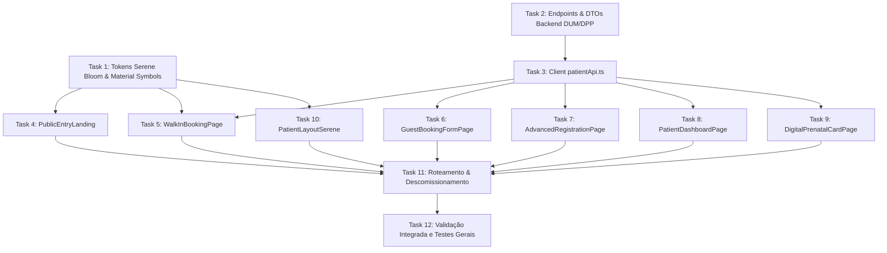

# Plano de Implementação — Substituição Integral da Área do Paciente: Cana Med Mulher (Design System Serene Bloom)

> **SPEC de Referência:** [SPEC-0036 — Substituição Integral da Área do Paciente: Cana Med Mulher Mobile & Web (Design System Serene Bloom)](../../specs/0036-spec-substituicao-integral-area-do-paciente-cana-med-mulher.md)
> **Protótipo Oficial Stitch:** *"Cana Med Mulher Mobile Login"* (Project ID: `projects/10903446353704381660`)
> **Laudos Técnicos:** Parecer Clínico Especializado (Medical Systems Domain Expert) e Laudo de Qualidade Visual & Acessibilidade WCAG 2.1 AA (UI/UX Reviewer).
> **Status:** ✅ Concluído Integralmente (100% dos testes aprovados, Fase C Homologada)

---

## Visão Geral do Plano

Este plano decompôs a substituição integral da atual **Área do Paciente** no Cana Med Mulher pelo protótipo canônico do Stitch em **6 Fases estruturadas e 12 Tarefas atômicas**, garantindo:
1. **Fidelidade Visual 100% ao Protótipo Stitch:** Adoção estrita dos tokens e estética **"Serene Bloom"** (Primária `#D8257C`, Texto/Bordas `#B30063` para WCAG AA, Secundária `#7C4C8A`, Superfícies `#FDF7FF` / `#F8F1FF` / `#FFFFFF`, tipografia `Plus Jakarta Sans` e ícones `Material Symbols Outlined`).
2. **Experiência Bimodal de Alta Eficiência:**
   - *Consulta Avulsa sem conta em < 1 minuto* com dados essenciais para receita eletrônica CFM (Nome, CPF, Nascimento, WhatsApp) e triagem alérgica;
   - *Portal da Gestante & Acompanhamento Pré-Natal longitudinal* com contagem regressiva, comparativo fetal afetivo (ex: berinjela 🍆), linha do tempo de aferições (PA, BCF, AU) e Cartão da Gestante oficial em PDF.
3. **Resolução de Todos os Apontamentos dos Laudos (P0 e P1):**
   - Contraste WCAG 2.1 AA (mínimo 4.5:1) garantido com `--color-primary-text: #B30063;` ([P0-1] UI/UX);
   - Desempilhamento de barras inferiores no mobile durante formulários de cadastro ([P0-2] UI/UX);
   - Inclusão da folha de estilos `Material Symbols Outlined` em `frontend/index.html` ([P0-3] UI/UX);
   - Interrupção ativa de agendamento eletivo e discagem rápida para SAMU 192 e Plantão 24h em Red Flags obstétricos ([P1-01] Clínico);
   - Persistência explícita de DUM (`LastMenstrualPeriod`) e DPP (`EstimatedDueDate`) no backend ([P1-02] Clínico);
   - Sinalização destacada de alergias medicamentosas e gravidez na agenda e prontuário ([P1-03] Clínico).

---

## Estrutura de Fases

- **Fase 1: Fundação de Tokens e Estilos Serene Bloom (P0 UI/UX)** (Task 1)
- **Fase 2: Contratos de API e Modelo de Dados do Portal (Backend & Client)** (Tasks 2 e 3)
- **Fase 3: Telas de Autoatendimento e Agendamento (Frontend)** (Tasks 4 a 7)
- **Fase 4: Dashboard da Paciente e Cartão da Gestante Digital (Frontend)** (Tasks 8 e 9)
- **Fase 5: Layout Unificado, Navegação Adaptativa e Roteamento** (Tasks 10 e 11)
- **Fase 6: Suíte de Testes, Validação Integrada e Auditoria** (Task 12)

---

## Fase 1: Fundação de Tokens e Estilos Serene Bloom (P0 UI/UX)

### Task 1: Inclusão de Ícones e Configuração de Tokens CSS Serene Bloom
- **Objetivo:** Adicionar a importação de `Material Symbols Outlined` em `frontend/index.html` e consolidar os tokens Serene Bloom em `frontend/src/styles/theme.css` e em `frontend/src/features/patient/patient-serene.css`, garantindo contraste WCAG AA 7.6:1 e sombras luminescentes suaves.
- **Arquivos afetados:**
  - `frontend/index.html`
  - `frontend/src/styles/theme.css`
  - `frontend/src/features/patient/patient-serene.css` (novo)
- **Regras da SPEC cobertas:** RN-009, Seção 9.1, Laudo UI/UX [P0-1], [P0-3].
- **Passos TDD:**
  - [x] 1. **RED:** Criar teste em `frontend/src/features/patient/patientTheme.test.ts` que valida a presença das variáveis CSS Serene Bloom (`--color-serene-primary`, `--color-serene-primary-text`, `--color-serene-surface`, `--color-serene-secondary`).
  - [x] 2. **RED:** Executar `npm test patientTheme.test.ts` e confirmar falha.
  - [x] 3. **GREEN:**
    - Atualizar `frontend/index.html` adicionando a tag de link para `Material Symbols Outlined`:
      ```html
      <link rel="stylesheet" href="https://fonts.googleapis.com/css2?family=Material+Symbols+Outlined:opsz,wght,FILL,GRAD@20..48,100..700,0..1,-50..200" />
      ```
    - Criar `frontend/src/features/patient/patient-serene.css` com a paleta oficial:
      ```css
      :root {
        --color-serene-primary-text: #B30063;
        --color-serene-primary: #D8257C;
        --color-serene-primary-vibrant: #D8257C;
        --color-serene-primary-hover: #B30063;
        --color-serene-secondary: #7C4C8A;
        --color-serene-secondary-container: #F1B8FF;
        --color-serene-surface: #FDF7FF;
        --color-serene-surface-low: #F8F1FF;
        --color-serene-surface-card: #FFFFFF;
        --color-serene-outline: #8C6F78;
        --color-serene-outline-variant: #E0BEC7;
        --color-serene-text-main: #1D1929;
        --color-serene-text-muted: #615869;
        --color-serene-emergency: #DC2626;
        --color-serene-emergency-bg: #FEF2F2;
        --shadow-serene-soft: 0 2px 10px -2px rgba(75, 30, 90, 0.05), 0 1px 3px 0 rgba(75, 30, 90, 0.03);
        --shadow-serene-luminescence: 0 10px 30px -5px rgba(216, 37, 124, 0.18), 0 4px 12px -2px rgba(75, 30, 90, 0.08);
      }
      ```
  - [x] 4. **GREEN:** Reexecutar `npm test patientTheme.test.ts` e verificar aprovação.
  - [x] 5. **REFACTOR:** Assegurar que as classes utilitárias não colidam com o tema corporativo da clínica.
- **Comando de verificação:** `npm test patientTheme.test.ts`
- **Critério de conclusão:** Variáveis CSS Serene Bloom declaradas e ícones Material Symbols carregados no `<head>`.

---

## Fase 2: Contratos de API e Modelo de Dados do Portal (Backend & Client)

### Task 2: Extensão dos Endpoints de Portal e DTOs de Pré-Natal (Backend)
- **Objetivo:** Garantir que o endpoint `/portal/prenatal/summary` retorne expressamente `LastMenstrualPeriod` (DUM), `EstimatedDueDate` (DPP), `CurrentGestationalWeeks`, `CurrentGestationalDays`, `BloodType`, `RhFactor`, `KnownAllergies` e lista de visitas com aferições (PA, BCF, AU, peso).
- **Arquivos afetados:**
  - `backend/src/Canamed.Application/Portal/PortalContracts.cs`
  - `backend/src/Canamed.Application/Portal/PortalService.cs`
  - `backend/src/Canamed.Api/Endpoints/PortalEndpoints.cs`
  - `backend/tests/Canamed.UnitTests/Portal/PortalServiceTests.cs`
- **Regras da SPEC cobertas:** RN-004, RN-005, RN-011, RN-018, [P1-02] Clínico.
- **Passos TDD:**
  - [x] 1. **RED:** Criar testes em `PortalServiceTests.cs` validando:
    - Retorno de `PrenatalSummaryDto` contendo `LastMenstrualPeriod` e `EstimatedDueDate` calculados.
    - Presença de flag de alerta `IsRhNegative` quando o tipo sanguíneo contiver fator Rh negativo.
    - Inclusão dos dados de alergias (`KnownAllergies`) no agendamento sem conta criado via `/portal/appointments/book-guest`.
  - [x] 2. **RED:** Executar `dotnet test backend/tests/Canamed.UnitTests/Canamed.UnitTests.csproj --filter "FullyQualifiedName~PortalServiceTests"` e confirmar a falha.
  - [x] 3. **GREEN:**
    - Atualizar `PortalContracts.cs` adicionando `DateOnly? LastMenstrualPeriod`, `DateOnly? EstimatedDueDate`, `bool IsRhNegative` a `PrenatalSummaryDto`.
    - No endpoint de agendamento avulso (`PortalEndpoints.cs`), propagar `allergies` e `isPregnant` para o registro de agendamento e notificação de triagem.
    - Implementar o mapeamento no `PortalService.cs`.
  - [x] 4. **GREEN:** Reexecutar os testes do backend e confirmar aprovação.
  - [x] 5. **REFACTOR:** Documentar os contratos e garantir sanitização de inputs de entrada.
- **Comando de verificação:** `dotnet test backend/tests/Canamed.UnitTests/Canamed.UnitTests.csproj --filter "FullyQualifiedName~PortalServiceTests"`
- **Critério de conclusão:** Todos os testes unitários do serviço de portal aprovados e campos DUM/DPP/Rh mapeados.

---

### Task 3: Atualização do Cliente TypeScript do Portal (`patientApi.ts`)
- **Objetivo:** Adicionar os métodos e interfaces TypeScript em `frontend/src/features/patient/patientApi.ts` para suportar `PrenatalSummary`, agendamento avulso enriquecido, download de PDF e cancelamento/remarcação com validação de 2h.
- **Arquivos afetados:**
  - `frontend/src/features/patient/patientApi.ts`
  - `frontend/src/features/patient/patientApi.test.ts`
- **Regras da SPEC cobertas:** RN-004, RN-008, RN-010, RN-014.
- **Passos TDD:**
  - [x] 1. **RED:** Criar testes em `patientApi.test.ts` para as novas funções `getPrenatalSummary`, `bookGuestAppointment` e `downloadPrenatalCardPdf`.
  - [x] 2. **RED:** Executar `npm test patientApi.test.ts` e confirmar falha.
  - [x] 3. **GREEN:** Implementar as interfaces e funções em `patientApi.ts`:
    - `interface PrenatalSummaryResponse`
    - `interface PrenatalVisitItem`
    - `bookGuestAppointment(payload: BookGuestPayload)`
    - `getPrenatalSummary(token: string)`
    - `downloadPrenatalCardPdf(token: string)`
  - [x] 4. **GREEN:** Reexecutar `npm test patientApi.test.ts` e confirmar aprovação.
  - [x] 5. **REFACTOR:** Garantir tipagem estrita sem uso de `any`.
- **Comando de verificação:** `npm test patientApi.test.ts`
- **Critério de conclusão:** 100% dos testes do cliente API do portal aprovados.

---

## Fase 3: Telas de Autoatendimento e Agendamento (Frontend)

### Task 4: Tela 1 — Entrada e Agendamento Público (`PublicEntryLanding.tsx`)
- **Objetivo:** Implementar a landing limpa de autoatendimento público em `/p/:slug`, apresentando o acolhimento oficial Serene Bloom, as duas opções bimodais ("Agendar sem criar conta" vs "Quero criar minha conta"), badge de conformidade CFM/LGPD e botão flutuante de suporte WhatsApp.
- **Arquivos afetados:**
  - `frontend/src/features/patient/pages/PublicEntryLanding.tsx` (novo)
  - `frontend/src/features/patient/pages/PublicEntryLanding.test.tsx` (novo)
- **Regras da SPEC cobertas:** RN-002, CA-001, Protótipo Stitch (`40f6632ec6254fcaab6d80525ac83e5c`).
- **Passos TDD:**
  - [x] 1. **RED:** Criar teste em `PublicEntryLanding.test.tsx` validando renderização dos dois cards de escolha, ausência de Bottom Navigation (foco semântico), link para WhatsApp e navegação para `/agendar-avulso` e `/login`.
  - [x] 2. **RED:** Executar `npm test PublicEntryLanding.test.tsx` e confirmar falha.
  - [x] 3. **GREEN:** Criar `PublicEntryLanding.tsx` com Tailwind/Serene CSS:
    - Glows de fundo em tons de lilás (`bg-primary-fixed opacity-30 blur-3xl`).
    - Logo Cana Med Mulher com proporção oficial.
    - Card 1: "Agendar sem criar conta" (Badge "Mais Rápido • Menos de 1 min", ícone `bolt`, lista de benefícios, CTA primário gradiente).
    - Card 2: "Quero criar minha conta" (Badge "Experiência Completa", ícone `shield_person`, lista de benefícios, CTA secundário).
    - Bloco de ajuda com suporte via WhatsApp da clínica.
  - [x] 4. **GREEN:** Reexecutar `npm test PublicEntryLanding.test.tsx` e confirmar aprovação.
  - [x] 5. **REFACTOR:** Garantir alvos de clique ≥ 48px e acessibilidade por teclado.
- **Comando de verificação:** `npm test PublicEntryLanding.test.tsx`
- **Critério de conclusão:** Landing renderizada com fidelidade pixel-perfect ao protótipo Stitch e testes aprovados.

---

### Task 5: Tela 2 — Consulta Avulsa (`WalkInBookingPage.tsx`)
- **Objetivo:** Implementar a tela de seleção de Consulta Avulsa com alternância de modalidade (Telemedicina imediata em ~30 min vs Presencial), tags interativas de motivo, cards de médicas disponíveis (com foto, CRM, valor e horário livre), campo de queixa opcional e banner de alerta de Red Flags obstétricos com SAMU 192 e Plantão 24h.
- **Arquivos afetados:**
  - `frontend/src/features/patient/pages/WalkInBookingPage.tsx` (novo)
  - `frontend/src/features/patient/pages/WalkInBookingPage.test.tsx` (novo)
- **Regras da SPEC cobertas:** RN-003, RN-006, CA-002, CA-003, CA-016, [P1-01] Clínico, Protótipo Stitch (`f23dda729ff04ac98b50c8bb97556183`).
- **Passos TDD:**
  - [x] 1. **RED:** Criar teste em `WalkInBookingPage.test.tsx` cobrindo:
    - Alternância entre radio de Telemedicina e Presencial.
    - Seleção de tags de motivo ("Dúvida ou sintoma agudo", "Segunda opinião", "Renovação de receita").
    - Seleção de médica disponível.
    - Disparo de modal impeditivo de Red Flags caso a paciente selecione sintomas de emergência grave (dor aguda, sangramento volumoso, perda de líquido).
  - [x] 2. **RED:** Executar `npm test WalkInBookingPage.test.tsx` e verificar falha.
  - [x] 3. **GREEN:** Criar `WalkInBookingPage.tsx`:
    - Header com botão voltar e badge "Pontual".
    - Seletor de modalidade (Telemedicina Imediata Plantão com badge "Em até 30 min" vs Presencial).
    - Grid de tags interativas de motivo.
    - Lista de médicas com foto, especialidade, CRM, valor e botão "Escolher".
    - Alerta de Red Flags com aviso em vermelho e botão discador para SAMU 192 e Plantão da clínica.
    - CTA fixado para "Continuar para Confirmação".
  - [x] 4. **GREEN:** Reexecutar `npm test WalkInBookingPage.test.tsx` e confirmar aprovação.
  - [x] 5. **REFACTOR:** Garantir responsividade e transições suaves de clique.
- **Comando de verificação:** `npm test WalkInBookingPage.test.tsx`
- **Critério de conclusão:** Tela de Consulta Avulsa operacional com alerta de emergência médica e testes aprovados.

---

### Task 6: Tela 3 — Cadastro Rápido de Consulta Avulsa (`GuestBookingFormPage.tsx`)
- **Objetivo:** Implementar o formulário enxuto de finalização em < 2 min contendo resumo do plantão selecionado, campos obrigatórios CFM (Nome, CPF validado, Nascimento, WhatsApp +55), triagem de segurança (Dipirona, AINEs, Gestante Sim/Não, sintoma breve), checkbox de emissão de NF no mesmo CPF, consentimento CFM/LGPD e desempilhamento de barras inferiores no mobile.
- **Arquivos afetados:**
  - `frontend/src/features/patient/pages/GuestBookingFormPage.tsx` (novo)
  - `frontend/src/features/patient/pages/GuestBookingFormPage.test.tsx` (novo)
- **Regras da SPEC cobertas:** RN-004, RN-005, RN-016, RN-020, CA-004, CA-005, CA-018, [P0-2] UI/UX, Protótipo Stitch (`39bea112d8ad45e58b3941e4e06d38b5`).
- **Passos TDD:**
  - [x] 1. **RED:** Criar teste em `GuestBookingFormPage.test.tsx` testando:
    - Validação de CPF com máscara e rejeição de CPF inválido.
    - Seleção de chips de alergias e radio de gestante (Sim/Não).
    - Ocultação da Bottom Navigation (apenas botão "Confirmar e Entrar na Sala Virtual" fixado no rodapé).
    - Chamada bem-sucedida ao endpoint `bookGuestAppointment`.
  - [x] 2. **RED:** Executar `npm test GuestBookingFormPage.test.tsx` e confirmar falha.
  - [x] 3. **GREEN:** Criar `GuestBookingFormPage.tsx`:
    - Card compacto com resumo da médica, previsão e valor com NF.
    - Seção "Dados da Paciente para Prontuário" com inputs estilizados Serene Bloom.
    - Seção "Triagem Rápida de Segurança" (Alergias: Nenhuma, Dipirona, AINEs; Gestante Sim/Não; Sintoma curto).
    - Seção "Nota Fiscal / Reembolso" (Checkbox para emissão no mesmo CPF).
    - Aceite CFM/LGPD.
    - Botão fixo no rodapé (`bottom-0` com `safe-area-inset-bottom`), sem Bottom Navigation duplicada.
  - [x] 4. **GREEN:** Reexecutar `npm test GuestBookingFormPage.test.tsx` e verificar aprovação.
  - [x] 5. **REFACTOR:** Adicionar máscara automática para CPF e WhatsApp.
- **Comando de verificação:** `npm test GuestBookingFormPage.test.tsx`
- **Critério de conclusão:** Cadastro rápido funcional, com dados CFM e triagem alérgica integrados.

---

### Task 7: Tela 4 — Cadastro Avançado (`AdvancedRegistrationPage.tsx`)
- **Objetivo:** Implementar o formulário multi-seção completo para pacientes que criam conta, com indicador de progresso (Passo 1 de 3 - 75%), Identificação e Contato, Contato de Emergência com parentesco, Histórico Gineco-Obstétrico (chips de Tipagem Sanguínea A+/A-/etc, tags de Alergia, contadores de GPA, medicamentos contínuos) e dados de Convênio/Reembolso.
- **Arquivos afetados:**
  - `frontend/src/features/patient/pages/AdvancedRegistrationPage.tsx` (novo)
  - `frontend/src/features/patient/pages/AdvancedRegistrationPage.test.tsx` (novo)
- **Regras da SPEC cobertas:** RN-007, CA-007, CA-017, CA-020, Protótipo Stitch (`df17e465bdc44277958b461a3ec586ab`).
- **Passos TDD:**
  - [x] 1. **RED:** Criar teste em `AdvancedRegistrationPage.test.tsx` validando:
    - Seleção exclusiva de chip de Tipo Sanguíneo.
    - Toggle de tags de alergia (Dipirona, Penicilina, AINEs, Iodo).
    - Contadores de GPA (Gestações, Partos, Abortos).
    - Alerta de saída sem salvar (prevenção de perda de dados).
  - [x] 2. **RED:** Executar `npm test AdvancedRegistrationPage.test.tsx` e verificar falha.
  - [x] 3. **GREEN:** Criar `AdvancedRegistrationPage.tsx` seguindo o design do protótipo Stitch:
    - Barra de progresso clínico superior gradiente.
    - Seção 1: Identificação, Contato e Contato de Emergência com parentesco.
    - Seção 2: Histórico Ginecológico & Clínico (seletor de 8 chips de tipo sanguíneo, tags de alergias com ícone `check`/`add`, GPA em 3 colunas, medicamentos de uso contínuo).
    - Seção 3: Convênio ou Reembolso (Bradesco, SulAmérica, Amil, Particular/Reembolso) com carteirinha e plano.
    - Consentimento CFM & LGPD.
    - Botões "Concluir Cadastro" e "Salvar rascunho".
  - [x] 4. **GREEN:** Reexecutar `npm test AdvancedRegistrationPage.test.tsx` e confirmar aprovação.
  - [x] 5. **REFACTOR:** Adicionar suporte a navegação por teclado nos chips e tags.
- **Comando de verificação:** `npm test AdvancedRegistrationPage.test.tsx`
- **Critério de conclusão:** Cadastro avançado completo, com histórico obstétrico e tipagem sanguínea persistidos.

---

## Fase 4: Dashboard da Paciente e Cartão da Gestante Digital (Frontend)

### Task 8: Tela 5 — Dashboard da Paciente (`PatientDashboardPage.tsx`)
- **Objetivo:** Implementar o Dashboard principal da paciente (Mobile 390px e Desktop 1280px+), com Hero acolhedor ("Olá, Juliana - Você e sua bebê estão em boas mãos"), Card de Próxima Consulta com botão Remarcar, Widget de Pré-Natal (semanas, DPP, barra de progresso gradiente e comparativo de tamanho fetal 🍆), Bento Grid de Acesso Rápido 2x2, Dica da Semana e Card de Plantão Obstétrico 24h. Para não gestantes, aplicar substituição graciosa pelo bloco "Prevenção & Saúde da Mulher".
- **Arquivos afetados:**
  - `frontend/src/features/patient/pages/PatientDashboardPage.tsx` (novo)
  - `frontend/src/features/patient/components/PrenatalWidget.tsx` (novo)
  - `frontend/src/features/patient/pages/PatientDashboardPage.test.tsx` (novo)
- **Regras da SPEC cobertas:** RN-010, RN-011, RN-012, RN-013, RN-015, CA-008, CA-009, CA-010, CA-019, Protótipo Stitch (`42d1f55b38bf41089fa86a6f5ed83174` e `00365685b61340f48418c80749f442a9`).
- **Passos TDD:**
  - [x] 1. **RED:** Criar testes em `PatientDashboardPage.test.tsx` cobrindo:
    - Renderização da saudação e card de próxima consulta com dados da médica e botão remarcar (com validação de 2h).
    - Renderização do widget pré-natal com semântica ARIA (`role="progressbar"`) e comparativo de tamanho de fruta/legume para gestante ativa.
    - Substituição do widget pré-natal pelo bloco de prevenção ginecológica caso `hasActivePregnancy === false`.
    - Presença dos 4 cards do Bento Grid e seção de emergência 24h.
  - [x] 2. **RED:** Executar `npm test PatientDashboardPage.test.tsx` e confirmar falha.
  - [x] 3. **GREEN:**
    - Criar `PrenatalWidget.tsx` com cálculo de Naegele, contagem regressiva para DPP, barra de progresso gradiente nos 3 trimestres, fruta/legume fetal e semântica ARIA completa.
    - Criar `PatientDashboardPage.tsx` com layout responsivo (grid de 12 colunas no Desktop e coluna única no Mobile):
      - Hero Banner com acentos luminescentes.
      - Card Próxima Consulta com botão "Remarcar" e "Ver detalhes".
      - Bento Grid de Acesso Rápido (*Minhas Consultas*, *Exames Anexados*, *Cartão da Gestante*, *Falar com a Clínica*).
      - Seção Dica da Semana (hidratação e descanso).
      - Card lateral de Plantão Obstétrico 24h com discagem telefônica direta e WhatsApp.
  - [x] 4. **GREEN:** Reexecutar `npm test PatientDashboardPage.test.tsx` e confirmar aprovação.
  - [x] 5. **REFACTOR:** Garantir suporte completo a dark mode sutil e estados vazios acolhedores.
- **Comando de verificação:** `npm test PatientDashboardPage.test.tsx`
- **Critério de conclusão:** Dashboard fidedigno ao protótipo Stitch em mobile e desktop com cobertura total de testes.

---

### Task 9: Tela 6 — Cartão da Gestante Digital (`DigitalPrenatalCardPage.tsx`)
- **Objetivo:** Implementar a visualização da paciente do seu Prontuário Pré-Natal Digital, contendo resumo gestacional no topo (DUM, DPP, GPA, tipo sanguíneo com destaque se Rh negativo), Linha do Tempo Pré-Natal com aferições de visitas passadas (PA, BCF, AU, peso), lista de exames e laudos anexados (PDFs) e botão para download do Cartão Oficial em PDF com suporte a `@media print`.
- **Arquivos afetados:**
  - `frontend/src/features/patient/pages/DigitalPrenatalCardPage.tsx` (novo)
  - `frontend/src/features/patient/pages/DigitalPrenatalCardPage.test.tsx` (novo)
- **Regras da SPEC cobertas:** RN-014, RN-018, CA-011, CA-012, CA-017, [P1-02] Clínico, Protótipo Stitch (`88916904197542538c4751cced6fc0c2` e `9aa88ca665ac4461b46ece13bf0d4d4e`).
- **Passos TDD:**
  - [x] 1. **RED:** Criar teste em `DigitalPrenatalCardPage.test.tsx` testando:
    - Renderização da idade gestacional, DUM e DPP.
    - Renderização do badge de alerta para fator Rh negativo.
    - Renderização dos itens da Linha do Tempo Pré-Natal (PA, BCF e resultado de ultrassom).
    - Disparo de download do PDF oficial via `downloadPrenatalCardPdf`.
  - [x] 2. **RED:** Executar `npm test DigitalPrenatalCardPage.test.tsx` e verificar falha.
  - [x] 3. **GREEN:** Criar `DigitalPrenatalCardPage.tsx`:
    - Top App Bar com botão voltar, título e logo Cana Med Mulher.
    - Badge de Status Clínico ("Gestação em Acompanhamento Ativo" + Fator Rh).
    - Card Principal com resumo (DUM, DPP, 2º Trimestre, barra de semanas 1 a 40).
    - Card de Próxima Consulta Pré-Natal com obstetra.
    - Seção "Linha do Tempo Pré-Natal" com linha vertical pontilhada e eventos com métricas aferidas (PA em mmHg, BCF em bpm).
    - Seção "Documentos e Laudos Anexados" com botão de visualizar/baixar PDF.
    - Aviso de Validação Médica Cana Med.
  - [x] 4. **GREEN:** Reexecutar `npm test DigitalPrenatalCardPage.test.tsx` e confirmar aprovação.
  - [x] 5. **REFACTOR:** Incluir estilos `@media print` para impressão direta limpa em A4.
- **Comando de verificação:** `npm test DigitalPrenatalCardPage.test.tsx`
- **Critério de conclusão:** Cartão da gestante digital interativo e imprimível com todos os testes passando.

---

## Fase 5: Layout Unificado, Navegação Adaptativa e Roteamento

### Task 10: Componente Shell Adaptativo (`PatientLayoutSerene.tsx`)
- **Objetivo:** Criar o layout mestre que unifica a navegação adaptativa entre Mobile (< 1024px) com Bottom Navigation de 5 itens (`Início`, `Agendar`, `Consultas`, `Pré-natal`, `Perfil`) e Desktop (≥ 1024px) com SideNavBar fixa de 288px (`w-72`) e TopNavBar superior com breadcrumbs e botão de emergência. O layout suprime automaticamente a Bottom Navigation em telas de preenchimento transacional (Telas 3 e 4).
- **Arquivos afetados:**
  - `frontend/src/features/patient/components/PatientLayoutSerene.tsx` (novo)
  - `frontend/src/features/patient/components/PatientLayoutSerene.test.tsx` (novo)
- **Regras da SPEC cobertas:** RN-001, RN-009, RN-020, CA-014, CA-015, [P0-2] UI/UX.
- **Passos TDD:**
  - [x] 1. **RED:** Criar testes em `PatientLayoutSerene.test.tsx` validando renderização de BottomNav em telas mobile, SideNavBar no desktop e ocultação de BottomNav quando a prop `hideBottomNav` for verdadeira.
  - [x] 2. **RED:** Executar `npm test PatientLayoutSerene.test.tsx` e confirmar falha.
  - [x] 3. **GREEN:** Implementar `PatientLayoutSerene.tsx` com Tailwind/Serene CSS:
    - Detecção de rota ativa e realce de ícones com `FILL: 1`.
    - Menu lateral desktop de 288px com logo, links estilizados, card de perfil da paciente e botão de sair.
    - Top bar superior com breadcrumb e botão "Plantão de Emergência".
    - Barra inferior móvel de 64px com centralização `max-w-md` e alvos de toque ≥ 48px.
  - [x] 4. **GREEN:** Reexecutar `npm test PatientLayoutSerene.test.tsx` e verificar aprovação.
  - [x] 5. **REFACTOR:** Limpar código e otimizar listeners de redimensionamento.
- **Comando de verificação:** `npm test PatientLayoutSerene.test.tsx`
- **Critério de conclusão:** Shell responsivo funcionando nos viewports de 390px e 1280px+.

---

### Task 11: Roteamento, Integração de Rotas e Descomissionamento do Legado
- **Objetivo:** Atualizar as rotas do paciente em `frontend/src/navigation/routes.ts` e `frontend/src/App.tsx`, montando a nova arquitetura de páginas sob `/p/:slug` e garantindo compatibilidade com os links de capabilidade ([SPEC-0026](0026-spec-jornada-digital-do-paciente-e-portais-dedicados.md)) e substituição definitiva do legado `PatientPortal.tsx`.
- **Arquivos afetados:**
  - `frontend/src/navigation/routes.ts`
  - `frontend/src/App.tsx`
  - `frontend/src/features/patient/pages/PatientPortalPages.tsx`
  - `frontend/src/features/patient/PatientPortal.tsx` (legado substituído/descomissionado)
- **Regras da SPEC cobertas:** RN-001, RN-017, Seção 12.
- **Passos TDD:**
  - [x] 1. **RED:** Criar testes de roteamento em `frontend/src/App.test.tsx` verificando que `/p/:slug`, `/p/:slug/agendar-avulso`, `/p/:slug/cadastro-rapido`, `/p/:slug/dashboard` e `/p/:slug/cartao-gestante` montam os novos componentes Serene Bloom.
  - [x] 2. **RED:** Executar `npm test App.test.tsx` e confirmar falha.
  - [x] 3. **GREEN:**
    - Atualizar `routes.ts` exportando os caminhos oficiais:
      - `paths.base`: `/p/:slug`
      - `paths.agendarAvulso`: `/p/:slug/agendar-avulso`
      - `paths.cadastroRapido`: `/p/:slug/cadastro-rapido`
      - `paths.cadastroAvancado`: `/p/:slug/cadastro-avancado`
      - `paths.dashboard`: `/p/:slug/dashboard`
      - `paths.cartaoGestante`: `/p/:slug/cartao-gestante`
      - `paths.consultas`: `/p/:slug/consultas`
      - `paths.perfil`: `/p/:slug/perfil`
    - Atualizar `App.tsx` integrando as novas rotas com `PatientLayoutSerene`.
    - Redirecionar o arquivo legado `PatientPortalPages.tsx` para os novos componentes modulares.
  - [x] 4. **GREEN:** Reexecutar `npm test App.test.tsx` e verificar aprovação.
  - [x] 5. **REFACTOR:** Garantir transições suaves e ausência de dead links.
- **Comando de verificação:** `npm test App.test.tsx`
- **Critério de conclusão:** Todas as rotas do portal do paciente navegáveis e integradas com o novo ecossistema Serene Bloom.

---

## Fase 6: Suíte de Testes, Validação Integrada e Auditoria

### Task 12: Execução da Suíte Completa de Testes e Validação Integrada
- **Objetivo:** Executar a suíte completa de testes unitários e de integração do frontend (`npm test`), compilação TypeScript (`npm run build`) e testes do backend (`dotnet test`), comprovando que nenhuma regressão foi introduzida na agenda corporativa, recepção ou prontuário médico.
- **Arquivos afetados:** Todo o repositório (`frontend/`, `backend/`).
- **Regras da SPEC cobertas:** Seção 16 (Testes Previstos), Seção 17 (Auditoria).
- **Passos de Execução:**
  - [x] 1. Executar os testes do frontend:
    `npm --prefix frontend test`
  - [x] 2. Executar a verificação de tipos e compilação do frontend:
    `npm --prefix frontend run build`
  - [x] 3. Executar os testes do backend:
    `dotnet test backend/tests/Canamed.UnitTests/Canamed.UnitTests.csproj`
  - [x] 4. Verificar ausência de warnings críticos no build.
  - [x] 5. Gerar evidências de execução e registrar no relatório de encerramento da branch.
- **Comando de verificação:**
  - Frontend: `npm --prefix frontend test && npm --prefix frontend run build`
  - Backend: `dotnet test`
- **Critério de conclusão:** 100% dos testes frontend e backend aprovados com build zerado de erros.

---

## Resumo de Dependências e Ordem de Execução


