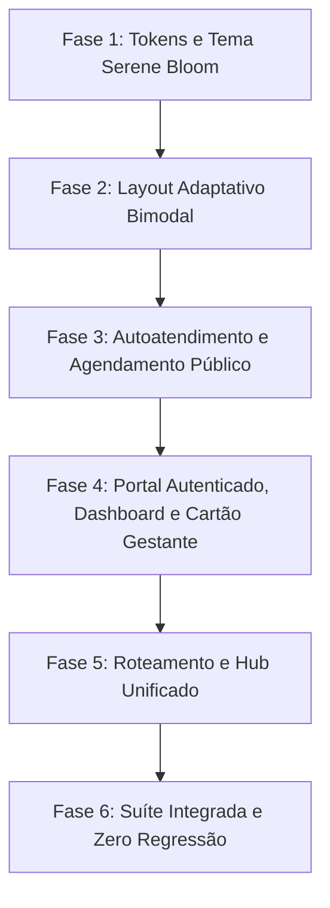

# Plano de Implementação Atômico TDD — Reimplementação da Área da Paciente (Google Stitch: Serene Bloom)

| Metadado | Detalhe |
| :--- | :--- |
| **Data** | 2026-10-29 |
| **SPEC de Referência** | [SPEC-0036 — Substituição Integral da Área do Paciente (v1.1.0)](../../specs/0036-spec-substituicao-integral-area-do-paciente-cana-med-mulher.md) |
| **Protótipo Stitch Oficial** | *"Cana Med Mulher Mobile Login"* (Project ID: `projects/10903446353704381660`) |
| **Tema e Design System** | Serene Bloom (Palette M3 Mapped, Plus Jakarta Sans, Material Symbols Outlined) |
| **Autor** | Planejador e Arquiteto de Produto (Cana Med) |
| **Módulos Afetados** | `frontend/src/features/patient/`, `frontend/src/app/`, `frontend/tailwind.config.js`, `frontend/index.html` |
| **Metodologia** | TDD Estrito em 5 Passos (Red ➔ Confirmação ➔ Green Stitch ➔ Zero Regressão ➔ Refactor) |

---

## 1. Visão Geral e Pergunta de Controle

### Pergunta de Controle (`GEMINI.md`)
> **"Isso reduz atrito na rotina da clínica?"**
> 
> **Sim, decisivamente.**
> 1. **Zero Fricção no Agendamento:** Permite que pacientes agendem consultas avulsas de urgência ou eletivas em menos de 60 segundos pelo celular sem necessidade de cadastro burocrático inicial, reduzindo filas no balcão e no WhatsApp da recepção.
> 2. **Autonomia Pré-Natal Segura:** A gestante acompanha sua contagem regressiva, exames e linha do tempo de consultas com aferições de PA, BCF e Altura Uterina, além de emitir seu Cartão da Gestante Oficial em PDF a qualquer momento sem onerar a equipe assistencial.
> 3. **Mitigação de Riscos Clínicos (Red Flags):** Identifica sintomas de emergência obstétrica e direciona instantaneamente para SAMU 192 e Plantão 24h, impedindo que emergências fiquem represadas em agendamentos ambulatoriais comuns.
> 4. **Dados Vitais Prontos para a Médica:** O cadastro rápido já captura CPF validado, WhatsApp e triagem de alergias (Dipirona, AINEs), entregando para a médica obstetra o prontuário pronto para prescrição digital CFM.

---

## 2. Mapeamento das 6 Telas e Layout do Stitch

| # | Superfície / Tela | ID Stitch (Mobile) | ID Stitch (Web Desktop) | Arquivo Frontend Canônico |
| :--- | :--- | :--- | :--- | :--- |
| **0** | **Layout Adaptativo Bimodal** | TopBar + BottomNav 5 abas | SideNavBar (w-72) + TopNavBar Breadcrumbs | `frontend/src/features/patient/components/PatientLayoutSerene.tsx` & `frontend/src/app/PatientLayout.tsx` |
| **1** | **Entrada e Agendamento Público** | `40f6632ec6254fcaab6d80525ac83e5c` | *Responsivo centralizado (max-w-md)* | `frontend/src/features/patient/pages/PublicEntryLanding.tsx` |
| **2** | **Consulta Avulsa (Seleção)** | `f23dda729ff04ac98b50c8bb97556183` | `5ac5683bf5dd4f4282d30c64bd7421d8` | `frontend/src/features/patient/pages/WalkInBookingPage.tsx` |
| **3** | **Cadastro Consulta Avulsa (CFM)** | `39bea112d8ad45e58b3941e4e06d38b5` | `3e2084fab7fa44078e4edf6a0554c023` | `frontend/src/features/patient/pages/GuestBookingFormPage.tsx` |
| **4** | **Cadastro Avançado (PEP Gestante)**| `df17e465bdc44277958b461a3ec586ab` | `30c0016a3ed44faab2150a94f127aef3` | `frontend/src/features/patient/pages/AdvancedRegistrationPage.tsx` |
| **5** | **Dashboard da Paciente** | `42d1f55b38bf41089fa86a6f5ed83174` | `00365685b61340f48418c80749f442a9` | `frontend/src/features/patient/pages/PatientDashboardPage.tsx` |
| **6** | **Cartão Digital da Gestante** | `88916904197542538c4751cced6fc0c2` | `9aa88ca665ac4461b46ece13bf0d4d4e` | `frontend/src/features/patient/pages/DigitalPrenatalCardPage.tsx` |

---

## 3. Estrutura de Fases e Tasks Atômicas TDD

- **Fase 1: Tokens e Tema Serene Bloom** (Task 1)
- **Fase 2: Layout Adaptativo Bimodal** (Task 2)
- **Fase 3: Autoatendimento e Agendamento Público** (Tasks 3, 4 e 5)
- **Fase 4: Portal Autenticado, Dashboard e Cartão Gestante** (Tasks 6, 7 e 8)
- **Fase 5: Roteamento e Hub Unificado** (Task 9)
- **Fase 6: Suíte Integrada e Zero Regressão** (Task 10)

---

## 4. Detalhamento das Tasks Atômicas

### Fase 1: Tokens e Tema Serene Bloom

#### Task 1: Harmonização dos Tokens Serene Bloom em `tailwind.config.js` e `patient-serene.css`
- **Objetivo:** Garantir fidelidade cromática e tipográfica exata ao protótipo Stitch (Primary `#b30063`, Primary Container `#d8257c`, Secondary `#7c4c8a`, Surface `#fdf7ff`, Outline `#8c6f78`, Text `#1d1929`), preservando as variáveis CSS `--color-serene-*` com contraste WCAG AA 7.6:1 e tipografia `Plus Jakarta Sans`.
- **Arquivos afetados:**
  - `frontend/tailwind.config.js`
  - `frontend/src/features/patient/patient-serene.css`
  - `frontend/src/features/patient/patientTheme.test.ts`
  - `frontend/index.html`
- **Regras da SPEC cobertas:** RN-009, Seção 9.1 da SPEC-0036.
- **Ciclo TDD:**
  - [ ] **Passo 1 (Red):** Atualizar `frontend/src/features/patient/patientTheme.test.ts` para verificar se os tokens canônicos do Stitch (`--color-serene-primary`, `--color-serene-primary-container`, `--color-serene-surface`, `--color-serene-text-main`, `--color-serene-outline-variant`) e as classes Tailwind Serene estão registradas.
  - [ ] **Passo 2 (Confirmação de falha):** Executar `npm test patientTheme.test.ts` e confirmar falhas nos tokens ausentes ou divergentes.
  - [ ] **Passo 3 (Green Stitch):**
    - Configurar os tokens de cor, tipografia e espaçamento no `frontend/tailwind.config.js` em harmonia com o JSON oficial do Stitch:
      - `primary: '#b30063'`, `primary-container: '#d8257c'`, `secondary: '#7c4c8a'`, `surface: '#fdf7ff'`, `on-surface: '#1d1929'`.
    - Garantir as classes utilitárias no `frontend/src/features/patient/patient-serene.css` (`soft-card-shadow`, `custom-luminescence`, `.material-symbols-outlined`, `canamed-input`).
    - Validar as tags de `<link>` no `frontend/index.html` para `Plus Jakarta Sans` e `Material Symbols Outlined`.
  - [ ] **Passo 4 (Zero Regressão):** Executar `npm test patientTheme.test.ts` e suíte geral de layout do frontend.
  - [ ] **Passo 5 (Refactor & Commit):** Refatorar nomes redundantes mantendo retrocompatibilidade com componentes internos da clínica.
- **Comando de verificação:** `npm test patientTheme.test.ts`

---

### Fase 2: Layout Adaptativo Bimodal

#### Task 2: Layout Adaptativo Bimodal em `PatientLayoutSerene.tsx` e `PatientLayout.tsx`
- **Objetivo:** Fornecer container responsivo com suporte a SideNavBar fixa desktop (288px / `w-72`), TopNavBar desktop com breadcrumb e botão persistente "Plantão Obstétrico 24h", e BottomNavBar mobile com 5 destinos (`Início`, `Agendar`, `Consultas`, `Pré-natal`, `Perfil`), além do mecanismo de ocultação `hideBottomNav` para as telas de formulário transacional.
- **Arquivos afetados:**
  - `frontend/src/features/patient/components/PatientLayoutSerene.tsx`
  - `frontend/src/features/patient/components/PatientLayoutSerene.test.tsx`
  - `frontend/src/app/PatientLayout.tsx`
- **Regras da SPEC cobertas:** RN-001, RN-009, RN-015, RN-020.
- **Ciclo TDD:**
  - [ ] **Passo 1 (Red):** Expandir `PatientLayoutSerene.test.tsx` cobrindo:
    - Renderização da SideNavBar com 6 links no desktop (≥ 1024px);
    - Renderização do botão "Plantão Obstétrico 24h" no desktop e atalho mobile;
    - Renderização da BottomNav móvel com 5 abas (`Início`, `Agendar`, `Consultas`, `Pré-natal`, `Perfil`);
    - Ocultação da BottomNav quando `hideBottomNav={true}`;
    - Chamadas de callback `onTabChange` ao clicar nas abas.
  - [ ] **Passo 2 (Confirmação de falha):** Executar `npm test PatientLayoutSerene.test.tsx` e registrar quebras esperadas.
  - [ ] **Passo 3 (Green Stitch):**
    - Ajustar `PatientLayoutSerene.tsx` utilizando as classes exatas do protótipo Stitch:
      - Desktop aside: `hidden lg:flex fixed left-0 top-0 h-screen w-72 flex-col justify-between p-6 z-40 bg-white border-r border-slate-200 shadow-sm`;
      - Topbar desktop: `sticky top-0 z-30 flex h-16 items-center justify-between border-b border-slate-200/80 bg-white/95 px-6 backdrop-blur`;
      - Botão Plantão 24h: `inline-flex items-center gap-2 rounded-xl bg-red-600 px-4 py-2.5 text-xs font-bold text-white shadow-sm hover:bg-red-700`;
      - BottomNav mobile: `fixed bottom-0 left-0 w-full z-50 flex justify-around items-center px-2 py-2 h-16 bg-surface border-t border-outline-variant/30 shadow-[0_-4px_16px_rgba(75,30,90,0.06)]`.
    - Garantir que `PatientLayout.tsx` envolva a rota com o contexto de tenant `/p/:slug` e `ToastProvider`.
  - [ ] **Passo 4 (Zero Regressão):** Executar `npm test PatientLayoutSerene.test.tsx` e verificar 100% de sucesso.
  - [ ] **Passo 5 (Refactor & Commit):** Otimizar transições e garantir alvos de clique mínimos de 48px nos ícones móveis.
- **Comando de verificação:** `npm test PatientLayoutSerene.test.tsx`

---

### Fase 3: Autoatendimento e Agendamento Público

#### Task 3: Tela 1 — Entrada e Agendamento Público (`PublicEntryLanding.tsx`)
- **Objetivo:** Implementar a tela pública de boas-vindas do portal (`/p/:slug`), exibindo acolhimento afetivo Serene Bloom, as duas opções bimodais de autoatendimento ("Agendar sem criar conta" vs "Quero criar minha conta"), badge de conformidade CFM/LGPD e suporte via WhatsApp da recepção.
- **Stitch ID:** `40f6632ec6254fcaab6d80525ac83e5c` ("Entrada e Agendamento Público").
- **Arquivos afetados:**
  - `frontend/src/features/patient/pages/PublicEntryLanding.tsx`
  - `frontend/src/features/patient/pages/PublicEntryLanding.test.tsx`
- **Regras da SPEC cobertas:** RN-001, RN-002, CA-001.
- **Ciclo TDD:**
  - [ ] **Passo 1 (Red):** Criar/atualizar testes em `PublicEntryLanding.test.tsx` validando:
    - Presença do logo institucional Cana Med Mulher;
    - Renderização dos dois cartões de escolha bimodal ("Agendar sem criar conta" com badge "Mais Rápido • Menos de 1 min" e "Quero criar minha conta");
    - Disparo de navegação para `paths.walkIn` e `paths.login`;
    - Link direto para o suporte WhatsApp da clínica.
  - [ ] **Passo 2 (Confirmação de falha):** Executar `npm test PublicEntryLanding.test.tsx` e comprovar falha.
  - [ ] **Passo 3 (Green Stitch):**
    - Implementar a árvore DOM com classes do Stitch:
      - Hero com badge "Autoatendimento Cana Med Mulher" (`inline-flex items-center gap-1.5 px-3 py-1 rounded-full bg-secondary-fixed/50 text-secondary`);
      - Card 1 Avulso: borda `border-2 border-primary/20 hover:border-primary`, ícone `bolt`, lista com checkmarks e botão primário com gradiente `from-primary to-primary-container`;
      - Card 2 Conta Completa: borda `border border-outline-variant/30`, ícone `shield_person`, lista com benefícios pré-natal e botão secundário;
      - Rodapé com selo "Dados protegidos conforme LGPD e resoluções CFM".
  - [ ] **Passo 4 (Zero Regressão):** Reexecutar `npm test PublicEntryLanding.test.tsx`.
  - [ ] **Passo 5 (Refactor & Commit):** Assegurar semântica de botões acessíveis e tags `aria-label`.
- **Comando de verificação:** `npm test PublicEntryLanding.test.tsx`

---

#### Task 4: Tela 2 — Seleção de Consulta Avulsa (`WalkInBookingPage.tsx`)
- **Objetivo:** Implementar o seletor de agendamento de consulta avulsa com alternância de modalidade (Telemedicina imediata em ~30 min vs Presencial), chips de seleção de queixa/motivo, listagem em tempo real de profissionais médicas com CRM, valor e horário livre, campo de sintoma breve e banner de alerta de emergência obstétrica com SAMU 192 e Plantão 24h.
- **Stitch IDs:** Mobile `f23dda729ff04ac98b50c8bb97556183` / Desktop `5ac5683bf5dd4f4282d30c64bd7421d8`.
- **Arquivos afetados:**
  - `frontend/src/features/patient/pages/WalkInBookingPage.tsx`
  - `frontend/src/features/patient/pages/WalkInBookingPage.test.tsx`
- **Regras da SPEC cobertas:** RN-003, RN-006, RN-009, CA-002, CA-003, CA-016.
- **Ciclo TDD:**
  - [ ] **Passo 1 (Red):** Atualizar testes em `WalkInBookingPage.test.tsx` validando:
    - Alternância entre abas "Telemedicina" e "Presencial";
    - Seleção de tags de motivo (ex: "Rotina", "Pré-natal", "Urgência ginecológica");
    - Listagem das médicas com foto, CRM, preço e horários livres;
    - Exibição de banner de alerta médico ao selecionar queixas de risco agudo (sangramento, dor intensa);
    - Transição para o formulário de cadastro rápido (`paths.guestBooking`) com parâmetros de médica e modalidade.
  - [ ] **Passo 2 (Confirmação de falha):** Executar `npm test WalkInBookingPage.test.tsx` e confirmar falha.
  - [ ] **Passo 3 (Green Stitch):**
    - Estruturar os componentes com classes Stitch:
      - Abas de modalidade com `rounded-full p-1 bg-surface-container` e botão ativo `bg-primary text-on-primary shadow-sm`;
      - Carrossel de tags em chip `no-scrollbar flex gap-2 overflow-x-auto`;
      - Cards de médica em `bg-surface-container-lowest rounded-2xl p-4 border border-outline-variant/40 shadow-sm`;
      - Banner de alerta de emergência médica em vermelho carmim (`bg-red-50 border-red-200 text-red-900`) com botões para SAMU 192 e Plantão 24h.
  - [ ] **Passo 4 (Zero Regressão):** Executar `npm test WalkInBookingPage.test.tsx`.
  - [ ] **Passo 5 (Refactor & Commit):** Extrair utilitários de formatação de horários e tags.
- **Comando de verificação:** `npm test WalkInBookingPage.test.tsx`

---

#### Task 5: Tela 3 — Cadastro Rápido de Consulta Avulsa CFM (`GuestBookingFormPage.tsx`)
- **Objetivo:** Construir o formulário ágil de autoatendimento para consulta sem conta prévia, capturando estritamente Nome completo, CPF com validação de dígitos, Data de Nascimento, Celular/WhatsApp com DDD (+55), triagem de alergias (Dipirona, AINEs), status gestacional (Sim/Não), sintoma principal, opção de emissão de NF no mesmo CPF e consentimento CFM/LGPD.
- **Stitch IDs:** Mobile `39bea112d8ad45e58b3941e4e06d38b5` / Desktop `3e2084fab7fa44078e4edf6a0554c023`.
- **Arquivos afetados:**
  - `frontend/src/features/patient/pages/GuestBookingFormPage.tsx`
  - `frontend/src/features/patient/pages/GuestBookingFormPage.test.tsx`
- **Regras da SPEC cobertas:** RN-004, RN-005, RN-016, RN-019, RN-020, CA-004, CA-005, CA-018.
- **Ciclo TDD:**
  - [ ] **Passo 1 (Red):** Atualizar testes em `GuestBookingFormPage.test.tsx` validando:
    - Ocultação da BottomNav móvel via `hideBottomNav` (RN-020);
    - Máscaras automáticas e validação de CPF e telefone celular;
    - Seleção de chips de alergias medicamentosas (Dipirona, AINEs, Sem alergias conhecidas);
    - Checkbox de solicitação de NF para reembolso de convênio (RN-016);
    - Bloqueio do botão de envio caso o CPF seja inválido (ER-001);
    - Chamada bem-sucedida para `bookGuestAppointment` com redirecionamento para confirmação e sala telemedicina.
  - [ ] **Passo 2 (Confirmação de falha):** Executar `npm test GuestBookingFormPage.test.tsx` e registrar reprovação.
  - [ ] **Passo 3 (Green Stitch):**
    - Construir a UI com as classes Stitch:
      - Card resumo do topo com avatar da médica, modalidade e data/horário selecionado;
      - Campos de entrada estilizados com `.canamed-input`;
      - Chips seletivos de triagem rápida: alergias em botões de alternância (`rounded-full px-3 py-1.5 text-xs font-semibold`);
      - Barra inferior de ação persistente em mobile com `sticky bottom-0 bg-white/95 backdrop-blur p-4 border-t border-slate-200 z-30` com botão de agendar de largura total.
  - [ ] **Passo 4 (Zero Regressão):** Reexecutar `npm test GuestBookingFormPage.test.tsx`.
  - [ ] **Passo 5 (Refactor & Commit):** Garantir feedback visual de validação em tempo real e tratamento de erros de conflito 409 (ER-003).
- **Comando de verificação:** `npm test GuestBookingFormPage.test.tsx`

---

### Fase 4: Portal Autenticado, Dashboard e Cartão Gestante

#### Task 6: Tela 4 — Cadastro Avançado da Gestante PEP (`AdvancedRegistrationPage.tsx`)
- **Objetivo:** Implementar o formulário completo de admissão obstétrica para pacientes que criam conta ou necessitam de perfil PEP estruturado, coletando contato de emergência com parentesco, perfil obstétrico preliminar GPA (Gestações, Partos, Abortos), tipagem sanguínea em chips seletivos (A+, A-, B+, B-, AB+, AB-, O+, O-), tags de alergias adicionais, medicamentos em uso contínuo, operadora de saúde para reembolso e termos LGPD.
- **Stitch IDs:** Mobile `df17e465bdc44277958b461a3ec586ab` / Desktop `30c0016a3ed44faab2150a94f127aef3`.
- **Arquivos afetados:**
  - `frontend/src/features/patient/pages/AdvancedRegistrationPage.tsx`
  - `frontend/src/features/patient/pages/AdvancedRegistrationPage.test.tsx`
- **Regras da SPEC cobertas:** RN-007, RN-018, RN-019, RN-020, CA-007, CA-018.
- **Ciclo TDD:**
  - [ ] **Passo 1 (Red):** Atualizar `AdvancedRegistrationPage.test.tsx` validando:
    - Ocultação da Bottom Navigation móvel (`hideBottomNav`);
    - Seleção exclusiva de tipagem sanguínea com alerta automático caso Rh negativo (RN-018);
    - Inserção de contato de emergência (Nome, Telefone, Parentesco);
    - Campos de histórico GPA (G, P, A);
    - Atualização bem-sucedida do perfil via `updatePatientProfile`.
  - [ ] **Passo 2 (Confirmação de falha):** Executar `npm test AdvancedRegistrationPage.test.tsx` e confirmar falha.
  - [ ] **Passo 3 (Green Stitch):**
    - Implementar a página com a estrutura visual do Stitch:
      - Cabeçalho acolhedor com ícone `health_and_safety` e passos informativos;
      - Grade de chips de tipo sanguíneo (`grid grid-cols-4 gap-2`) com destaque rosa Serene no selecionado;
      - Badge de recomendação profilática se fator Rh negativo selecionado (RN-018);
      - Agrupamento em seções colapsáveis ou cartões limpos com divisórias sutis `border-outline-variant/30`.
  - [ ] **Passo 4 (Zero Regressão):** Executar `npm test AdvancedRegistrationPage.test.tsx`.
  - [ ] **Passo 5 (Refactor & Commit):** Refatorar validações e garantir diálogo preventivo de perda de dados (CA-020).
- **Comando de verificação:** `npm test AdvancedRegistrationPage.test.tsx`

---

#### Task 7: Tela 5 — Dashboard da Paciente (`PatientDashboardPage.tsx` e `PrenatalWidget.tsx`)
- **Objetivo:** Reimplementar a home da paciente autenticada com fidelidade de 100% ao Stitch: saudação afetiva personalizada (*"Olá, Juliana"*), card de Próxima Consulta com dados da médica, horário e atalho para remarcar (respeitando antecedência de 2h), Widget de Acompanhamento Pré-Natal com contagem regressiva, trimestres, fruta/legume fetal afetivo (ex: berinjela 🍆), Bento Grid de acesso rápido (Minhas Consultas, Exames, Cartão da Gestante, Contato) e bloco de Prevenção Ginecológica como fallback caso a paciente não esteja grávida.
- **Stitch IDs:** Mobile `42d1f55b38bf41089fa86a6f5ed83174` / Desktop `00365685b61340f48418c80749f442a9`.
- **Arquivos afetados:**
  - `frontend/src/features/patient/pages/PatientDashboardPage.tsx`
  - `frontend/src/features/patient/pages/PatientDashboardPage.test.tsx`
  - `frontend/src/features/patient/components/PrenatalWidget.tsx`
  - `frontend/src/features/patient/components/PrenatalWidget.test.tsx`
- **Regras da SPEC cobertas:** RN-008, RN-010, RN-011, RN-012, RN-013, RN-015, CA-008 a CA-013, CA-019.
- **Ciclo TDD:**
  - [ ] **Passo 1 (Red):** Atualizar testes em `PatientDashboardPage.test.tsx` e `PrenatalWidget.test.tsx` validando:
    - Renderização da saudação afetiva com nome da paciente;
    - Renderização do card de Próxima Consulta com dados da médica e botão remarcar (com trava de 2h conforme ER-005);
    - Renderização do widget pré-natal quando houver gestação ativa (IG, contagem regressiva para DPP, fruta/legume fetal);
    - Substituição pelo bloco de Prevenção e Saúde da Mulher quando não gestante (RN-012);
    - Renderização dos 4 módulos do Bento Grid 2x2;
    - Acessibilidade ARIA do widget de progresso (`role="progressbar"` - CA-019).
  - [ ] **Passo 2 (Confirmação de falha):** Executar `npm test PatientDashboardPage.test.tsx PrenatalWidget.test.tsx` e registrar falha.
  - [ ] **Passo 3 (Green Stitch):**
    - Implementar a página com o HTML e classes extraídas do Stitch:
      - Header com logo, botão de notificações com badge e avatar com anel `ring-2 ring-primary/20`;
      - Hero com badge "Espaço Saúde da Mulher" (`inline-flex items-center gap-1.5 px-3 py-1 rounded-full bg-secondary-fixed/50 text-secondary`);
      - Card Próxima Consulta com badge "Confirmada" verde esmeralda (`bg-emerald-50 text-emerald-800 border-emerald-200`);
      - Widget Pré-Natal com barra gradiente `from-secondary to-primary-container`, texto de fruta fetal e atalho para o Cartão da Gestante;
      - Bento Grid de 4 cartões com ícones `calendar_month`, `description`, `auto_stories`, `chat`;
      - Seção de Dica da Semana com atalho "Plantão Obstétrico 24h".
  - [ ] **Passo 4 (Zero Regressão):** Executar testes focados e verificar passagem completa.
  - [ ] **Passo 5 (Refactor & Commit):** Modularizar estados de carregamento (skeletons suaves) e estados de erro elegantes (ER-006).
- **Comando de verificação:** `npm test PatientDashboardPage.test.tsx PrenatalWidget.test.tsx`

---

#### Task 8: Tela 6 — Cartão Digital da Gestante (`DigitalPrenatalCardPage.tsx`)
- **Objetivo:** Implementar a visualização e acompanhamento longitudinal do Cartão da Gestante Oficial, contendo o resumo obstétrico vital (DUM, DPP, GPA, Tipo Sanguíneo e fator Rh com alerta anti-D), linha do tempo cronológica com cards de visitas anteriores (IG, Pressão Arterial, BCF em bpm, Altura Uterina em cm, Peso em kg), relação de laudos ultrassonográficos/laboratoriais e botão de ação para emissão e download do PDF oficial com selo de autenticidade da clínica.
- **Stitch IDs:** Mobile `88916904197542538c4751cced6fc0c2` / Desktop `9aa88ca665ac4461b46ece13bf0d4d4e`.
- **Arquivos afetados:**
  - `frontend/src/features/patient/pages/DigitalPrenatalCardPage.tsx`
  - `frontend/src/features/patient/pages/DigitalPrenatalCardPage.test.tsx`
- **Regras da SPEC cobertas:** RN-009, RN-014, RN-018, CA-011, CA-012, CA-017, ER-008.
- **Ciclo TDD:**
  - [ ] **Passo 1 (Red):** Atualizar `DigitalPrenatalCardPage.test.tsx` validando:
    - Exibição de cabeçalho obstétrico com DUM, DPP e GPA;
    - Badge de atenção para fator Rh negativo quando aplicável (RN-018);
    - Timeline de visitas com aferições clínicas (PA, BCF, AU, Peso);
    - Ação do botão "Baixar Cartão da Gestante em PDF" disparando `downloadPrenatalCardPdf` e feedback em caso de falha (ER-008);
    - Botão de suporte de emergência médica.
  - [ ] **Passo 2 (Confirmação de falha):** Executar `npm test DigitalPrenatalCardPage.test.tsx` e confirmar falha.
  - [ ] **Passo 3 (Green Stitch):**
    - Implementar a página com o padrão Stitch:
      - Resumo em cartão gradiente suave `bg-gradient-to-br from-surface-container-lowest to-surface-container-low`;
      - Linha do tempo vertical com marcadores circulares `w-8 h-8 rounded-full bg-primary-fixed text-primary` conectados por linha sutil `w-0.5 bg-outline-variant/40`;
      - Cada card de visita contendo grid 2x2 com badges de PA ("110/70 mmHg"), BCF ("142 bpm"), AU ("24 cm") e Peso ("63.5 kg");
      - Botão primário de download do PDF oficial com ícone `download` e selo de assinatura digital médica.
  - [ ] **Passo 4 (Zero Regressão):** Executar `npm test DigitalPrenatalCardPage.test.tsx`.
  - [ ] **Passo 5 (Refactor & Commit):** Garantir acessibilidade com leitores de tela em tabelas e listas da timeline.
- **Comando de verificação:** `npm test DigitalPrenatalCardPage.test.tsx`

---

### Fase 5: Roteamento e Hub Unificado

#### Task 9: Roteamento Integrado de Superfície em `PatientHub.tsx` e `routes.ts`
- **Objetivo:** Unificar as 6 telas sob o roteador declarativo `/p/:slug`, integrando o fluxo de transição entre landing anônima, login OTP, cadastro avulso, cadastro avançado, dashboard e cartão de pré-natal, preservando a segregação estrita contra rotas internas da clínica e mantendo a retrocompatibilidade com links tokenizados de capabilidade.
- **Arquivos afetados:**
  - `frontend/src/features/patient/pages/PatientHub.tsx`
  - `frontend/src/features/patient/pages/PatientRoutingSerene.test.tsx`
  - `frontend/src/navigation/routes.ts`
- **Regras da SPEC cobertas:** RN-001, RN-008, RN-017, CA-001, CA-006.
- **Ciclo TDD:**
  - [ ] **Passo 1 (Red):** Atualizar `PatientRoutingSerene.test.tsx` testando todas as rotas sob `/p/:slug`:
    - Rota `/` ➔ Landing pública de entrada;
    - Rota `/agendar-avulso` ➔ Consulta Avulsa;
    - Rota `/cadastro-avulso` ➔ Cadastro Rápido CFM;
    - Rota `/cadastro-avancado` ➔ Cadastro Avançado PEP;
    - Rota `/dashboard` ➔ Dashboard da Gestante;
    - Rota `/cartao-gestante` ➔ Cartão Digital da Gestante;
    - Rota de capabilidade pública preservada intacta (`/public/capabilities/*`).
  - [ ] **Passo 2 (Confirmação de falha):** Executar `npm test PatientRoutingSerene.test.tsx` e registrar reprovação.
  - [ ] **Passo 3 (Green Stitch):**
    - Ajustar `PatientHub.tsx` e `routes.ts` para renderizar as telas dentro de `PatientLayoutSerene` com o gerenciador de estado de sessão (`X-Patient-Token`).
    - Garantir redirecionamento gracioso para `/p/cana-med` caso nenhum slug seja informado.
  - [ ] **Passo 4 (Zero Regressão):** Reexecutar `npm test PatientRoutingSerene.test.tsx`.
  - [ ] **Passo 5 (Refactor & Commit):** Limpar imports obsoletos e garantir tipagem de rotas.
- **Comando de verificação:** `npm test PatientRoutingSerene.test.tsx`

---

### Fase 6: Suíte Integrada e Zero Regressão

#### Task 10: Suíte Integrada de Testes do Portal e Regressão Zero
- **Objetivo:** Executar toda a suíte de testes unitários e de integração do frontend do portal do paciente, garantindo 100% de aprovação em todos os componentes novos e assegurando que os módulos administrativos e médicos (Agenda, Recepção, PEP) não tenham sofrido nenhuma regressão.
- **Arquivos afetados:**
  - `frontend/src/features/patient/**/*.test.{ts,tsx}`
  - Testes do sistema em geral
- **Regras da SPEC cobertas:** Todas (RN-001 a RN-020, CA-001 a CA-020).
- **Ciclo TDD:**
  - [ ] **Passo 1 (Red):** Verificar se algum cenário das regras RN-001 a RN-020 ficou sem teste automatizado cobrindo suas precondições e asserções.
  - [ ] **Passo 2 (Confirmação):** Adicionar asserções específicas para casos de borda (ex: cancelamento tardio, colisão 409, ausência de gestação ativa).
  - [ ] **Passo 3 (Green):** Confirmar que todos os testes unitários do portal do paciente passam com 100% de sucesso.
  - [ ] **Passo 4 (Zero Regressão):** Executar os testes das áreas administrativas e médicas para validar zero quebra colateral (`npm test AgendaPage`, `npm test PatientsPanel`).
  - [ ] **Passo 5 (Refactor & Commit):** Emitir relatório consolidado de cobertura e qualidade visual.
- **Comando de verificação:**
  - Portal: `npm test patient`
  - Regressão geral: `npm test`

---

## 5. Matriz de Rastreabilidade (Regras da SPEC ➔ Tasks do Plano)

| Regra da SPEC | Descrição Sintética | Task Responsável | Status Previsto |
| :--- | :--- | :--- | :--- |
| **RN-001** | Segregação estrita de superfícies (`/p/:slug`) | Task 2, Task 9 | Coberta |
| **RN-002** | Bimodalidade de entrada pública | Task 3 | Coberta |
| **RN-003** | Seleção de modalidade na consulta avulsa | Task 4 | Coberta |
| **RN-004** | Dados mínimos para consulta avulsa (CFM) | Task 5 | Coberta |
| **RN-005** | Triagem de segurança em consulta avulsa | Task 5 | Coberta |
| **RN-006** | Alerta clínico de emergência e interrupção de red flags | Task 4, Task 5 | Coberta |
| **RN-007** | Cadastro avançado da gestante e histórico GPA | Task 6 | Coberta |
| **RN-008** | Autenticação segura passwordless com OTP | Task 7, Task 9 | Coberta |
| **RN-009** | Layout adaptativo (BottomNav mobile vs SideNav desktop) | Task 1, Task 2, Task 8 | Coberta |
| **RN-010** | Card de próxima consulta inteligente e cancelamento/remarcação | Task 7 | Coberta |
| **RN-011** | Cálculo de idade gestacional, DPP e comparativo fetal | Task 7 | Coberta |
| **RN-012** | Substituição graciosa para paciente não gestante | Task 7 | Coberta |
| **RN-013** | Bento Grid de acesso rápido 2x2 | Task 7 | Coberta |
| **RN-014** | Cartão da gestante digital interativo com timeline e laudos | Task 8 | Coberta |
| **RN-015** | Botão de emergência e plantão obstétrico 24h | Task 2, Task 7 | Coberta |
| **RN-016** | Opção de nota fiscal para reembolso | Task 5 | Coberta |
| **RN-017** | Preservação de links tokenizados de capabilidade | Task 9 | Coberta |
| **RN-018** | Identificação de fator Rh negativo e profilaxia anti-D | Task 6, Task 8 | Coberta |
| **RN-019** | Visibilidade de alergias e gravidez no PEP e recepção | Task 5, Task 6 | Coberta |
| **RN-020** | Desempilhamento de barras inferiores no mobile durante formulários | Task 2, Task 5, Task 6 | Coberta |

---

## 6. Critérios de Homologação e Conclusão

1. **Fidelidade Visual 100%:** Aderência estrita à paleta Serene Bloom e estrutura das 6 telas identificadas no Google Stitch (`projects/10903446353704381660`).
2. **Conformidade WCAG 2.1 AA:** Contraste de cor mínimo de 4.5:1 verificado em todos os botões e textos principais (`--color-serene-primary-text: #b30063`).
3. **Ergonomia Mobile Superior:** Nenhuma sobreposição de Bottom Navigation com o teclado do celular em formulários transacionais (`hideBottomNav: true`).
4. **Ciclo TDD Rigoroso:** 100% dos testes executados seguindo o fluxo Red ➔ Confirmação ➔ Green ➔ Zero Regressão ➔ Refactor.
5. **Impacto Assistencial:** Redução do atrito operacional na recepção e garantia de triagem segura para a médica obstetra e a gestante.
