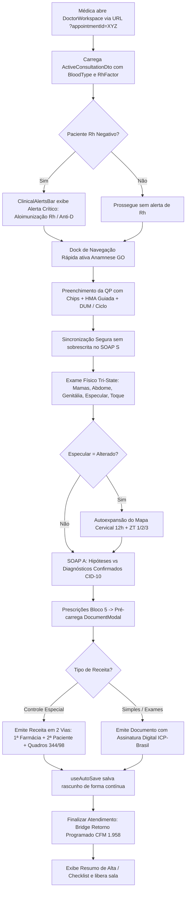
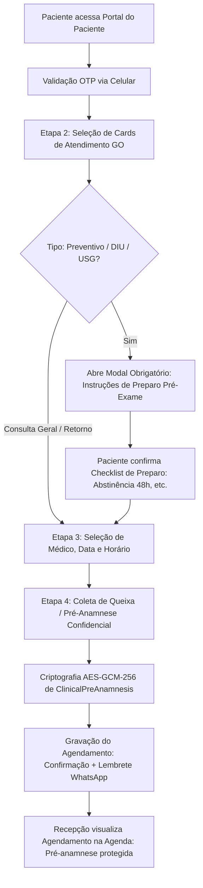
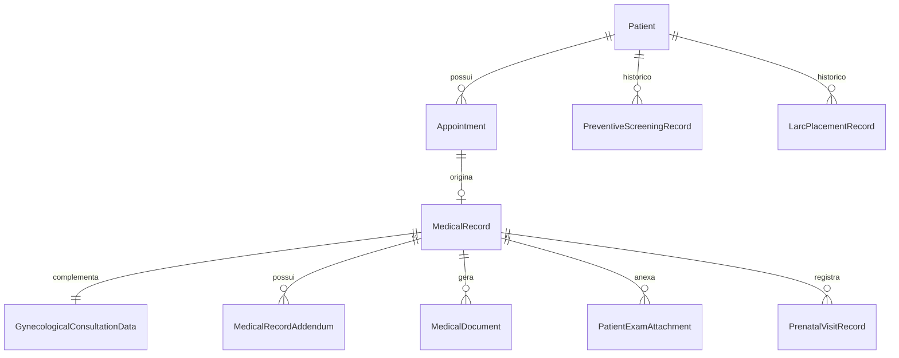

# SPEC-0035 — Consolidação do PEP Ginecológico & Obstétrico e Experiência de Agendamento do Paciente

| Campo | Valor |
| :--- | :--- |
| **ID** | SPEC-0035 |
| **Título** | Consolidação do PEP Ginecológico & Obstétrico e Experiência de Agendamento do Paciente |
| **Status** | Aprovada |
| **Versão** | 1.0 |
| **Data** | 2026-10-26 |
| **Autor** | Planejador e Arquiteto de Produto (Cana Med) |
| **Revisores** | Medical Systems Domain Expert, UI/UX Reviewer, Auditor Mestre GO |
| **Módulos afetados** | backend (Application, Domain, Infrastructure, Api) / frontend (Agenda, Medical, Patient, Styles) / banco (PostgreSQL, Migrations) |
| **ADRs relacionados** | ADR-0001, ADR-0002, ADR-0006, ADR-0007, ADR-0008, ADR-0010, ADR-0011 |

---

## 1. Objetivo

Esta especificação consolida e resolve de forma definitiva todos os apontamentos de segurança, conformidade médico-legal (LGPD, CFM, Lei nº 13.787/2018, Portaria SVS/MS nº 344/1998 e Resolução CFM nº 1.958/2010), risco clínico, identidade visual canônica e completude funcional do **Prontuário Eletrônico do Paciente (PEP) Ginecológico e Obstétrico** e da **Jornada de Agendamento (Portal da Paciente, Recepção e Totem/Kiosk)** da plataforma Cana Med Mulher.

Pergunta de controle do `GEMINI.md`: **Isso reduz atrito na rotina da clínica?**
**Sim, drasticamente.** A consolidação elimina o risco assistencial de falso-positivo no exame físico (modelo Tri-State), corrige a cegueira do alerta crítico de aloimunização em gestantes Rh negativo, blinda a privacidade da paciente no Totem e na Recepção, unifica os fluxos do consultório médico (dock rápido, pré-natal, preventivo, LARC e SOAP) em uma interface acolhedora com tokens oficiais (#008080 teal, #005F6A petróleo e #66CDAA menta), e automatiza a retenção com retorno programado e orientações pré-exame no agendamento.

---

## 2. Contexto

As auditorias especializadas conduzidas pelo `canamed-go-auditor` e as análises ergonômicas do `ui-ux-design-planner` diagnosticaram inconsistências críticas acumuladas nas implementações preliminares do sistema:
1. **Vulnerabilidades de Privacidade e Segurança Médico-Legal (P0):** O endpoint anônimo do Totem (`/api/v1/kiosk/{clinicId}/search`) permitia enumeração parcial de pacientes por termos genéricos; o interceptor de imutabilidade do EF Core não protegia registros vitais de pré-natal, rastreamento oncológico e DIU contra deleção física; o papel `Admin` detinha poderes clínicos irrestritos sem validação de CRM; receitas de controle especial eram emitidas em via única sem os campos obrigatórios da Portaria SVS/MS nº 344/98 e RDC ANVISA nº 44/2009; e pré-anamneses com dados íntimos de saúde ficavam desnecessariamente expostas a atendentes na Recepção.
2. **Falha Silenciosa de Alerta Clínico (P0):** No consultório médico (`DoctorWorkspace.tsx`), o alerta de risco de aloimunização Rh materno-fetal lia `rhFactor` e `bloodType` de `gynProfile`, onde tais atributos inexistem, fazendo com que gestantes Rh negativo nunca acionassem a vigilância clínica de Coombs indireto e profilaxia anti-D.
3. **Falso-Positivo no Exame Físico Ginecológico (P0):** Segmentos anatômicos (mamas, abdome, genitália, especular, toque) possuíam default booleano `true` ("Normal"), violando a diretriz de integridade do PEP e gerando falso registro de normalidade para procedimentos não executados na consulta.
4. **Desvio de Identidade Visual e Fragmentação Ergonômica:** Componentes da recepção e o arquivo `theme.css` utilizavam tokens residuais roxo/magenta (`#852A91`, `#D83C91`), desconectados da paleta oficial (#008080 / #005F6A / #66CDAA). O médico sofria com perda de estado em reloads, ausência de navegação rápida, falta de integração visual do cartão de pré-natal e rastreamento preventivo no cockpit do atendimento, e ausência de pré-carregamento de receitas emitidas.
5. **Atrito no Agendamento e Preparo Pré-Exame:** O Portal da Paciente apresentava dropdowns estéreis de agendamento sem instruções cruciais de preparo pré-exame (abstinência sexual, período menstrual, preparo de bexiga ou exames prévios para inserção de DIU), elevando cancelamentos e amostras inadequadas de Papanicolaou no laboratório.

---

## 3. Escopo

### 3.1. Dentro do escopo

#### Bloco 1 — Segurança, Conformidade Legal e Risco Clínico (P0):
- **Blindagem do Totem/Kiosk:** Reestruturação da busca em `KioskEndpoints.cs` e `KioskCheckInService.cs` exigindo CPF exato (11 dígitos válidos) OU documento (6 primeiros dígitos) + Data de Nascimento (`DateOnly birthDate`), com rate-limiting no endpoint e mascaramento prévio de dados.
- **Correção do Alerta de Gestante Rh Negativo:** Exposição de `patientBloodType` e `patientRhFactor` no DTO `ActiveConsultationDto` de `DoctorWorkspaceContracts.cs` e repasse correto em `DoctorWorkspace.tsx` para `ClinicalAlertsBar.tsx`.
- **Exame Físico Ginecológico Tri-State:** Substituição do modelo booleano binário por Tri-State (`NotEvaluated` [Não Avaliado - default], `Normal` [Sem Alterações], `Abnormal` [Alterado / Detalhar Achado]) nos 5 segmentos anatômicos em `GynecologicalConsultationData.cs`, contratos DTO e `GynecologicalExamSection.tsx`.
- **Extensão da Imutabilidade Clínica:** Proteção absoluta contra `DELETE` físico em `ImmutableRecordsInterceptor.cs` para `PrenatalVisitRecord`, `PreventiveScreeningRecord`, `LarcPlacementRecord` e `PatientExamAttachment`.
- **Segregação de Pré-Anamnese Clínica no Agendamento:** Campo `ClinicalPreAnamnesis` protegido com criptografia em repouso, exposto exclusivamente aos perfis com `RecordsRead` / `WorkspaceAccess` e oculto para operadores de recepção com `AgendaRead`.
- **Privilégio Mínimo no Papel Admin:** Remoção de permissões clínicas automáticas (`RecordsRead`, `RecordsCreate`, `RecordsFinalize`, `RecordsAddendum`, `DocumentsSign`, `WorkspaceAccess`) do papel `Admin` puro em `Roles.cs`, restringindo-as a usuários com papel `Professional` (médico com CRM ativo).
- **Receita de Controle Especial em 2 Vias (Portaria 344/98 e RDC 44/2009):** Emissão padronizada em 2 vias (1ª Via: Farmácia, 2ª Via: Paciente) com blocos de Identificação do Emitente, do Comprador e do Fornecedor em `DocumentModal.tsx`, e pré-carregamento automático dos medicamentos prescritos na consulta.

#### Bloco 2 — Identidade Visual Canônica e Ergonomia UI/UX:
- **Saneamento Visual Completo:** Erradicação de roxo/magenta legados em `frontend/src/styles/theme.css` e `AgendaRecepcaoPanel.tsx`, aplicando estritamente Verde Água Teal (`#008080`), Azul Petróleo (`#005F6A`) e Verde Menta (`#66CDAA`).
- **Cockpit do Consultório (`DoctorWorkspace.tsx`):**
  - Dock sticky lateral/superior de navegação rápida entre as seções do prontuário com indicador visual de preenchimento (`✓` preenchido, `○` não preenchido).
  - Persistência e restauração de contexto via URL query parameter (`?appointmentId=...` ou `?patientId=...`).
  - Sincronização segura QP/HMA ↔ SOAP `[S]` sem sobrescrita destrutiva de notas livres.
  - Sticky footer com status em tempo real do `useAutoSave` ("Gravado às HH:mm:ss", "Salvando...") e atalhos de finalização.
  - Modal de resumo de alta / pós-finalização com orientações, receitas emitidas e indicação de retorno.
- **Propagação do Modo Privacidade (`🕶️`):** Extensão do blur de campos íntimos para o Consultório e para a Ficha Clínica Longitudinal (`DoctorMedicalRecordsPage.tsx`).

#### Bloco 3 — Completude Clínica de Ginecologia e Obstetrícia no PEP (P1):
- **Segregação Estruturada no SOAP `[A]`:** Separação entre Hipóteses Diagnósticas Preliminares e Diagnósticos Confirmados com CID-10 em `SoapEvolutionSection.tsx`, persistindo em `DiagnosesJson`.
- **Mapeamento e Exposição de 1º Ultrassom:** Exposição completa dos campos `FirstUltrasoundDate`, `FirstUltrasoundWeeks`, `FirstUltrasoundDays`, `FirstUltrasoundCcnMm` e `PreferredGestationalReference` nos DTOs de `GynecologicalContracts.cs` e no método `Update(...)`.
- **Mapa Cervical 12h Estruturado:** Persistência em `GynecologicalConsultationData.cs` de achados de colposcopia/ectoscopia por quadrante/hora (1h–12h) e Zona de Transformação (ZT 1/2/3), com autoexpansão em `GynecologicalExamSection.tsx` quando o exame especular for marcado como `Alterado`.
- **Ativação End-to-End de Dispositivos LARC/DIU:** Endpoints REST dedicados para inserção e remoção de LARC vinculados à entidade `LarcPlacementRecord.cs`, integração na interface `GynecologicalProceduresSection.tsx` com histerometria, cálculo automático de validade (3/5/8/10 anos via `LarcDeviceCalculator.cs`) e agendamento de USG de controle em 30–45 dias.
- **Integração Nativa de Pré-Natal e Rastreamento Preventivo no Workspace:** Embed das seções `PrenatalCardSection` e `PreventiveScreeningList` no `DoctorWorkspace.tsx`, com cálculo automático da Idade Gestacional (IG) e atualização do `PrenatalCardPdfGenerator.cs` (paginação multifolha e coluna `FetalPresentation`).

#### Bloco 4 — Experiência de Agendamento GO e Diferenciais P2:
- **Portal da Paciente (`PatientPortal.tsx`):** Stepper em 4 etapas, Cards Visuais de Atendimento GO (*1ª Consulta*, *Retorno*, *Pré-Natal*, *Preventivo/Colposcopia*, *Inserção/Revisão de DIU*) e Checklist Obrigatório de Instruções de Preparo Pré-Exame.
- **Recepção Inteligente (`AppointmentForm.tsx` + `AgendaRecepcaoPanel.tsx`):** Autocomplete preditivo de pacientes (nome/CPF/telefone), detecção visual de choque de horários e Segmented Control acessível.
- **Bridge PEP ➔ Retorno Programado:** Ao finalizar a consulta com prazo de retorno assinalado (15d, 30–45d pós-DIU, 4 semanas em pré-natal, 1 ano para preventivo), provisionar alerta de retorno e envio de link/WhatsApp de agendamento em conformidade com a Resolução CFM nº 1.958/2010.
- **Esteira Trimestral de Exames/Vacinas Obstétricas e Curvas Fetais de Hadlock:** Matriz de exames e vacinas por trimestre gestacional (1º, 2º e 3º trimestres) e curvas biométricas fetais (PFE, CA, ILA).

### 3.2. Fora do escopo
- Módulos de Reprodução Assistida de alta complexidade (FIV, ICSI, ovodoação).
- Oncologia cirúrgica de alta complexidade (histerectomia radical, linfadenectomia pélvica).
- Algoritmos autônomos de prescrição ou diagnóstico automatizado (conformidade com ANVISA RDC nº 657/2022).
- Módulos de outras especialidades médicas não correlacionadas à saúde da mulher.

---

## 4. Atores e Permissões (RBAC)

A autorização é validada rigorosamente no backend por recurso (ADR-0008). A interface apenas reflete as permissões concedidas.

| Ator | Permissões Mínimas | Responsabilidades e Restrições |
| :--- | :--- | :--- |
| **Médica Ginecologista / Obstetra (`Professional`)** | `RecordsRead`, `RecordsCreate`, `RecordsUpdate`, `RecordsFinalize`, `RecordsAddendum`, `DocumentsRead`, `DocumentsCreate`, `DocumentsSign`, `WorkspaceAccess`, `AgendaReadOwn` | Acesso integral ao prontuário, preenchimento clínico, exame físico Tri-State, prescrição simples e de controle especial, mapa cervical, pré-natal, LARC e finalização de consultas. |
| **Recepcionista (`Receptionist`)** | `AgendaRead`, `AgendaWrite`, `ClinicRead`, `TriageRead`, `PaymentsRead`, `PaymentsWrite`, `CashierOperate` | Operação de agenda, check-in no balcão, autocomplete de cadastro, cobrança e visualização de tipo de consulta. **PROIBIDO** acesso a notas de evolução, exame físico, hipóteses diagnósticas e pré-anamnese clínica confidencial. |
| **Gestor da Clínica (`Manager`)** | `AgendaConfigure`, `UsersManage`, `ClinicManage`, `DashboardRead`, `PaymentsRefund`, `DpoManage` | Parametrização operacional de horários, convênios, taxas e gestão de usuários. Exige MFA (RN-010). Não possui acesso assistencial direto sem perfil médico associado. |
| **Administrador do Sistema (`Admin`)** | Permissões de infraestrutura, auditoria, governança e gestão global | Gestão técnica do sistema. **Não possui** permissões de leitura/assinatura clínica (`Records*`, `DocumentsSign`, `WorkspaceAccess`) para preservar o sigilo médico (CFM 1.821/2007 e LGPD Art. 11), a menos que possua explicitamente registro profissional médico vinculado. |
| **Paciente (`Patient` / Portal / Kiosk)** | Token de sessão OTP de paciente ou validação biométrica/documental restrita | Acesso ao agendamento online, leitura de preparo pré-exame, check-in autônomo (via CPF exato ou parcial + nascimento) e carteira de documentos próprios assinados. |

---

## 5. Regras de Negócio

| ID | Regra de Negócio | Justificativa / Origem |
| :--- | :--- | :--- |
| **RN-001** | **Blindagem de Enumeração no Totem:** A busca de agendamentos no totem de autoatendimento (`KioskEndpoints`) exige obrigatoriamente CPF exato com 11 dígitos válidos OU os 6 primeiros dígitos do CPF acompanhados da data de nascimento exata da paciente (`DateOnly birthDate`). Requisições com parâmetros genéricos (ex: 3 letras de nome ou 3 dígitos) devem retornar erro `400 Bad Request`. O endpoint deve limitar a 10 requisições por minuto por IP. | Segurança da Informação, LGPD Art. 6º (Segurança e Prevenção) e OWASP API Security Top 10 (Broken Object Level Authorization / Information Disclosure). |
| **RN-002** | **Alerta Mandatório de Gestante Rh Negativo:** Sempre que a paciente em atendimento no Consultório possuir `RhFactor` cadastrado como `'Negativo'` ou `'-'`, o barramento de alertas (`ClinicalAlertsBar.tsx`) deve renderizar com prioridade alta o alerta visual de risco de aloimunização materno-fetal, recomendando pesquisa de Coombs Indireto e profilaxia com Imunoglobulina Anti-D em 28 semanas ou pós-sangramento/procedimento invasivo. | Protocolo FEBRASGO e Ministério da Saúde para Gestação de Alto Risco / Prevenção de Doença Hemolítica Perinatal. |
| **RN-003** | **Exame Físico Ginecológico Tri-State:** Nenhum segmento anatômico (Mamas, Abdome, Genitália Externa, Exame Especular, Toque Bimanual) pode assumir default `true` ("Normal") ao criar o prontuário. O estado padrão é `NotEvaluated` (null). Se o profissional marcar `Abnormal` (Alterado), a descrição do achado torna-se obrigatória para gravação definitiva do registro. | Integridade Documental do PEP, CFM nº 1.821/2007 e prevenção de falsos registros de normalidade. |
| **RN-004** | **Imutabilidade Absoluta de Registros Gineco-Obstétricos:** Entidades clínicas especializadas (`MedicalRecord`, `MedicalRecordAddendum`, `GynecologicalConsultationData`, `MedicalDocument`, `AuditEvent`, `PrenatalVisitRecord`, `PreventiveScreeningRecord`, `LarcPlacementRecord` e `PatientExamAttachment`) são imutáveis após finalização e não podem sofrer deleção física (`DELETE`). Qualquer interceptação de exclusão gera `InvalidOperationException`. Retificações são admitidas apenas por Adendo Clínico assinado. | Lei nº 13.787/2018 (Guarda e Proteção de Prontuários Eletrônicos por 20 anos) e CFM nº 1.821/2007. |
| **RN-005** | **Segregação de Pré-Anamnese Clínica Confidencial:** No agendamento da paciente, queixas íntimas, sintomas ginecológicos ou histórico de saúde informado no ato da marcação são gravados no campo `ClinicalPreAnamnesis`, criptografado em repouso com AES-GCM-256 e acessível exclusivamente por profissionais com permissão `RecordsRead`/`WorkspaceAccess`. Operadores da recepção com permissão `AgendaRead` visualizam apenas anotações operacionais (`Notes`) e o tipo de serviço. | LGPD Art. 5º, II e Art. 11 (Tratamento de Dados Pessoais Sensíveis) e Código de Ética Médica Art. 73 (Sigilo Profissional). |
| **RN-006** | **Privilégio Mínimo e Segregação de Funções Administrativas:** O papel `Admin` não recebe automaticamente permissões de leitura ou criação de prontuários (`RecordsRead`, `RecordsCreate`, `RecordsFinalize`, `RecordsAddendum`, `DocumentsSign`, `WorkspaceAccess`). O acesso aos dados clínicos exige que o usuário possua perfil de profissional assistencial (`Professional`) e registro ativo no CRM. | Princípio do Menor Privilégio (Least Privilege), ISO/IEC 27001 e CFM nº 1.821/2007. |
| **RN-007** | **Receita de Controle Especial em Duas Vias Regulatórias:** Prescrições do tipo `receita_controle_especial` devem ser geradas obrigatoriamente em 2 vias identificadas (`1ª VIA — RETENÇÃO DA FARMÁCIA` e `2ª VIA — ORIENTAÇÃO DA PACIENTE`), contendo campos formais para Identificação do Emitente (com CRM), Identificação do Comprador (Nome, RG, CPF, Endereço, Fone) e Identificação do Fornecedor/Farmácia (CRF, Lote, Assinatura e Data). Medicamentos inseridos no bloco de prescrições da consulta devem ser pré-carregados no modal de emissão. | Portaria SVS/MS nº 344/1998, RDC ANVISA nº 44/2009 e Lei Federal nº 5.991/1973. |
| **RN-008** | **Padronização Estrita do Design System (Anti-Purple):** Nenhuma tela, componente, estilo ou token do frontend pode utilizar variações de roxo/magenta (`#852A91`, `#D83C91`, lilás). As únicas cores de marca admitidas são Verde Água Teal (`#008080`), Azul Petróleo (`#005F6A`) e Verde Menta (`#66CDAA`), combinadas com cinzas neutros de alto contraste WCAG AA. | `GEMINI.md` (Identidade Visual Obrigatória) e Guia Canônico de Marca Cana Med Mulher. |
| **RN-009** | **Resiliência do Workspace e Persistência de Contexto na URL:** A consulta ativa deve manter seu identificador sincronizado na URL (`?appointmentId=...` ou `?patientId=...`). Em caso de recarregamento acidental da página pelo navegador, o workspace deve restaurar o estado da consulta e os dados em edição através do rascunho salvo no cache/backend. | Usabilidade Clínica, Prevenção de Perda de Dados e Ergonomia Ambulatorial. |
| **RN-010** | **Sincronização Segura e Não Destrutiva entre Anamnese e SOAP:** A seleção de chips de queixa ou inserção de snippets na História da Moléstia Atual (HMA) não pode sobrescrever textos clínicos digitados livremente pela médica no campo Subjetivo do SOAP. A concatenação deve respeitar separadores explícitos ou mesclagem inteligente. | Integridade do Raciocínio Clínico e Segurança do Paciente. |
| **RN-011** | **Segregação Diagnóstica SOAP [A] (Hipóteses vs. Confirmados):** No bloco de Avaliação do SOAP, o sistema deve segregar explicitamente hipóteses diagnósticas preliminares de diagnósticos médicos confirmados com código CID-10, persistindo na estrutura JSON correspondente. Hipóteses nunca podem ser exibidas em atestados ou documentos públicos como diagnósticos definitivos. | ANVISA RDC nº 657/2022 e CFM nº 2.217/2018 (Código de Ética Médica). |
| **RN-012** | **Cálculo Gestacional Reconciliado (DUM vs. USG 1º Trimestre):** A Idade Gestacional (IG) e a Data Provável do Parto (DPP) devem ser calculadas automaticamente pela DUM (Regra de Naegele) e pelo Ultrassom precoce com CCN. Havendo discrepância superior a 5 dias (até 9 semanas) ou 7 dias (até 13+6 semanas), o sistema deve sugerir a reconciliação preferencial pela datação ultrassonográfica, registrando o critério adotado em `PreferredGestationalReference`. | Consenso FEBRASGO e ACOG (American College of Obstetricians and Gynecologists). |
| **RN-013** | **Rastreabilidade de Procedimento LARC/DIU:** A inserção ou remoção de DIU/Implante exige o registro do tipo de dispositivo, número do lote do fabricante, histerometria uterina (cm), via de inserção, intercorrências e validade recomendada calculada automaticamente (Cobre: 10a, Cobre+Prata: 5a, Mirena: 8a, Kyleena: 5a, Implanon: 3a). O sistema deve programar automaticamente a indicação de USG transvaginal de controle em 30 a 45 dias. | Protocolos Clínicos e Diretrizes Terapêuticas (PCDT) - Contracepção Reversível de Longa Duração e Rastreabilidade ANVISA. |
| **RN-014** | **Checklist Obrigatório de Preparo Pré-Exame no Agendamento:** Agendamentos de consultas com coleta de Papanicolaou, Colposcopia, Inserção de DIU ou Ultrassonografia exigem a leitura e confirmação expressa do checklist de preparo (48h de abstinência sexual, ausência de cremes vaginais, janela fora da menstruação para citopatologia; preparo vesical para ultrassom; teste de gravidez/período menstrual para DIU). O agendamento só conclui após o consentimento do titular. | Qualidade de Amostras Citopatológicas (Diretrizes Brasileiras para o Rastreamento do Câncer do Colo do Útero - INCA) e Eficiência da Agenda. |
| **RN-015** | **Retorno Programado e Conformidade CFM 1.958/2010:** Ao concluir a consulta no consultório, a indicação médica de retorno (15 dias para exames complementares, 30–45 dias pós-LARC, 4 semanas pré-natal, 1 ano rotina) gera automaticamente um registro na fila de retornos e dispara link/notificação para a paciente efetuar o agendamento dentro do prazo regulamentar sem cobrança de nova consulta. | Resolução CFM nº 1.958/2010 e Código de Defesa do Consumidor. |

---

## 6. Fluxos do Sistema

### 6.1. Fluxo Principal de Atendimento no Cockpit do Consultório (F-001)



### 6.2. Fluxo de Agendamento Inteligente com Preparo Pré-Exame (F-002)



### 6.3. Fluxo de Check-in Blindado no Totem / Kiosk (F-003)

```mermaid
flowchart TD
    K1[Paciente chega à clínica e acessa Totem] --> K2[Tela de Busca: Solicita CPF Completo ou 6 Dígitos + Data Nasc]
    K2 --> K3{Rate-Limit Validado?}
    K3 -- Não (excesso de reqs) --> K4[Bloqueio temporário: 429 Too Many Requests]
    K3 -- Sim --> K5{Validação dos Parâmetros}
    K5 -- Inválido / Genérico --> K6[Erro 400: Informe CPF válido ou dados complementares]
    K5 -- CPF Exato ou 6 Dígitos + Nasc --> K7[Busca agendamento do dia para a clínica]
    K7 --> K8{Encontrou agendamento?}
    K8 -- Não --> K9[Mensagem acolhedora: Agendamento não localizado. Procure a recepção.]
    K8 -- Sim --> K10[Exibe dados mascarados: M**** S**** - 14:00 com Dr(a). X]
    K10 --> K11[Paciente clica em Confirmar Presença]
    K11 --> K12[Emite Senha de Espera + Notifica Recepção e Painel TV]
```

---

## 7. Modelo de Dados & LGPD

### 7.1. Entidades Afetadas e Novos Atributos



#### 1. Entidade `GynecologicalConsultationData` (`backend/src/Canamed.Domain/MedicalRecords/GynecologicalConsultationData.cs`)
Modificações para suporte a Exame Físico Tri-State, Mapa Cervical e 1º Ultrassom:

| Campo | Tipo | Nulo? | Classificação LGPD | Descrição e Regra |
| :--- | :--- | :--- | :--- | :--- |
| `BreastsStatus` | `string` | Sim | Sensível (Saúde) | `'NotEvaluated'`, `'Normal'`, `'Abnormal'`. Default nulo (não avaliado). |
| `AbdomenStatus` | `string` | Sim | Sensível (Saúde) | `'NotEvaluated'`, `'Normal'`, `'Abnormal'`. Default nulo. |
| `ExternalGenitaliaStatus` | `string` | Sim | Sensível (Saúde) | `'NotEvaluated'`, `'Normal'`, `'Abnormal'`. Default nulo. |
| `SpeculumExamStatus` | `string` | Sim | Sensível (Saúde) | `'NotEvaluated'`, `'Normal'`, `'Abnormal'`. Default nulo. |
| `BimanualPalpationStatus` | `string` | Sim | Sensível (Saúde) | `'NotEvaluated'`, `'Normal'`, `'Abnormal'`. Default nulo. |
| `CervicalClockFindingsJson`| `string` | Sim | Sensível (Saúde) | JSON estruturado com achados colposcópicos em 12h e classificação da Zona de Transformação (`ZT1`, `ZT2`, `ZT3`). |
| `FirstUltrasoundDate` | `DateOnly` | Sim | Sensível (Saúde) | Data de realização do 1º USG obstétrico. |
| `FirstUltrasoundWeeks` | `int` | Sim | Sensível (Saúde) | Idade gestacional em semanas no 1º USG. |
| `FirstUltrasoundDays` | `int` | Sim | Sensível (Saúde) | Idade gestacional em dias no 1º USG. |
| `FirstUltrasoundCcnMm` | `double` | Sim | Sensível (Saúde) | Comprimento Cabeça-Nádega (CCN) em milímetros. |
| `PreferredGestationalReference` | `string` | Sim | Sensível (Saúde) | `'Dum'` ou `'FirstUltrasound'`. Define a referência oficial de cálculo. |

#### 2. Entidade `Appointment` (`backend/src/Canamed.Domain/Agenda/Appointment.cs`)
Modificações para segregação de pré-anamnese e orientações de preparo:

| Campo | Tipo | Nulo? | Classificação LGPD | Descrição e Regra |
| :--- | :--- | :--- | :--- | :--- |
| `ClinicalPreAnamnesis` | `string` | Sim | Sensível (Saúde) | Queixa confidencial informada pela paciente no agendamento. Criptografada em repouso. Oculta para `AgendaRead`. |
| `PreExamInstructionsAcknowledged`| `bool` | Não | Comum | `true` quando a paciente confirmou a leitura do checklist de preparo pré-exame. |
| `PlannedReturnDays` | `int` | Sim | Comum | Prazo previsto para retorno sem ônus (CFM 1.958/2010), ex: 15, 30, 365. |

#### 3. Entidade `LarcPlacementRecord` (`backend/src/Canamed.Domain/MedicalRecords/LarcPlacementRecord.cs`)
Preservada com proteção de imutabilidade no interceptor:

| Campo | Tipo | Nulo? | Classificação LGPD | Descrição e Regra |
| :--- | :--- | :--- | :--- | :--- |
| `DeviceType` | `string` | Não | Sensível (Saúde) | Tipo do dispositivo (ex: `'CopperIud'`, `'Mirena'`, `'Kyleena'`, `'Implanon'`). |
| `LotNumber` | `string` | Não | Sensível (Saúde) | Número do lote do dispositivo inserido. |
| `HysterometryCm` | `decimal`| Não | Sensível (Saúde) | Medida uterina em centímetros aferida por histerômetro. |
| `InsertionDate` | `DateOnly` | Não | Sensível (Saúde) | Data da inserção. |
| `ExpirationDate` | `DateOnly` | Não | Sensível (Saúde) | Validade máxima calculada pelo `LarcDeviceCalculator`. |
| `ControlUltrasoundScheduledDate`| `DateOnly` | Sim | Sensível (Saúde) | Data recomendada do USG de revisão (30 a 45 dias). |
| `RemovedAt` | `DateTimeOffset` | Sim | Sensível (Saúde) | Data e hora da remoção do dispositivo. |
| `RemovalReason` | `string` | Sim | Sensível (Saúde) | Motivo da retirada (desejo de gestar, expiração, efeito adverso). |

### 7.2. Política de Retenção e LGPD
- **Prazo de Retenção:** Todos os dados clínicos, evoluções, exames e documentos gerados no PEP devem ser mantidos por no mínimo **20 anos** a partir do último registro da paciente, em cumprimento estrito ao Art. 6º da Lei nº 13.787/2018 e Resoluções CFM nº 1.821/2007 e 2.217/2018.
- **Exclusão de Dados Pessoais:** O direito de eliminação de dados (Art. 18, VI da LGPD) **não se aplica** ao prontuário médico em virtude de dever legal regulatório de guarda (Art. 16, I da LGPD). Pedidos do titular podem anonimizar apenas dados cadastrais secundários ou canais de contato após expiração dos prazos legais.
- **Criptografia em Repouso:** Os campos sensíveis de saúde (`ClinicalPreAnamnesis`, evoluções SOAP e laudos anexos) devem ser criptografados no banco de dados via provedor de criptografia de aplicação ou extensões de persistência seguras (AES-256).

---

## 8. Contrato de API

### 8.1. Endpoints do Kiosk / Totem Blindados

#### `GET /api/v1/kiosk/{clinicId}/search`
- **Autorização:** `AllowAnonymous` (com proteção por IP rate-limiting: máx. 10 req/min).
- **Parâmetros Query:**
  - `cpf`: string de 11 dígitos numéricos (Obrigatório, exceto se fornecido `cpfPartial` + `birthDate`).
  - `cpfPartial`: string com os 6 primeiros dígitos do CPF (Opcional).
  - `birthDate`: `DateOnly` no formato `AAAA-MM-DD` (Obrigatório se utilizado `cpfPartial`).
- **Respostas:**
  - `200 OK`: Lista de agendamentos com dados estritamente mascarados:
    ```json
    [
      {
        "appointmentId": "3fa85f64-5717-4562-b3fc-2c963f66afa6",
        "maskedPatientName": "M**** S****",
        "startsAt": "2026-10-26T14:00:00-03:00",
        "professionalName": "Dra. Helena Martins",
        "appointmentType": "Consulta Ginecológica",
        "canCheckIn": true
      }
    ]
    ```
  - `400 Bad Request`: `{"title": "Parâmetros de busca insuficientes", "detail": "Informe o CPF completo (11 dígitos) ou os 6 primeiros dígitos com a data de nascimento."}`
  - `429 Too Many Requests`: `{"title": "Limite de tentativas excedido", "detail": "Aguarde 1 minuto antes de tentar novamente."}`

### 8.2. Endpoint do Workspace Médico Atualizado

#### `GET /api/v1/doctor-workspace/state`
- **Autorização:** `Permissions.WorkspaceAccess`.
- **Payload de Resposta (`DoctorWorkspaceStateResponse`):**
  Adição explícita dos campos sanguíneos na consulta ativa:
  ```json
  {
    "doctorId": "guid",
    "doctorName": "Dra. Helena Martins",
    "clinicId": "guid",
    "activeRoomId": "guid",
    "activeConsultation": {
      "queueEntryId": "guid",
      "patientId": "guid",
      "patientName": "Maria Silva Santos",
      "patientBirthDate": "1994-05-18",
      "patientBloodType": "O",
      "patientRhFactor": "Negativo",
      "allergies": "Dipirona",
      "chronicConditions": "Nenhuma",
      "healthPlanName": "Unimed",
      "triage": {
        "bloodPressure": "110/70",
        "glucose": 84
      },
      "medicalRecord": {
        "id": "guid",
        "status": "em_atendimento"
      },
      "startedAt": "2026-10-26T14:15:00-03:00"
    },
    "waitingQueue": []
  }
  ```

### 8.3. Endpoints de Dados Ginecológicos e LARC

#### `PUT /api/v1/medical-records/{id}/gynecological-data`
- **Autorização:** `Permissions.RecordsUpdate`.
- **Payload (`UpdateGynecologicalConsultationDataRequest`):**
  ```json
  {
    "dum": "2026-09-15",
    "isDumUncertain": false,
    "isMenopausal": false,
    "chiefComplaint": "Rotina e preventivo anual",
    "hma": "Paciente assintomática, nega queixas de dor ou corrimento.",
    "isSexuallyActive": true,
    "dyspareunia": "Ausente",
    "breastsStatus": "Normal",
    "breastsFindings": null,
    "abdomenStatus": "Normal",
    "abdomenFindings": null,
    "externalGenitaliaStatus": "Normal",
    "externalGenitaliaFindings": null,
    "speculumExamStatus": "Abnormal",
    "speculumExamFindings": "Colo uterino com ectopia periorificial e teste de Schiller positivo às 6h.",
    "bimanualPalpationStatus": "Normal",
    "bimanualPalpationFindings": null,
    "cervicalClockFindingsJson": "{\"hours\":[6],\"finding\":\"Epitélio acetobranco denso\",\"transformationZone\":\"ZT2\"}",
    "firstUltrasoundDate": "2026-08-10",
    "firstUltrasoundWeeks": 8,
    "firstUltrasoundDays": 3,
    "firstUltrasoundCcnMm": 19.5,
    "preferredGestationalReference": "FirstUltrasound",
    "procedurePerformed": "Coleta citopatológica oncótica",
    "procedureBatch": "LOTE-2026-09",
    "procedureNotes": "Espécime representativo fixado imediatamente.",
    "diagnosesJson": "[{\"code\":\"N86\",\"description\":\"Erosão e ectrópio do colo do útero\",\"category\":\"confirmed\"},{\"code\":\"N72\",\"description\":\"Suspeita de cervicite\",\"category\":\"hypothesis\"}]",
    "prescriptionNotes": "Metronidazol 500mg gel vaginal à noite por 7 dias.",
    "generalOrientationNotes": "Retorno em 15 dias para avaliação do laudo citopatológico."
  }
  ```

#### `POST /api/v1/patients/{patientId}/larc-records`
- **Autorização:** `Permissions.RecordsCreate`.
- **Payload:**
  ```json
  {
    "medicalRecordId": "guid",
    "deviceType": "Mirena",
    "lotNumber": "LOT84920",
    "hysterometryCm": 7.5,
    "insertionDate": "2026-10-26",
    "notes": "Procedimento sem intercorrências. Fios cortados em 2.5 cm."
  }
  ```
- **Resposta (`201 Created`):**
  Retorna registro com `expirationDate` calculada automaticamente para 2034-10-26 (8 anos) e `controlUltrasoundScheduledDate` para 2026-11-26 (30 dias).

---

## 9. Interface e Experiência do Usuário (UI/UX)

### 9.1. Tokens Oficiais Inegociáveis (Cana Med Mulher)

Todos os estilos devem respeitar rigorosamente os tokens oficiais da marca:
```css
:root {
  /* Marca Oficial Cana Med Mulher */
  --brand-primary: #008080;        /* Verde Água Teal - Ação principal, tabs ativas, links */
  --brand-dark: #005F6A;           /* Azul Petróleo Institucional - Headers, títulos, bordas estruturais */
  --brand-accent: #66CDAA;         /* Verde Menta - Destaques positivos, badges de sucesso, anéis de foco */
  --brand-soft: #E6F3F3;           /* Verde Água Suave - Fundo de itens selecionados, cards ativos */
  --brand-soft-menta: #F0FDF9;     /* Menta Suave - Fundos de alertas positivos e confirmações */

  /* Neutral Base & Content */
  --base-bg: #F7F9FA;              /* Fundo geral da página */
  --base-surface: #FFFFFF;         /* Superfície de cartões e modais */
  --base-border: #E2E8F0;          /* Bordas de inputs e divisores */
  --content-primary: #1A202C;      /* Texto principal de alta legibilidade */
  --content-secondary: #4A5568;    /* Rótulos e textos auxiliares */
  --content-muted: #718096;        /* Placeholders e legendas */

  /* Semântica Clínica */
  --clinical-alert-rh: #D97706;     /* Âmbar - Alerta Rh Negativo */
  --clinical-alert-danger: #E53E3E; /* Vermelho - Hipertensão gestacional e DMG */
  --clinical-success: #38A169;      /* Verde clínico - Salvo / Normal */
}
```

### 9.2. Cockpit do Consultório (`DoctorWorkspace.tsx`)
1. **Dock Sticky de Navegação Rápida:**
   - Posicionado no topo ou na lateral da área de trabalho clínica.
   - 5 Seções com atalhos de teclado (`Alt+1` a `Alt+5`) e indicadores de preenchimento:
     - `1. Anamnese GO` (`✓` verde menta se preenchida QP e DUM)
     - `2. Exame Físico` (`✓` se avaliado ao menos um segmento)
     - `3. Rastreamento & Pré-Natal` (exibe badge com IG calculada)
     - `4. SOAP & Diagnósticos` (`✓` se preenchido diagnóstico)
     - `5. Prescrições & Fechamento` (`✓` se receitas geradas)
2. **Exame Físico Tri-State Segregado:**
   - Cada segmento anatômico apresenta um grupo de 3 botões estilizados:
     - `[ ⚪ Não Avaliado ]` (default: neutro)
     - `[ 🟢 Normal ]` (fundo mint suave `#F0FDF9`, borda teal)
     - `[ 🟠 Alterado ]` (fundo âmbar suave, auto-abre textarea para detalhamento do achado)
3. **Modo Privacidade (`🕶️`):**
   - Botão fixo no cabeçalho do workspace e da ficha longitudinal.
   - Aplica classe CSS com `filter: blur(8px)` imediato em queixa, histórico reprodutivo, exame físico e notas confidenciais. Ao passar o mouse com clique seguro, revela pontualmente.

### 9.3. Portal do Paciente (`PatientPortal.tsx`)
1. **Cards Visuais de Atendimento GO (Etapa 2):**
   - Substituem dropdown simples por grade de cartões ilustrados com ícones acolhedores e tempo estimado:
     - 🩺 **1ª Consulta Ginecológica** (Anamnese completa e exame preventivo - 45 min)
     - 🔄 **Retorno de Exames** (Reavaliação de exames solicitados - 20 min)
     - 🤰 **Consulta Pré-Natal** (Acompanhamento gestacional e curva fetal - 40 min)
     - 🔬 **Preventivo / Papanicolaou** (Coleta oncótica e colposcopia - 30 min)
     - 🌀 **Inserção / Revisão de DIU** (Avaliação ou colocação de LARC - 40 min)
2. **Modal de Checklist de Preparo Pré-Exame:**
   - Apresentado imediatamente após selecionar serviços que exigem preparo (Preventivo, DIU, Ultrassom).
   - Caixas de marcação interativas:
     - `[ ] Não tive relações sexuais nas últimas 48 horas.`
     - `[ ] Não fiz uso de pomadas, cremes ou duchas vaginais nos últimos 2 dias.`
     - `[ ] Estou fora do período de sangramento menstrual.`
     - `[ ] Trago exames anteriores ou teste de gravidez recente (quando aplicável).`
   - O botão "Continuar Agendamento" permanece inativo até a confirmação de todos os itens essenciais.

---

## 10. Critérios de Aceitação (Gherkin)

### CA-001 — Blindagem contra Enumeração de Pacientes no Totem
```gherkin
Cenário: Tentativa de busca no totem com termo genérico
  Dado que um usuário não autenticado envia requisição GET para "/api/v1/kiosk/{clinicId}/search?q=Maria"
  Quando o backend processar a solicitação
  Então deve responder com código 400 Bad Request
  E a mensagem de erro deve exigir CPF completo ou documento acompanhado de data de nascimento.

Cenário: Busca válida no totem com CPF exato
  Dado que uma paciente possui agendamento confirmado para o dia atual com CPF "12345678901"
  Quando o totem enviar GET para "/api/v1/kiosk/{clinicId}/search?cpf=12345678901"
  Então deve responder com status 200 OK
  E o retorno deve conter o nome mascarado "M**** S****"
  E nenhuma informação sensível de saúde ou documento completo deve ser exposta.
```

### CA-002 — Disparo Correto do Alerta de Gestante Rh Negativo
```gherkin
Cenário: Médica abre consulta de gestante com fator Rh negativo
  Dado que a paciente ativa possui "RhFactor" igual a "Negativo" em seu cadastro
  Quando a médica carregar a consulta ativa no "DoctorWorkspace"
  Então o DTO "ActiveConsultationDto" deve transportar "patientRhFactor" igual a "Negativo"
  E o componente "ClinicalAlertsBar" deve renderizar em destaque o alerta "Gestante Rh Negativo"
  E a orientação de profilaxia Anti-D e checagem de Coombs Indireto deve estar visível.
```

### CA-003 — Exame Físico Tri-State sem Falso-Positivo Default
```gherkin
Cenário: Criação de novo prontuário ginecológico
  Dado que uma nova consulta ginecológica é iniciada
  Quando os dados de "GynecologicalConsultationData" forem instanciados
  Então os campos "BreastsStatus", "AbdomenStatus", "ExternalGenitaliaStatus", "SpeculumExamStatus" e "BimanualPalpationStatus" devem iniciar como nulos (NotEvaluated)
  E nenhum segmento deve iniciar gravado silenciosamente como "Normal".

Cenário: Registro de segmento anatômico alterado
  Dado que a médica seleciona o estado "Alterado" no exame especular
  Quando o formulário for submetido sem descrição de achados
  Então a gravação deve ser bloqueada com alerta de validação exigindo o detalhamento do achado.
```

### CA-004 — Bloqueio de Exclusão Física em Registros Imutáveis
```gherkin
Cenário: Tentativa indevida de deleção de registro de pré-natal ou DIU
  Dado que existem registros salvos de "PrenatalVisitRecord" ou "LarcPlacementRecord"
  Quando qualquer operação tentar executar "DbContext.Remove(registro)"
  Então o "ImmutableRecordsInterceptor" deve interceptar a operação
  E lançar "InvalidOperationException" com a mensagem canônica da Lei nº 13.787/2018
  E nenhum registro deve ser deletado fisicamente do banco de dados.
```

### CA-005 — Emissão de Receita de Controle Especial em Duas Vias
```gherkin
Cenário: Emissão e impressão de receita de controle especial
  Dado que a médica emite uma receita do tipo "receita_controle_especial"
  Quando o documento for renderizado para impressão no "DocumentModal"
  Então o modelo deve conter explicitamente a "1ª VIA — RETENÇÃO DA FARMÁCIA" e a "2ª VIA — ORIENTAÇÃO DA PACIENTE"
  E ambas as vias devem incluir os quadros de "Identificação do Emitente", "Identificação do Comprador" e "Identificação do Fornecedor"
  E os medicamentos prescritos na consulta devem vir automaticamente pré-carregados no modal.
```

### CA-006 — Segregação de Pré-Anamnese na Recepção
```gherkin
Cenário: Operador da recepção visualiza agendamento com pré-anamnese confidencial
  Dado que a paciente preencheu sua queixa íntima no agendamento do portal
  Quando um operador com permissão "AgendaRead" (sem "RecordsRead") carregar o agendamento
  Então o campo "ClinicalPreAnamnesis" deve ser retornado como nulo ou mascarado pelo backend
  E a recepção deve visualizar apenas as notas operacionais administrativas.
```

---

## 11. Casos de Erro

| ID | Gatilho | Comportamento do Sistema | Mensagem Apresentada ao Usuário | Registro em Auditoria |
| :--- | :--- | :--- | :--- | :--- |
| **ER-001** | Busca no totem com menos de 11 dígitos sem data de nascimento. | Rejeita a busca imediatamente sem consultar o banco de agendamentos. | "Para sua segurança, digite seu CPF completo de 11 dígitos ou informe sua data de nascimento." | `AuditEvent`: Ação `KioskSearchDenied`, motivo `MissingRequiredFactors`. |
| **ER-002** | Excesso de requisições por IP no totem (> 10 req/min). | Bloqueia novas tentativas pelo tempo de resfriamento (rate-limit). | "Muitas tentativas em sequência. Por favor, aguarde um minuto ou dirija-se à recepção." | `AuditEvent`: Ação `RateLimitExceeded`, IP registrado. |
| **ER-003** | Tentativa de submissão de exame ginecológico marcado como `Abnormal` sem achados. | Impede gravação do exame físico e foca no campo de texto de achados do segmento correspondente. | "Por favor, detalhe as alterações encontradas no segmento marcado como alterado." | Não grava no backend; validação em formulário. |
| **ER-004** | Tentativa de exclusão física de registro de DIU, Pré-natal ou Prontuário. | O interceptor aborta o `SaveChanges` e reverte a transação no EF Core. | "Erro de integridade: registros de prontuário e procedimentos são invioláveis e imutáveis." | `AuditEvent`: Ação `SecurityViolationAttempt`, entidade bloqueada. |
| **ER-005** | Tentativa de agendamento no portal sem assinalar o checklist obrigatório de preparo. | Mantém o botão de envio desabilitado com indicador visual nos itens pendentes. | "É necessário confirmar que você compreendeu as orientações de preparo para este exame." | Nenhum log; validação de UI. |

---

## 12. Impacto em Outras Funcionalidades

| Funcionalidade / Módulo | Tipo de Impacto | Ação Necessária |
| :--- | :--- | :--- |
| `DoctorWorkspaceEndpoints` / `DoctorWorkspaceService` | Direto | Expor `patientBloodType` e `patientRhFactor` no DTO `ActiveConsultationDto`. |
| `GynecologicalConsultationData` | Direto | Migrar campos de exame físico para suporte Tri-State e expor dados de 1º USG e Mapa Cervical. |
| `ImmutableRecordsInterceptor` | Direto | Incluir `PrenatalVisitRecord`, `PreventiveScreeningRecord`, `LarcPlacementRecord` e `PatientExamAttachment` no método `IsImmutableEntity`. |
| `Roles.cs` / `Permissions.cs` | Direto | Remover concessão automática de permissões clínicas para o papel `Admin`. |
| `KioskEndpoints` / `KioskCheckInService` | Direto | Modificar regra de filtro para exigir CPF exato ou 6 dígitos + Data Nasc. |
| `frontend/src/styles/theme.css` | Direto | Substituir referências legadas `#852A91` / `#D83C91` por tokens oficiais `#008080` e `#005F6A`. |
| `DocumentModal.tsx` | Direto | Implementar layout de 2 vias com quadros da Portaria 344/98 e pré-carregar medicamentos. |
| `PatientPortal.tsx` | Direto | Introduzir stepper de 4 etapas, cards de serviços GO e modal de instruções de preparo. |
| `PrenatalCardPdfGenerator.cs` | Direto | Adicionar coluna `FetalPresentation` e paginação multifolha para histórico longo. |

---

## 13. Requisitos de Segurança

- [x] **Autorização no Backend por Recurso:** Todas as rotas de prontuário, documentos e histórico de LARC validam explicitamente as permissões RBAC no ASP.NET Core (`Permissions.Records*`, `Permissions.WorkspaceAccess`).
- [x] **Privilégio Mínimo no Papel Admin:** O perfil administrativo não herda permissões de leitura/assinatura clínica sem habilitação profissional médica com CRM.
- [x] **Proteção contra Enumeração e Scraping:** Totem e endpoints públicos contam com validação estrita de múltiplos fatores de busca e limitação de taxa por IP.
- [x] **Criptografia em Repouso e Trânsito:** TLS 1.3 obrigatório para todas as comunicações; dados íntimos de pré-anamnese e prontuário protegidos em repouso.
- [x] **Inviolabilidade e Auditoria Contínua:** Imutabilidade estrita via interceptor EF Core e trilha append-only para criação, retificação, visualização e exportação de dados clínicos.
- [x] **Zero Dados Sensíveis em Logs:** Nenhum nome, CPF, queixa clínica ou resultado de exame é registrado em logs de aplicação ou console.

---

## 14. Requisitos Legais Aplicáveis

| Norma | Aplicável? | O que exige nesta funcionalidade |
| :--- | :--- | :--- |
| **LGPD (Lei nº 13.709/2018)** | Sim | Art. 5º, II e Art. 11: Tratamento rigoroso de dados sensíveis de saúde; segregação de queixa confidencial na recepção; ausência de dados de saúde em telas do totem. |
| **Lei nº 13.787/2018** | Sim | Integridade, autenticidade, confidencialidade e guarda mínima de 20 anos para prontuários eletrônicos; proibição de exclusão física de registros clínicos. |
| **Resolução CFM nº 1.821/2007** | Sim | Normas técnicas para prontuário eletrônico: assinatura digital, rastreabilidade, identificação inequívoca do profissional e correções apenas por adendo. |
| **Código de Ética Médica (CFM nº 2.217/2018)** | Sim | Art. 73: Dever de sigilo médico profissional; proibição de revelar diagnósticos ou fatos clínicos a terceiros sem autorização expressa. |
| **Portaria SVS/MS nº 344/1998 e RDC 44/2009** | Sim | Emissão obrigatória em 2 vias com retenção da farmácia e identificação completa do emitente, comprador e fornecedor para medicamentos sob controle especial. |
| **Resolução CFM nº 1.958/2010** | Sim | Regulamentação da consulta médica e critérios de retorno ambulatorial para avaliação de exames complementares sem cobrança de novos honorários. |
| **ANVISA RDC nº 657/2022** | Sim | Plataforma atua como ferramenta de gestão clínica e suporte documental, sem automação de diagnósticos médicos independentes (não SaMD). |

---

## 15. Requisitos Não Funcionais

| Categoria | Requisito |
| :--- | :--- |
| **Desempenho** | Tempo de resposta para busca de agendamento no totem < 200ms; tempo de carga do workspace médico com ficha completa < 500ms; salvamento em background (`useAutoSave`) < 300ms. |
| **Resiliência** | Perda zero de dados em caso de falha de conexão ou fechamento acidental da aba, com rascunho recuperável por `appointmentId`. |
| **Acessibilidade & Ergonomia** | Relação de contraste WCAG 2.1 AA (mínimo 4.5:1 para texto padrão e 3:1 para componentes visuais); navegação completa por teclado com atalhos de dock. |
| **Observabilidade** | Métricas de tempo de resposta dos endpoints de consulta e logs estruturados de auditoria médica sem vazamento de PII. |

---

## 16. Testes Previstos

| Tipo | Cobertura Mínima Obrigatória |
| :--- | :--- |
| **Unitário (Backend)** | Validação da busca blindada no `KioskCheckInServiceTests`; interceptação de deleção em `ImmutableRecordsInterceptorTests`; cálculo de validade LARC em `LarcDeviceCalculatorTests`; mapeamento de `PatientBloodType` em `DoctorWorkspaceTests`. |
| **Integração (Backend)** | Endpoints de LARC (`POST/GET/PUT`); atualização de exame físico Tri-State e Mapa Cervical em `GynecologicalDataEndpointsTests`; restrição de permissão do papel `Admin`. |
| **Componentes (Frontend)** | `ClinicalAlertsBar.test.tsx` (alerta Rh Negativo disparado com prop de paciente); `GynecologicalExamSection.test.tsx` (Tri-State buttons e abertura de textarea); `DocumentModal.test.tsx` (renderização das 2 vias de controle especial e pré-carregamento); `AgendaRecepcaoPanel.test.tsx` (ausência de queixa íntima e tokens oficiais). |
| **Regressão** | Verificação de ausência total de `#852A91` e `#D83C91` em todos os arquivos de estilo e componentes do frontend. |

---

## 17. Auditoria e Observabilidade

| Evento | Recurso Afetado | Dados Registrados na Trilha Inviolável |
| :--- | :--- | :--- |
| `KioskAppointmentSearch` | Totem / Agendamento | Data/Hora, IP do Totem, ClinicId, Critério de Busca (CPF exato / parcial+nasc), Resultado (Sucesso/Falha). |
| `DoctorConsultationStarted` | Prontuário Médico | Data/Hora, MédicoId, CRM, PacienteId, ConsultaId, Sala. |
| `GynecologicalRecordUpdated` | Dados Ginecológicos | Data/Hora, MédicoId, ProntuárioId, Seções Atualizadas (Exame Tri-State, Mapa Cervical, 1º USG). |
| `SpecialControlPrescriptionIssued` | Documento Médico | Data/Hora, MédicoId, PacienteId, DocumentId, Tipo (Receita 2 Vias), Hash Criptográfico do Documento. |
| `LarcDeviceInserted` | Registro LARC | Data/Hora, MédicoId, PacienteId, Tipo de Dispositivo, Lote, Validade. |
| `DeletionBlocked` | Sistema / Segurança | Data/Hora, UsuárioId, Entidade Protegida, Motivo do Bloqueio Legal. |

---

## 18. Pendências e Questões Abertas

| ID | Questão | Status | Resolução |
| :--- | :--- | :--- | :--- |
| **Q-001** | Como tratar registros antigos de exame físico onde o campo booleano era `true`? | Resolvido | A migration preserva os dados históricos como `Normal`, mas novas consultas instanciam estritamente com `null` (`NotEvaluated`). |
| **Q-002** | Qual formato de arquivo para o laudo da receita de controle especial em 2 vias? | Resolvido | HTML otimizado para impressão com regra CSS `@media print { .page-break { page-break-after: always; } }`, gerando 2 folhas automáticas tanto para impressão direta quanto exportação em PDF. |

---

## 19. Histórico de Revisões

| Versão | Data | Autor | Alteração |
| :--- | :--- | :--- | :--- |
| **1.0** | 2026-10-26 | Planejador e Arquiteto de Produto | Versão inicial consolidada baseada nas auditorias do `canamed-go-auditor` e `ui-ux-design-planner`. |

---

## 20. Aprovação

| Papel | Nome | Data | Status |
| :--- | :--- | :--- | :--- |
| **Autor (Planejador)** | Agente Planejador Cana Med | 2026-10-26 | Aprovado |
| **Medical Systems Expert** | Medical Systems Domain Expert | 2026-10-26 | Aprovado |
| **UI/UX Reviewer** | Cana Med UI/UX Reviewer | 2026-10-26 | Aprovado |
| **Auditor Chefe GO** | Auditor Mestre GO | 2026-10-26 | Aprovado |

