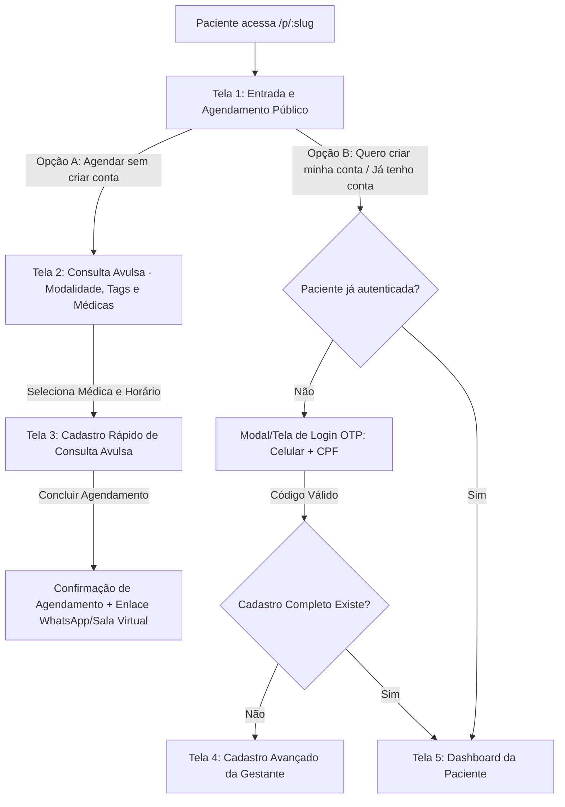
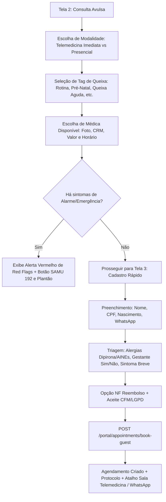
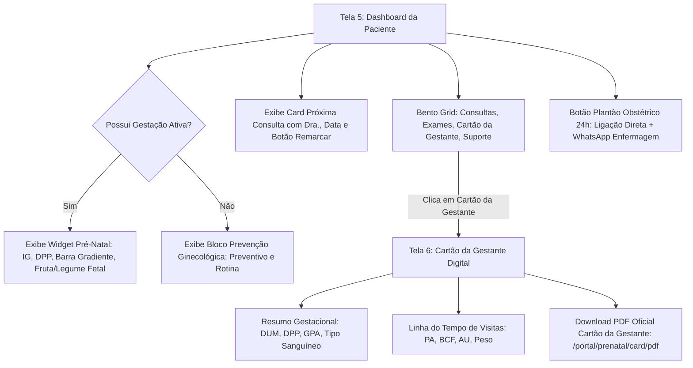

# SPEC-0036 — Substituição Integral da Área do Paciente: Cana Med Mulher Mobile & Web (Design System Serene Bloom)

| Campo | Valor |
| :--- | :--- |
| **ID** | SPEC-0036 |
| **Título** | Substituição Integral da Área do Paciente: Cana Med Mulher Mobile & Web (Design System Serene Bloom) |
| **Status** | Aprovada |
| **Versão** | 1.0.0 |
| **Data** | 2026-10-28 |
| **Autor** | Time Multidisciplinar Cana Med (Product Architect, Planejador e Arquiteto de Produto) |
| **Revisores** | Medical Systems Domain Expert, UI/UX Reviewer, Technical Architect |
| **Módulos afetados** | `frontend/src/features/patient/`, `frontend/src/app/PatientLayout.tsx`, `frontend/src/navigation/routes.ts`, `backend/src/Canamed.Api/Endpoints/PortalEndpoints.cs`, `backend/src/Canamed.Application/Portal/` |
| **ADRs relacionados** | ADR-0004, ADR-0006, ADR-0007, ADR-0008, ADR-0010, ADR-0011 |

---

## 1. Objetivo

Substituir integralmente a interface e a jornada atual da **Área do Paciente** no Cana Med Mulher pela especificação canônica inspirada no protótipo oficial do Stitch (*"Cana Med Mulher Mobile Login"*, Project ID: `projects/10903446353704381660`), adotando o tema e tokens visuais **Serene Bloom**.

A solução estabelece uma bimodalidade de autoatendimento sem fricção:
1. **Consulta Avulsa Sem Conta:** Agendamento expresso em menos de 1 minuto para telemedicina imediata ou presencial, solicitando apenas dados vitais para emissão de receita eletrônica CFM (Nome, CPF, Nascimento, WhatsApp) e triagem de segurança (alergias de risco e sintoma agudo);
2. **Conta Completa e Acompanhamento Pré-Natal:** Cadastro detalhado com perfil gineco-obstétrico (GPA, DUM, DPP, tipo sanguíneo), histórico vacinal/medicamentoso e acesso ao **Dashboard da Gestante** com contagem regressiva, comparativo fetal afetivo, linha do tempo pré-natal digital com aferições clínicas (PA, BCF, AU) e emissão do **Cartão da Gestante Oficial em PDF**.

Pergunta de controle do `GEMINI.md`: **isso reduz atrito na rotina da clínica?**
**Sim, dramaticamente.** Elimina o gargalo crônico da recepção ao permitir que pacientes agendem consultas avulsas em menos de 60 segundos pelo celular ou acessem seus exames, carteira de pré-natal e remarcações sem intervenção telefônica ou filas de WhatsApp da equipe administrativa. Ao mesmo tempo, fornece à médica obstetra dados clínicos prévios organizados e reduz o não comparecimento (*no-show*) com alertas automatizados e canais diretos de emergência.

---

## 2. Contexto

A versão anterior da Área do Paciente (especificada na [SPEC-0033](0033-spec-portal-do-paciente-cana-med-mulher.md) e estendida na [SPEC-0035](0035-spec-consolidacao-pep-ginecologico-e-agendamento-paciente.md)) validou a segregação por URLs dedicadas (`/p/:slug`, [ADR-0011](../adr/0011-roteamento-por-url-e-superficies-dedicadas.md)) e autenticação por OTP. No entanto, a experiência de navegação carecia da sensibilidade estética e funcional exigida pelo público do **Cana Med Mulher**, apresentando telas genéricas de agendamento em formulário cinzento e sem destaque para o ciclo gestacional.

O protótipo oficial do Stitch traz a identidade de marca **"Serene Bloom"**:
- **Cores primárias e de contraste:** Primary `#D8257C`, Primary Container `#B30063`, Secondary `#7C4C8A`, superfícies suaves `#FDF7FF`, `#F8F1FF`, `#FFFFFF`, contornos `#8C6F78` / `#E0BEC7` e tipografia de alto contraste `#1D1929`.
- **Tipografia:** `Plus Jakarta Sans`, moderna, humanizada e com excelente legibilidade móvel.
- **Iconografia:** `Material Symbols Outlined` com traço consistente de 2px.
- **Responsividade bimodal:** Layout mobile-first de 390px com barra de navegação inferior (*Bottom Navigation*) de 5 abas, e versão desktop responsiva (1280px+) com barra lateral fixa (*SideNavBar* de 72 / 288px) e barra de topo com breadcrumb e botão persistente de emergência.

A modernização unifica o agendamento de telemedicina de urgência ginecológica e o acompanhamento longitudinal da gestante em um único ecossistema integrado com o backend .NET do Cana Med.

---

## 3. Escopo

### 3.1 Dentro do escopo

1. **Substituição dos Componentes de Superfície do Paciente (`frontend/src/features/patient/`):**
   - **Tela 1 — Entrada e Agendamento Público:** Landing pública de acolhimento com escolha entre "Agendar sem criar conta" (Consulta Avulsa) e "Quero criar minha conta" (Acesso completo ao portal), além de botão flutuante de suporte via WhatsApp.
   - **Tela 2 — Consulta Avulsa:** Seleção de modalidade (Telemedicina imediata em até 30 min vs Presencial), filtros interativos por tags de queixa/motivo, listagem de profissionais médicas com foto, CRM, valor da consulta e próximo horário livre, campo opcional de queixa e alerta de emergência médica.
   - **Tela 3 — Cadastro de Consulta Avulsa (Rápido):** Formulário compacto contendo Nome completo, CPF, Data de Nascimento, Celular/WhatsApp, triagem de alergias (Dipirona, AINEs), status gestacional (Sim/Não), sintoma principal, opção de emissão de NF com mesmo CPF e consentimento CFM/LGPD.
   - **Tela 4 — Cadastro Avançado (Criação de Conta Completa):** Identificação, e-mail para laudos, contato de emergência com parentesco, perfil obstétrico preliminar (GPA: Gestações, Partos, Abortos), tipagem sanguínea em chips seletivos, alergias medicamentosas em tags, medicamentos em uso contínuo, dados de convênio para reembolso e termos LGPD.
   - **Tela 5 — Dashboard da Paciente:**
     - Saudação personalizada e afetuosa (*"Olá, [Nome] - Você e sua bebê estão em boas mãos"*);
     - Card em evidência de "Próxima Consulta" com identificação da médica, CRM, data/hora, sala/unidade, botão de reagendamento e ver detalhes;
     - Widget interativo de "Acompanhamento Pré-Natal" com cálculo de Idade Gestacional (semanas + dias), DPP estimada com contagem regressiva, barra de progresso gestacional com gradiente temático, comparativo afetivo de tamanho fetal (ex: berinjela 🍆) e atalho para o último ultrassom validado;
     - Bento Grid de Acesso Rápido com 4 módulos (*Minhas Consultas*, *Exames e Laudos*, *Cartão da Gestante*, *Falar com a Clínica*);
     - Dica de cuidado da semana personalizada para a idade gestacional;
     - Seção de Emergência e Plantão Obstétrico 24h com discagem telefônica direta e canal com enfermagem obstétrica.
   - **Tela 6 — Cartão da Gestante Digital:** Resumo gestacional (DUM, DPP, GPA, Tipagem Sanguínea), linha do tempo cronológica com consultas prévias e aferições clínicas (PA, BCF, AU, peso), status de exames com download de laudo PDF e selo de autenticidade médica Cana Med Mulher.
2. **Navegação Adaptativa:**
   - *Mobile (< 1024px):* Bottom Navigation com 5 ícones: Início, Agendar, Consultas, Pré-natal, Perfil.
   - *Desktop (≥ 1024px):* SideNavBar fixa de 288px com tokens Serene Bloom, TopNavBar com breadcrumb estruturado e botão Plantão de Emergência.
3. **Contrato de API do Portal do Paciente:** Consumo e extensão dos endpoints de `/portal/` e `/public/` para suportar o resumo gestacional e download do cartão da gestante com token de sessão seguro (`X-Patient-Token`).

### 3.2 Fora do escopo

1. Processamento de cartão de crédito e checkout de pagamento em tempo real (mantido no modelo de faturamento em balcão/reembolso no MVP).
2. Edição de prontuário médico pela paciente (a paciente possui apenas permissão de visualização e download de seus próprios laudos e do cartão de gestante).
3. Modificação das áreas internas administrativas (`/app/*`) ou médicas (`/medico/*`).

---

## 4. Atores e Permissões

| Ator | Permissão necessária | Observações |
| :--- | :--- | :--- |
| **Paciente Anônima** | Pública (`AllowAnonymous`) | Pode acessar a landing de entrada, consultar profissionais/horários livres e agendar consulta avulsa sem autenticação prévia. |
| **Paciente Autenticada** | Sessão de Portal (`X-Patient-Token`) | Acessa seu Dashboard, histórico de agendamentos, documentos emitidos, dados cadastrais e visualização/download do Cartão da Gestante. Não possui acesso a nenhuma rota `/app/*` ou `/medico/*`. |
| **Profissional de Saúde (Médica)** | `Permissions.RecordsRead`, `RecordsCreate` | Registra consultas de pré-natal e emite laudos no PEP que alimentam em tempo real o Cartão da Gestante. |
| **Recepção / Gestão** | `Permissions.AgendaWrite`, `PatientsRead` | Confere agendamentos avulsos, recebe a paciente na clínica e confirma encaixes. |

A autorização é verificada **no backend, por recurso** ([ADR-0008](../adr/0008-autenticacao-autorizacao-e-auditoria.md)). A paciente jamais pode invocar endpoints de outros pacientes.

---

## 5. Regras de Negócio

| ID | Regra | Justificativa / Origem |
| :--- | :--- | :--- |
| **RN-001** | **Segregação Estrita de Superfícies:** A área do paciente deve residir exclusivamente sob `/p/:slug` (com fallback `/p/cana-med`). O layout do paciente nunca carrega a barra de navegação corporativa nem controles de consultório médico. | Segurança, privacidade LGPD e [ADR-0011](../adr/0011-roteamento-por-url-e-superficies-dedicadas.md). |
| **RN-002** | **Bimodalidade de Entrada:** A landing de entrada pública deve oferecer duas opções explícitas: (1) "Agendar sem criar conta" (Consulta Avulsa em < 1 min); (2) "Quero criar minha conta" (Acesso completo e pré-natal). | Redução máxima de fricção no agendamento inicial sem alienar a paciente habitual. |
| **RN-003** | **Seleção de Modalidade na Consulta Avulsa:** A consulta avulsa permite alternar entre Telemedicina (com encaixe prioritário em até 30 minutos ou horário marcado) e Atendimento Presencial em unidade física da rede. | Conveniência assistencial e agilidade no atendimento de queixas pontuais. |
| **RN-004** | **Dados Mínimos para Consulta Avulsa:** O cadastro rápido de consulta avulsa exige obrigatoriamente apenas: Nome Completo, CPF válido, Data de Nascimento e WhatsApp com DDD (+55). O CPF é mandatório para permitir emissão de receita eletrônica válida conforme resoluções do CFM. | Conformidade CFM (Resolução CFM nº 2.299/2021) e emissão de atestados/prescrições eletrônicas. |
| **RN-005** | **Triagem de Segurança em Consulta Avulsa:** Durante o cadastro rápido, o sistema coleta alergias a medicamentos comuns (Dipirona, AINEs/Anti-inflamatórios), confirmação se está gestante (Sim/Não) e um campo sucinto de sintoma/queixa principal. Esses dados são repassados diretamente à fila de espera médica. | Segurança do paciente e prevenção de choques anafiláticos em prescrições telemédicas. |
| **RN-006** | **Alerta Clínico de Emergência e Interrupção Ativa de Red Flags:** Em todas as etapas de autoatendimento, se a usuária reportar sintomas de alto risco (sangramento na gestação, dor abdominal súbita aguda, febre alta persistente, perda de líquido amniótico, sinais premonitórios de pré-eclâmpsia como cefaleia intensa com escotomas/visão turva, ou redução abrupta/ausência de movimentos fetais no 3º trimestre), a tela interrompe o fluxo de agendamento eletivo e apresenta aviso visual em vermelho imperativo orientando ida imediata ao pronto-socorro obstétrico mais próximo, com botões de discagem rápida para SAMU 192 e Plantão da Clínica. | Protocolo de Suporte Vital Obstétrico, FEBRASGO e mitigação de risco médico-legal. |
| **RN-007** | **Cadastro Avançado da Gestante e Histórico GPA:** Pacientes que criam conta completa informam dados estendidos: Contato de Emergência (Nome + Telefone + Parentesco), Histórico Obstétrico GPA (Gestações, Partos vaginais/cesáreas, Abortos), Tipagem Sanguínea e Fator Rh em chips interativos (A+, A-, B+, B-, AB+, AB-, O+, O-), Alergias adicionais em tags, Medicamentos de uso contínuo e Dados de Reembolso/Convênio (Operadora e Carteirinha). | Continuidade do cuidado pré-natal e segurança transfusional/profilaxia anti-D. |
| **RN-008** | **Autenticação Segura Passwordless com OTP:** O acesso à conta completa e ao Dashboard da Paciente requer validação por código OTP de 6 dígitos enviado via WhatsApp/SMS associado ao CPF. O token de sessão gerado (`X-Patient-Token`) tem validade de 2 horas de inatividade. | Segurança contra vazamento de senhas e facilidade de acesso no smartphone ([SPEC-0015](0015-spec-agendamento-online-e-portal-do-paciente.md)). |
| **RN-009** | **Layout Adaptativo (Mobile BottomNav vs Desktop Web):** Em telas com largura inferior a 1024px, a navegação é controlada por barra inferior fixa com 5 destinos: *Início*, *Agendar*, *Consultas*, *Pré-natal*, *Perfil*. Em telas desktop (≥ 1024px), a navegação é controlada por SideNavBar lateral de 288px com identidade Serene Bloom, complementada por TopNavBar com breadcrumb e botão persistente "Plantão Obstétrico 24h". | Design System Serene Bloom e ergonomia de uso multiplataforma. |
| **RN-010** | **Card de Próxima Consulta Inteligente:** O card de destaque exibe o próximo agendamento futuro com status "Confirmada" ou "Pendente", profissional com foto/CRM, modalidade, data/hora e atalhos rápidos para "Remarcar" (permitido com antecedência mínima de 2 horas) e "Ver Detalhes/Instruções de Preparo". Caso não haja agendamento futuro, exibe estado vazio acolhedor com botão de ação rápida para agendar. | Redução de absenteísmo e orientação clara à paciente. |
| **RN-011** | **Cálculo da Idade Gestacional e DPP:** O widget de pré-natal calcula automaticamente a Idade Gestacional (IG em semanas e dias) a partir da DUM ou ecografia do 1º trimestre registrada no prontuário. Exibe a DPP (Data Provável do Parto pela Regra de Naegele) com contagem regressiva em dias, barra de progresso gestacional segmentada nos 3 trimestres e comparativo afetivo de tamanho fetal (ex: 26ª semana = berinjela 🍆). | Engajamento materno e acompanhamento fidedigno do desenvolvimento fetal. |
| **RN-012** | **Substituição Graciosa para Paciente Não Gestante:** Se a paciente cadastrada não possuir gestação em curso registrada, o widget de pré-natal é substituído no Dashboard pelo bloco "Prevenção & Saúde da Mulher", informando a data da última consulta ginecológica e lembrete preventivo anual (Papanicolau/Mamografia). | Personalização assistencial sem causar confusão para pacientes não obstétricas. |
| **RN-013** | **Bento Grid de Acesso Rápido:** O Dashboard disponibiliza 4 módulos rápidos em formato Bento Grid: (1) *Minhas Consultas*; (2) *Exames e Laudos Anexados*; (3) *Cartão da Gestante Digital*; (4) *Falar com a Clínica* via WhatsApp. | Otimização de tempo e acesso direto às funcionalidades mais demandadas. |
| **RN-014** | **Cartão da Gestante Digital Interativo:** A tela de Cartão da Gestante apresenta: (1) Resumo clínico de topo (DUM, DPP, Tipo Sanguíneo, Alergias, GPA); (2) Linha do tempo de consultas com aferições de cada visita (Data, IG, Pressão Arterial, Batimentos Cardiofetais em bpm, Altura Uterina em cm, Peso); (3) Lista de exames ultrassonográficos e laboratoriais validados; (4) Botão para download do "Cartão da Gestante Oficial em PDF" com selo de autenticidade da clínica. | Diretrizes de Atenção ao Pré-Natal do Ministério da Saúde e FEBRASGO. |
| **RN-015** | **Botão de Emergência e Plantão Obstétrico 24h:** O portal disponibiliza acesso contínuo e em destaque para suporte emergencial: (1) Discagem telefônica imediata para a linha de sobreaviso da clínica; (2) Início de conversa de WhatsApp com a Enfermagem Obstétrica contendo mensagem pré-formatada com o nome da paciente. | Segurança assistencial e resposta rápida em intercorrências obstétricas agudas. |
| **RN-016** | **Opção de Nota Fiscal para Reembolso:** No agendamento da consulta avulsa, deve haver um checkbox opcional: *"Emitir Nota Fiscal no mesmo CPF para reembolso no meu convênio"*, facilitando o ressarcimento junto à operadora de saúde. | Agilidade contábil e transparência financeira para consultas particulares. |
| **RN-017** | **Preservação de Links Tokenizados de Capabilidade:** A modernização da área do paciente não invalida os links de capabilidade emitidos pela recepção ([SPEC-0026](0026-spec-jornada-digital-do-paciente-e-portais-dedicados.md)) para confirmação de consulta, cancelamento, check-in e validação pública de atestados/receitas. | Compatibilidade retroativa com notificações de WhatsApp e SMS já operacionais. |
| **RN-018** | **Identificação de Fator Rh Negativo e Profilaxia:** Caso a tipagem sanguínea registrada indique fator Rh negativo (ex: A-, O-, B-, AB-), o Cartão da Gestante digital e o PDF oficial exibem badge destacado de atenção para acompanhamento de Coombs Indireto e profilaxia de aloimunização com imunoglobulina anti-D. | Boas práticas de obstetrícia e prevenção de eritroblastose fetal (FEBRASGO). |
| **RN-019** | **Visibilidade de Alergias e Gravidez na Recepção e PEP:** Alergias declaradas pela paciente no agendamento avulso (especialmente AINEs e Dipirona) e confirmação de gestação em curso são transmitidas e renderizadas como alertas prioritários no topo da ficha do paciente no consultório médico e na recepção. | Prevenção de prescrição inadvertida de AINEs no 3º trimestre e segurança do paciente. |
| **RN-020** | **Desempilhamento de Barras Inferiores no Mobile:** Nas Telas 3 e 4 (formulários transacionais de cadastro), a Bottom Navigation de 5 itens é ocultada no mobile para desobstruir a tela e prevenir conflito de sobreposição com o teclado virtual, mantendo apenas a barra de ação primária em `bottom-0` com padding para área segura. | Ergonomia mobile e prevenção de oclusão de campos (Laudo UI/UX [P0-2]). |

---

## 6. Fluxos

### 6.1 Fluxo F-001: Navegação Geral e Bimodalidade de Entrada



---

### 6.2 Fluxo F-002: Agendamento de Consulta Avulsa e Triagem Rápida



---

### 6.3 Fluxo F-003: Dashboard e Acompanhamento do Cartão da Gestante



---

## 7. Modelo de Dados

### 7.1 Estruturas de Dados do Paciente e Pré-Natal

A área do paciente consome os dados já estruturados no backend Cana Med e estendidos para a jornada:

| Entidade | Campo | Tipo | Obrigatório | Classificação LGPD | Regra / Descrição |
| :--- | :--- | :--- | :--- | :--- | :--- |
| `Patient` | `Id` | `Guid` | Sim | Comum | Identificador único da paciente. |
| `Patient` | `Name` | `string(150)` | Sim | Comum | Nome completo da paciente. |
| `Patient` | `Document` | `string(14)` | Sim | Sensível | CPF formatado e validado. |
| `Patient` | `Phone` | `string(20)` | Sim | Comum | Telefone celular / WhatsApp. |
| `Patient` | `BirthDate` | `DateOnly` | Sim | Comum | Data de nascimento. |
| `PatientProfile` | `LastMenstrualPeriod`| `DateOnly?` | Não | Sensível (Saúde) | Data da Última Menstruação (DUM) para cálculo da IG e DPP. |
| `PatientProfile` | `EstimatedDueDate` | `DateOnly?` | Não | Sensível (Saúde) | Data Provável do Parto (DPP) estimada por Naegele ou USG. |
| `PatientProfile` | `BloodType` | `string(5)` | Não | Sensível (Saúde) | Tipagem sanguínea com fator Rh (ex: "O+", "A-"). |
| `PatientProfile` | `ObstetricGpa` | `string(30)` | Não | Sensível (Saúde) | Histórico GPA (ex: "G2 P1 A0"). |
| `PatientProfile` | `KnownAllergies`| `string(500)`| Não | Sensível (Saúde) | Tags de alergias medicamentosas separadas por vírgula. |
| `PatientProfile` | `ContinuousMeds`| `string(500)`| Não | Sensível (Saúde) | Medicamentos de uso contínuo informados. |
| `PatientProfile` | `EmergencyContact`| `string(200)`| Não | Comum | Nome, parentesco e telefone para emergências. |
| `PatientProfile` | `InsuranceName` | `string(100)`| Não | Comum | Nome da operadora de saúde para fins de reembolso. |
| `PatientProfile` | `InsuranceCard` | `string(50)` | Não | Comum | Número da carteirinha do convênio. |
| `PrenatalVisitRecord` | `VisitDate` | `DateOnly` | Sim | Sensível (Saúde) | Data em que a consulta obstétrica foi realizada. |
| `PrenatalVisitRecord` | `GestationalWeeks`| `int` | Sim | Sensível (Saúde) | Idade gestacional em semanas (0 a 44). |
| `PrenatalVisitRecord` | `GestationalDays` | `int` | Sim | Sensível (Saúde) | Idade gestacional em dias adicionais (0 a 6). |
| `PrenatalVisitRecord` | `BloodPressure` | `string(10)` | Sim | Sensível (Saúde) | Pressão arterial aferida (ex: "110/70"). |
| `PrenatalVisitRecord` | `FetalHeartRateBpm`| `int?` | Não | Sensível (Saúde) | Batimentos cardiofetais (ex: 142 bpm). |
| `PrenatalVisitRecord` | `UterineHeightCm` | `double?` | Não | Sensível (Saúde) | Altura uterina aferida em cm. |
| `PrenatalVisitRecord` | `WeightKg` | `double` | Sim | Sensível (Saúde) | Peso da gestante em kg. |

### 7.2 Retenção, Anonimização e LGPD

- **Classificação:** Dados cadastrais são classificados como dados pessoais comuns; registros de alergias, histórico obstétrico, aferições de pré-natal e tipagem sanguínea são dados pessoais sensíveis de saúde.
- **Retenção:** Prontuários e dados clínicos são guardados pelo prazo mínimo legal de **20 anos**, conforme a Lei Federal nº 13.787/2018.
- **Exclusão:** A paciente pode solicitar a exclusão de sua conta de acesso e dados meramente cadastrais pelo canal de privacidade LGPD; contudo, dados integrantes do prontuário médico permanecem retidos pelo período prescricional exigido por lei.

---

## 8. Contrato de API

A área do paciente utiliza os seguintes endpoints existentes e suas extensões para o portal:

| Método | Rota | Autorização | Descrição |
| :--- | :--- | :--- | :--- |
| `GET` | `/portal/meta` | Pública | Retorna metadados da clínica, lista de especialidades ginecológicas, médicas ativas e tipos de consulta. |
| `GET` | `/portal/available-slots` | Pública | Consulta horários livres por clínica, especialidade, médica e data. Parâmetros: `clinicId`, `specialtyId`, `professionalId`, `date`. |
| `POST` | `/portal/appointments/book-guest` | Pública | Cria agendamento avulso rápido (sem conta prévia). Recebe: `clinicId`, `professionalId`, `startsAt`, `patientName`, `cpf`, `phone`, `birthDate`, `symptoms`, `allergies`, `isPregnant`, `wantsInvoice`. Retorna: `appointmentId`, `startsAt`, `doctorName`, `meetUrl` ou instruções presenciais. |
| `POST` | `/portal/auth/request-otp` | Pública | Dispara código de 6 dígitos via WhatsApp/SMS para o CPF + Celular fornecidos. |
| `POST` | `/portal/auth/verify-otp` | Pública | Valida código e devolve `sessionToken` (`X-Patient-Token`), `patientId` e `patientName`. |
| `GET` | `/portal/appointments/my` | `X-Patient-Token` | Retorna lista de consultas da paciente (futuras, passadas e canceladas). |
| `POST` | `/portal/appointments/{id}/cancel`| `X-Patient-Token` | Cancela consulta futura (respeitando regra de antecedência de 2h). |
| `POST` | `/portal/appointments/{id}/reschedule`| `X-Patient-Token`| Reagenda consulta para novo horário livre. |
| `GET` | `/portal/profile` | `X-Patient-Token` | Retorna perfil completo da paciente autenticada (dados cadastrais, GPA, tipagem, alergias, convênio). |
| `PUT` | `/portal/profile` | `X-Patient-Token` | Atualiza dados cadastrais, contato de emergência e preferências da paciente. |
| `GET` | `/portal/prenatal/summary` | `X-Patient-Token` | Retorna resumo gestacional: DUM, DPP estimada, IG calculada (semanas/dias), marco fetal da semana (legume/fruta), último exame validado. |
| `GET` | `/portal/prenatal/visits` | `X-Patient-Token` | Retorna lista ordenada de consultas pré-natais com dados aferidos (PA, BCF, AU, Peso, IG). |
| `GET` | `/portal/prenatal/card/pdf` | `X-Patient-Token` | Efetua o download do Cartão da Gestante Oficial em formato PDF (compatível com `DownloadPrenatalCardPdfAsync`). |
| `GET` | `/portal/documents/my` | `X-Patient-Token` | Retorna relação de atestados, receitas e laudos emitidos com link de download. |

---

## 9. Interface e Experiência (Design System Serene Bloom)

### 9.1 Tokens Visuais Oficiais

```css
:root {
  /* Serene Bloom Palette & WCAG AA Contrast Tokens */
  --color-primary-text: #B30063;        /* Texto e bordas ativas em superfícies lilás (Contraste 7.6:1 WCAG AA) */
  --color-primary: #D8257C;             /* Cor de marca vibrante (ações secundárias) */
  --color-primary-vibrant: #D8257C;     /* Fundo de botões primários e gradientes com texto #FFFFFF (Contraste 4.67:1) */
  --color-primary-hover: #B30063;
  --color-primary-container: #D8257C;
  --color-secondary: #7C4C8A;
  --color-secondary-container: #F1B8FF;
  --color-surface: #FDF7FF;
  --color-surface-container-low: #F8F1FF;
  --color-surface-container: #F3EAFF;
  --color-surface-container-lowest: #FFFFFF;
  --color-outline: #8C6F78;
  --color-outline-variant: #E0BEC7;
  --color-text-main: #1D1929;           /* On-surface text (Contraste 14.2:1) */
  --color-text-muted: #615869;          /* Tertiary text (Contraste 5.4:1) */
  --color-emergency: #DC2626;
  --color-emergency-bg: #FEF2F2;

  /* Typography */
  --font-family-base: 'Plus Jakarta Sans', system-ui, -apple-system, sans-serif;
  --font-headline-lg: 700 2rem/2.5rem var(--font-family-base);
  --font-headline-lg-mobile: 700 1.625rem/2.125rem var(--font-family-base);
  --font-headline-md: 700 1.5rem/2rem var(--font-family-base);
  --font-headline-sm: 600 1.25rem/1.75rem var(--font-family-base);
  --font-body-md: 400 1rem/1.5rem var(--font-family-base);
  --font-label-lg: 600 0.875rem/1.25rem var(--font-family-base);
  --font-label-md: 500 0.75rem/1rem var(--font-family-base);

  /* Border Radius & Shadows */
  --radius-sm: 8px;
  --radius-md: 12px;
  --radius-lg: 16px;
  --radius-full: 9999px;
  --shadow-card: 0 4px 20px -2px rgba(124, 76, 138, 0.08);
  --shadow-floating: 0 8px 30px rgba(216, 37, 124, 0.2);
  --custom-luminescence: 0 10px 30px -5px rgba(216, 37, 124, 0.18), 0 4px 12px -2px rgba(75, 30, 90, 0.08);
  --card-shadow-soft: 0 2px 10px -2px rgba(75, 30, 90, 0.05), 0 1px 3px 0 rgba(75, 30, 90, 0.03);
}
```

> [!NOTE]
> Conforme apontamento **[P0-3]** do Laudo de UI/UX, o arquivo `frontend/index.html` deve carregar a folha de estilos de `Material Symbols Outlined` junto a `Plus Jakarta Sans`:
> `<link rel="stylesheet" href="https://fonts.googleapis.com/css2?family=Material+Symbols+Outlined:opsz,wght,FILL,GRAD@20..48,100..700,0..1,-50..200" />`

### 9.2 Comportamento por Tela

| Tela | Estados | Elementos Principais |
| :--- | :--- | :--- |
| **Tela 1: Entrada Pública** | Inicial / Carregando clínica | Logo Cana Med Mulher, headline acolhedora, cartões de escolha bimodal com botões proeminentes (`#D8257C`), suporte via WhatsApp flutuante. |
| **Tela 2: Consulta Avulsa** | Seleção / Lista vazia / Alerta | Seletor de modalidade em abas (Telemedicina / Presencial), chips de tags para queixas, cards com fotos das médicas, CRM, valor e horário mais próximo, banner de alerta de urgência. |
| **Tela 3: Cadastro Rápido** | Digitação / Erro de validação / Enviando | Resumo da consulta no topo, inputs com máscaras automáticas (CPF, celular, data), botões de seleção de alergias (chips), checkbox de NF e CTA primário full-width. |
| **Tela 4: Cadastro Avançado** | Etapas / Validação de CPF / Sucesso | Dados cadastrais completos, seletor de tipagem sanguínea em chips compactos, inputs de contato de emergência e histórico ginecológico GPA. |
| **Tela 5: Dashboard da Paciente** | Carregando / Com agendamento / Sem agendamento | Saudação afetiva, card de próxima consulta com botão "Remarcar", widget de pré-natal com progresso gradiente e fruta fetal, Bento Grid 2x2 com ícones Material Symbols, botão persistente de Plantão 24h. |
| **Tela 6: Cartão da Gestante** | Carregando / Preenchido / Download PDF | Cabeçalho com dados vitais obstétricos, timeline cronológica com cards de visitas passadas (PA, BCF, AU), lista de ultrassons e botão de download do PDF oficial. |

### 9.3 Layout Adaptativo

- **Mobile Viewport (390px):**
  - O conteúdo ocupa largura máxima com padding lateral de 16px.
  - A barra de navegação inferior (*Bottom Navigation*) é fixa no rodapé, com altura de 64px, fundo `#FFFFFF`, borda superior `#E0BEC7`, target mínimo de toque de 48px por item e ícones alinhados com label textual (`Início`, `Agendar`, `Consultas`, `Pré-natal`, `Perfil`).
- **Desktop Viewport (1280px+):**
  - Barra lateral fixa (*SideNavBar*) com largura de 288px (`w-72`), exibindo logo Cana Med Mulher, dados da paciente logada e menu vertical hierárquico com estados `:hover` e ativo em destaque rosa `#D8257C`.
  - Área principal de conteúdo com TopNavBar superior exibindo breadcrumbs dinâmicos, alerta de emergência médica e botão em vermelho carmim: *"Plantão Obstétrico 24h"*.

---

## 10. Critérios de Aceitação

| ID | Critério |
| :--- | :--- |
| **CA-001** | **Dado** uma paciente que acessa `/p/cana-med`, **Quando** a tela de entrada carregar, **Então** o sistema apresenta claramente as opções "Agendar sem criar conta" e "Quero criar minha conta", além do botão de contato direto por WhatsApp. |
| **CA-002** | **Dado** a seleção de "Agendar sem criar conta", **Quando** a paciente visualizar a tela de consulta avulsa, **Então** ela pode alternar entre Telemedicina e Presencial, filtrar por motivo da consulta via tags e escolher a médica com horário disponível em tempo real. |
| **CA-003** | **Dado** a paciente na tela de consulta avulsa, **Quando** ela relatar sintomas de risco (sangramento agudo ou dor intensa), **Então** o sistema exibe alerta clínico chamativo orientando atendimento imediato em pronto-socorro e atalho para o Plantão Obstétrico da clínica. |
| **CA-004** | **Dado** que a paciente selecionou a médica e horário, **Quando** avançar para o cadastro rápido de consulta avulsa, **Então** o sistema solicita apenas Nome, CPF (com validação de dígito verificador), Data de Nascimento, Celular (+55 com DDD), triagem de alergias e sintoma principal. |
| **CA-005** | **Dado** o preenchimento correto do cadastro rápido de consulta avulsa, **Quando** a paciente clica em confirmar agendamento, **Então** a consulta é registrada no backend, um protocolo é emitido e um link para a sala de telemedicina ou orientações de chegada é exibido. |
| **CA-006** | **Dado** a escolha da opção "Quero criar minha conta", **Quando** a paciente fornecer CPF e Celular, **Então** o sistema envia código OTP seguro de 6 dígitos e realiza o login após a conferência do código. |
| **CA-007** | **Dado** uma paciente autenticada pela primeira vez, **Quando** acessar o cadastro avançado, **Então** ela pode registrar seus dados de contato de emergência, histórico obstétrico GPA, tipagem sanguínea em chips e alergias medicamentosas. |
| **CA-008** | **Dado** uma paciente com consulta futura agendada, **Quando** ela acessar o Dashboard da Paciente, **Então** o card "Próxima Consulta" exibe os dados da médica, CRM, data, horário, modalidade e botão para remarcar com no mínimo 2h de antecedência. |
| **CA-009** | **Dado** uma gestante autenticada com prontuário ativo, **Quando** carregar o Dashboard, **Então** o widget de pré-natal exibe a Idade Gestacional atual, dias restantes para a DPP, barra de progresso gestacional e imagem/ícone comparativo de tamanho fetal (ex: berinjela 🍆). |
| **CA-010** | **Dado** uma paciente sem gestação ativa registrada, **Quando** ela carregar o Dashboard, **Então** o widget de pré-natal é substituído pelo bloco de Prevenção & Saúde da Mulher, informando a data da última consulta ginecológica e preventivo. |
| **CA-011** | **Dado** a paciente navegando no Dashboard, **Quando** clicar no Bento Grid "Cartão da Gestante", **Então** ela é direcionada para a linha do tempo do pré-natal com as consultas passadas exibindo PA, BCF e Altura Uterina aferidos. |
| **CA-012** | **Dado** a tela do Cartão da Gestante Digital, **Quando** a paciente clicar no botão "Baixar Cartão da Gestante em PDF", **Então** o sistema baixa o arquivo PDF oficial com a assinatura e validação da clínica Cana Med Mulher. |
| **CA-013** | **Dado** uma paciente em situação de emergência, **Quando** ela clicar no botão de emergência "Plantão Obstétrico 24h", **Então** o sistema oferece discagem telefônica direta para o número de sobreaviso e conversa no WhatsApp da equipe de enfermagem obstétrica. |
| **CA-014** | **Dado** um dispositivo com tela de 390px de largura, **Quando** o portal for renderizado, **Então** a navegação é feita por Bottom Navigation fixa com 5 itens, sem quebras de layout ou sobreposição de botões. |
| **CA-015** | **Dado** um dispositivo desktop com largura de 1280px ou mais, **Quando** o portal for renderizado, **Então** o menu lateral fixo (SideNavBar) é apresentado à esquerda e a barra de topo (TopNavBar) exibe breadcrumbs e botão de emergência. |
| **CA-016** | **Dado** a paciente informando sintomas de emergência (sangramento, dor aguda súbita, perda de líquido, cefaleia refratária com escotomas ou ausência de movimentos fetais no 3º tri), **Quando** a triagem for processada, **Então** o sistema bloqueia o agendamento eletivo diferido e exibe modal vermelho de emergência médica com discagem direta para SAMU 192 e Plantão 24h da clínica. |
| **CA-017** | **Dado** uma paciente com tipo sanguíneo de fator Rh negativo (A-, O-, B-, AB-), **Quando** o Cartão da Gestante for visualizado ou baixado em PDF, **Então** o sistema exibe alerta clínico para acompanhamento de Coombs Indireto e profilaxia anti-D. |
| **CA-018** | **Dado** a paciente acessando as Telas 3 ou 4 de cadastro em dispositivo mobile, **Quando** o formulário estiver ativo, **Então** a Bottom Navigation de 5 itens é ocultada, deixando a barra de ação em `bottom-0` com safe area para evitar sobreposição com o teclado virtual. |
| **CA-019** | **Dado** a barra de progresso pré-natal no Dashboard, **Quando** inspecionada por leitor de tela, **Então** ela possui semântica ARIA completa (`role="progressbar"`, `aria-valuenow`, `aria-valuemin="1"`, `aria-valuemax="40"` e `aria-valuetext`). |
| **CA-020** | **Dado** que a paciente preencheu parcialmente os campos de cadastro, **Quando** tentar fechar ou navegar para fora sem salvar, **Então** o sistema emite diálogo de confirmação prevenindo a perda acidental dos dados clínicos. |

---

## 11. Casos de Erro

| ID | Gatilho | Comportamento esperado | Mensagem ao usuário | Registro |
| :--- | :--- | :--- | :--- | :--- |
| **ER-001** | CPF inválido digitado no cadastro rápido ou avançado. | O campo de CPF é demarcado em vermelho e o botão de prosseguir fica desabilitado. | "O CPF informado é inválido. Por favor, verifique os dígitos." | Log local de validação de interface. |
| **ER-002** | Telefone celular sem DDD ou com formato incorreto. | O sistema bloqueia o envio e solicita os 11 dígitos com DDD. | "Informe o telefone celular com DDD (ex: 11 98888-7777)." | Não registrado em servidor. |
| **ER-003** | Tentativa de agendamento em horário que acabou de ser ocupado. | O sistema recusa o agendamento no backend (HTTP 409) e recarrega os horários vagos. | "Este horário acabou de ser preenchido por outra paciente. Por favor, escolha outro horário." | Log de colisão de agendamento. |
| **ER-004** | Código OTP incorreto ou expirado digitado pela paciente. | O sistema informa o erro, incrementa o contador de tentativas e mantém o campo focado. | "Código incorreto ou expirado. Verifique a mensagem recebida e tente novamente." | Evento de auditoria de autenticação falha. |
| **ER-005** | Tentativa de cancelamento de consulta com menos de 2 horas de antecedência. | O sistema impede o cancelamento automático e disponibiliza o contato da recepção. | "Cancelamentos com menos de 2h de antecedência devem ser feitos diretamente com a recepção da clínica via WhatsApp." | Auditoria de política de cancelamento violada. |
| **ER-006** | Falha de conexão ou indisponibilidade da API de pré-natal. | Exibição de estado de erro elegante com botão de "Tentar Novamente", sem quebra da tela. | "Não foi possível carregar as informações do pré-natal no momento. Toque para tentar novamente." | Log de erro de integração frontend/backend. |
| **ER-007** | Paciente tenta acessar documentos ou dados de outro paciente via URL. | O backend rejeita a requisição com HTTP 403 Forbidden e invalida a sessão se houver adulteração. | "Acesso negado. Você não tem permissão para visualizar estas informações." | Evento de segurança de alta severidade na auditoria. |
| **ER-008** | Falha no download do PDF do Cartão da Gestante. | O sistema notifica a falha e orienta solicitar o arquivo à recepção via WhatsApp. | "Houve uma instabilidade na geração do documento. Nossa recepção pode enviar seu cartão via WhatsApp." | Log com ID da paciente e timestamp. |

---

## 12. Impacto em Outras Funcionalidades

| Funcionalidade / Módulo | Tipo de Impacto | Ação Necessária |
| :--- | :--- | :--- |
| **Portal do Paciente Atual (`frontend/src/features/patient/`)** | Direto (Substituição) | Descomissionar telas antigas em favor da nova implementação modular com tokens Serene Bloom. |
| **Rotas da Aplicação (`frontend/src/navigation/routes.ts`)** | Direto | Atualizar caminhos e subtelas de `/p/:slug` para contemplar a bimodalidade e a nova rota de Cartão da Gestante (`/p/:slug/cartao-gestante`). |
| **Agenda da Recepção (`/app/agenda`)** | Indireto | Agendamentos criados via Consulta Avulsa passam a figurar na agenda com a tag `[Avulso Online]`, alertando a recepcionista para conferência de CPF. |
| **PEP Gineco-Obstétrico (`/medico/prontuario`)** | Indireto | Aferições de pré-natal cadastradas pela médica (`PrenatalVisitRecord`) passam a ser imediatamente refletidas na visualização do Cartão da Gestante da paciente. |
| **Links de Capabilidade (`/public/capabilities/`)** | Compatibilidade | Mantidos integralmente para garantir que lembretes automáticos de SMS e WhatsApp continuem funcionando sem descontinuidade. |

---

## 13. Requisitos de Segurança

- [x] Autorização verificada no backend por recurso e por sessão do paciente (`X-Patient-Token`), impedindo acesso horizontal indevido ([ADR-0008](../adr/0008-autenticacao-autorizacao-e-auditoria.md)).
- [x] Validação rigorosa de todos os dados de entrada no backend (formato de CPF, telefone E.164, datas válidas e sanitização de texto).
- [x] Criptografia de dados sensíveis em trânsito (HTTPS / TLS 1.3 obrigatório) e em repouso no banco de dados PostgreSQL.
- [x] Rate limiting ativo nas rotas públicas de agendamento e solicitação de OTP para prevenir abusos e ataques de negação de serviço.
- [x] Nenhum segredo, chave de API ou dado real de paciente mantido em código-fonte, branches ou logs de aplicação ([ADR-0004](../adr/0004-gestao-de-segredos-e-configuracao.md)).
- [x] Trilha de auditoria append-only para todas as operações de autenticação, agendamento, cancelamento e visualização de documentos clínicos.

---

## 14. Requisitos Legais Aplicáveis

| Norma | Aplicável? | O que exige nesta funcionalidade |
| :--- | :--- | :--- |
| **LGPD (Lei nº 13.709/2018)** | Sim | Base legal de tutela da saúde (Art. 7º, VIII e Art. 11, II, "f") para o tratamento de dados de pré-natal; transparência e consentimento claro para envio de mensagens; direito de acesso aos dados pela paciente. |
| **Lei nº 13.787/2018 (Prontuário Eletrônico)** | Sim | Guarda do histórico de consultas e dados do pré-natal pelo prazo mínimo de 20 anos; garantia de integridade e confidencialidade. |
| **Resolução CFM nº 2.299/2021 (Telemedicina)** | Sim | Coleta obrigatória de CPF e identificação da paciente para validação de prescrições e atestados médicos emitidos em teleconsultas. |
| **Resolução CFM nº 1.958/2010 (Prazos de Retorno)** | Sim | Exibição de regras de retorno e remarcação com antecedência mínima estipulada de 2 horas. |
| **Diretrizes de Atenção ao Pré-Natal (MS / FEBRASGO)** | Sim | Registro e disponibilização de dados essenciais no Cartão da Gestante: Idade Gestacional, DUM, DPP, PA, BCF, Altura Uterina, Peso e histórico sorológico/vacinal. |

---

## 15. Requisitos Não Funcionais

| Categoria | Requisito |
| :--- | :--- |
| **Desempenho** | Tempo de carregamento inicial da landing e Dashboard inferior a 1,2 segundo em conexões móveis 4G; resposta de endpoints de consulta inferior a 300ms. |
| **Responsividade & Acessibilidade** | Conformidade com diretrizes WCAG 2.1 nível AA: contraste de cor mínimo de 4.5:1 para texto normal, alvos de toque com dimensão mínima de 48x48px no mobile e navegação total acessível via leitor de tela. |
| **Disponibilidade** | Disponibilidade da superfície do paciente de no mínimo 99,8%, com tolerância a falhas na emissão de PDF e fallback para canais diretos de WhatsApp. |
| **Escalabilidade** | Capacidade de absorver picos de tráfego de agendamento online simultâneos com rate limiting elástico por endereço IP. |

---

## 16. Testes Previstos

| Tipo | Cobertura Mínima | Cenários Chave |
| :--- | :--- | :--- |
| **Unitário (Frontend)** | 90% dos componentes novos e utilitários | Cálculo da idade gestacional e DPP por Naegele; máscaras de CPF e telefone; alternância de abas de modalidade; exibição do card de alerta de emergência. |
| **Unitário (Backend)** | 90% dos serviços de agendamento e pré-natal | Criação de agendamento sem conta; geração de OTP com limite de tentativas; cálculo de idade gestacional a partir da DUM; restrição de cancelamento com menos de 2h. |
| **Integração (API)** | Endpoints de `/portal/*` e `/public/*` | Fluxo completo de agendamento avulso; verificação de OTP e geração de sessão; acesso ao resumo gestacional garantindo segregação de tenant e paciente. |
| **Comportamento (E2E / Componente)** | Fluxos principais F-001 a F-003 | Simulação de agendamento expresso em smartphone (390px); navegação via BottomNav; clique em download do cartão de gestante; acionamento do botão de emergência. |
| **Regressão** | 100% da suíte existente | Garantir que os testes de agenda interna (`AgendaPage.test.tsx`), recepção e prontuário médico continuem 100% aprovados. |

---

## 17. Auditoria e Observabilidade

| Evento | Recurso Afetado | Dados Registrados | Nível de Log |
| :--- | :--- | :--- | :--- |
| `portal.otp.requested` | `Auth` | CPF (hash), Telefone (mascarado), IP de origem, Timestamp | `Information` |
| `portal.otp.verified` | `Auth` | PatientId, CPF (hash), Sucesso/Falha, User-Agent, Timestamp | `Information` / `Warning` |
| `portal.appointment.guest_booked` | `Appointment` | AppointmentId, ClinicId, ProfessionalId, StartsAt, PatientName, Timestamp | `Information` |
| `portal.appointment.cancelled` | `Appointment` | AppointmentId, PatientId, Reason, Timestamp | `Information` |
| `portal.appointment.rescheduled`| `Appointment` | AppointmentId, PatientId, PreviousStartsAt, NewStartsAt, Timestamp | `Information` |
| `portal.prenatal.card_downloaded`| `MedicalRecord`| PatientId, DoctorId, Timestamp | `Information` |
| `portal.security.forbidden_access`| `Security` | SessionToken (hash), AttemptedResourceId, IP, User-Agent, Timestamp | `Warning` |

A trilha de auditoria é armazenada de forma imutável e estruturada (*append-only*), permitindo rastreamento completo de acessos a prontuários e agendamentos.

---

## 18. Pendências e Questões Abertas

| ID | Questão | Responsável | Prazo | Resolução Proposta |
| :--- | :--- | :--- | :--- | :--- |
| **Q-001** | Integração direta com gateway de pagamento PIX para consulta avulsa telemedicina imediata. | Product Architect / Gestão Financeira | Backlog P2 | No MVP da substituição, as consultas avulsas confirmam o horário e a cobrança é formalizada via chave PIX da clínica enviada no WhatsApp ou balcão físico. |
| **Q-002** | Personalização dos legumes/frutas do comparativo fetal para semanas além da 40ª semana. | Medical Systems Domain Expert | Concluído | Tabela médica canônica adotada com limite em 42 semanas ("melancia"), sinalizando necessidade de avaliação médica presencial para indução de parto. |

---

## 19. Histórico de Revisões

| Versão | Data | Autor | Alteração |
| :--- | :--- | :--- | :--- |
| **1.0.0** | 2026-10-28 | Time Multidisciplinar Cana Med | Versão inicial da especificação de substituição integral da Área do Paciente inspirada no protótipo oficial do Stitch "Cana Med Mulher Mobile Login" (Design System Serene Bloom). |

---

## 20. Aprovação

| Papel | Nome | Data | Status |
| :--- | :--- | :--- | :--- |
| **Autor (Planejador e Arquiteto de Produto)** | Victor Gomes | 2026-10-28 | Aprovado |
| **Medical Systems Domain Expert** | Dra. Especialista de Domínio Clínico | 2026-10-28 | Aprovado |
| **UI/UX Reviewer** | Designer Chefe de Interfaces | 2026-10-28 | Aprovado |
| **Technical Architect** | Arquiteto de Software Cana Med | 2026-10-28 | Aprovado |
